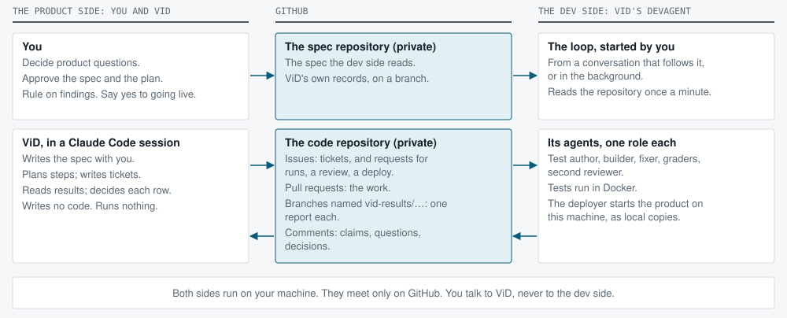
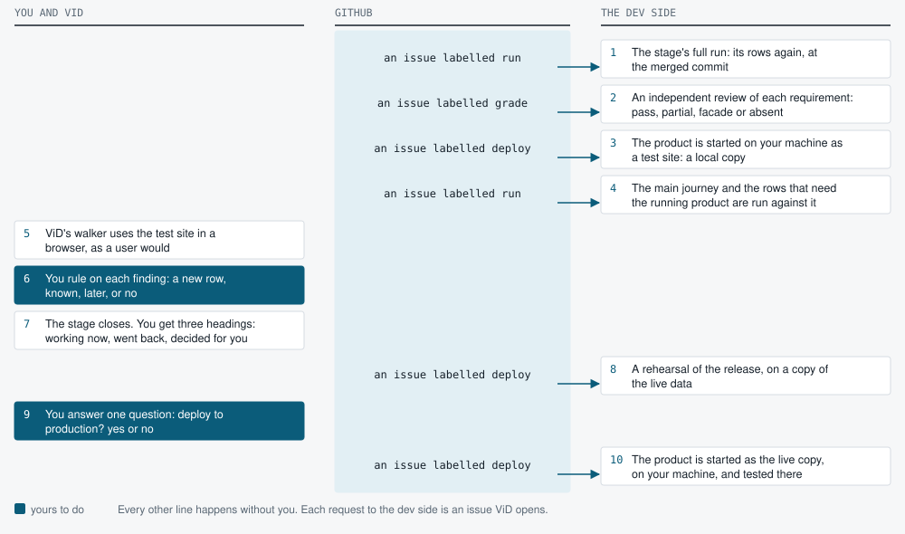

# ViD in GitHub auto mode: an overview

For a product manager, or an engineer with an interest in the product, who wants ViD to build a product through GitHub. You do not need to read code. This is the overview: read it once to see how the parts fit. A separate hands-on tutorial takes you through a small practice product step by step.

ViD works in three modes. In *local auto*, ViD's own agents build on your machine, with no GitHub. In *GitHub auto*, ViD builds your product through GitHub: every piece of work is a ticket and a pull request you can read, and ViD's own DevAgent does the building. In *GitHub manual*, ViD writes the same tickets and your own developers work them. **This document is about GitHub auto.**

**What you will know after reading this:**

1. What the mode is, and when to choose it over the other two.
2. What the two sides are, and what each does.
3. What you decide, and what you never see.
4. How a run goes, from an idea to a product you can open.
5. How to read a ticket, a decision and the status, at the level a product manager needs.
6. What the mode asks of your machine and of your time, and where it ends today.

**Where the examples come from.** No run of this mode has been made for this guide. What ViD prints is quoted from its own scripts and instructions. What a run looks like comes from three recorded runs, and each example says which:

- **The small recorded run:** a small practice product (a visitor saves a job search, confirms it by email, and gets a daily email) built by ViD's own dev side on real GitHub, through a first technical stage and one more stage, to a live copy on the same machine. A third stage was built and not closed.
- **The larger recorded run:** a larger product, whose first two steps were built and merged the same way.
- **The local auto run:** the tutorial's practice product, JobDigest search, taken from one paragraph to an approved spec. The spec is written the same way in every mode.

---

## 1. The idea in one page

In local auto, one Claude Code session does everything, and the record of the work stays in a folder on your machine. GitHub auto splits the same work into two sides that meet only on GitHub.



**The product side is you and ViD.** You sit with a Claude Code session. ViD writes the spec with you, plans the work, writes one ticket for each step, reads what comes back, and decides. On this side ViD writes no code, reads none, and runs nothing.

**The dev side is ViD's DevAgent.** It ships with ViD, in a folder named `devagent/`. You start it yourself, in a Claude Code conversation of its own where you can follow it, or in the background. ViD prints what to type. Once a minute it reads the code repository and starts a fresh agent for each piece of work it finds: one writes the tests, another builds, others review. In tickets and labels, *DevAgent* is the name for whoever works a ticket. Here that is ViD's own.

**GitHub is the record.** Tickets are issues. The work is a pull request. Test results are small branches. Questions and decisions are comments. Nothing passes between the two sides in any other way.

Three things follow, and they are the ones to remember.

- **You talk to one side only.** You answer and rule in ViD's session. The dev side takes no questions and no orders from you: you start it, you can follow what it does, and you can stop it.
- **Nothing merges without ViD's acceptance.** The dev side cannot report "done". For each test condition it must send runs: as a rule, a test that failed before the code existed and passes after it; where no such first run is possible, a deliberate break that the test is seen to catch. ViD decides from those runs, and only its acceptance lets a pull request merge.
- **Both sides run on your machine.** GitHub holds the record. The agents, the tests and the running product are on your machine, and it has to stay on.

---

## 2. When to choose it

| | Local auto | GitHub auto | GitHub manual |
|---|---|---|---|
| Who builds | ViD's own agents | ViD's own agents, as a separate dev side | Your own developers |
| Where the record is | A folder on your machine | Two GitHub repositories | Three GitHub repositories: yours, the spec, and ViD's own records |
| What you start | One session | One session, and ViD's DevAgent in a conversation of its own | Each of ViD's turns, by hand; your team does the rest |
| Where the product ends up | On your machine, and from there on a host you choose, through ViD's deploy command | As local copies on your machine: a test site, a rehearsal and a live copy. No real host today (section 8) | Where your team deploys it |

**Choose GitHub auto when** you want what local auto gives, a working product from an idea with no team, and one or more of these matter to you:

- **The work should be readable by others.** Every step is an issue and a pull request in a private repository. Anyone you give access to can read what was asked, what was sent back and what was decided.
- **You expect to hand the building to a team later.** The tickets are the ones a team would get. Moving to GitHub manual changes who works them, and that you start each of ViD's turns yourself.
- **You want to see the contract before you ask people to work to it.** Watching ViD's dev side work a ticket shows what a ticket asks and what an answer must hold.

**Choose local auto instead when** nobody else needs to follow the work and you want the shortest path: one session, no repositories, and a deploy command that takes the product to a real host.

**What GitHub auto costs over local auto:** two repositories; a second process to start and to keep alive until its time limit; findings from every ticket's review and every stage's review, each put to you as a line of its own to rule on; and a product that, at the end, runs on your machine and not yet on a host.

---

## 3. What you decide, and what you never see

### What is yours

Product questions are yours, always. The fixed points, in order:

| When | What you are shown | What you do |
|---|---|---|
| **The spec** | The interview, three approvals of the requirements, the technical hints, the test inventory, the stage cut. The same sittings as in local auto | Answer and approve. Keep it small |
| **The plan** | A few setup questions, then one page: the stages, the steps and their rows | Answer, ask for changes in words, approve |
| **During the run** | Numbered questions, `Q1`, `Q2`, …: a question the spec does not answer, a row that keeps failing, the findings of a review, a change to the spec | Answer each by its number |
| **At a stage's end** | The findings of the stage's review and of a walk through the running product | Rule on each: a new row, known, later, or no |
| **Before going live** | One question, with what the release changes | Your yes or your no. Only your yes starts it |

### What is not yours

- **Technical choices.** ViD makes them at the spec and writes each in `DECISIONS.md`. The dev side settles its own technical questions and writes them in its records.
- **The pull requests.** You do not review or approve them. The dev side merges a pull request when ViD's decision for that exact commit says `ticket: accepted`, and at no other time.
- **Starting test runs and deploys.** ViD asks for each on an issue. The dev side does it and reports.

### What you never see

- **The dev side's agents at work.** They are Claude Code sessions with no window. You see each pass as it ends, in the conversation that follows the dev side; what the agents put on GitHub; and a few plain files in the dev side's work folder. If its test setup has a question for whoever runs it, the question is in its report file there.
- **The code, unless you look.** It is in the code repository, and you may read it. ViD's product side never does: it decides from test results alone.
- **A percentage.** The status counts rows by state. It gives no score and, in this mode, no estimate of the time left.

---

## 4. How a run goes, from an idea to a product

**1. The spec.** In an empty folder you type `/vid:vid-init` and answer ViD's interview. This part is the same as in local auto, and the local auto overview's sections 2 and 3 describe every sitting. It ends with a spec and no product. In the local auto run, the practice product's spec took 59 minutes and came to 3 requirements and 59 test conditions (*rows*).

**2. Two repositories, made by ViD.** You create nothing on GitHub. You name a code repository and a spec repository at the plan's setup, and ViD makes both, private and empty, when the run starts.

**3. The plan.** You type `/vid:vid-run`. No plan is approved yet, so the run plans first. ViD asks where the code lives, whether ViD's own DevAgent or an outside team works the tickets (here: ViD's own), who is on the team (here: the default, one team named `devagent`), and how fine the steps should be. It writes the plan as *steps*, each a handful of rows that belong together, and shows you one page. The first step is always the *skeleton*: the thinnest working product, with its test setup. Your yes approves the plan and allows ViD to publish from it.

**4. The run.** On your yes the same session goes on into the run. It stays open until the end. It makes the two private repositories, publishes the spec in the spec repository, and publishes the first ticket on the code repository. In both recorded runs the first ticket was on GitHub three minutes after the run started. While nothing is new, the session waits inside a quiet command and uses no model.

**5. The dev side.** When the run starts, ViD prints what you need to start ViD's DevAgent: a short *job note* (which repository, which work folder, three limits, the model), filled in; where to save it; and the start, in two ways. ViD writes and starts nothing itself.

**The first way, which you can follow.** You make the work folder, save the note, open a new Claude Code conversation in the work folder, and type:

```
/vid:vid-devagent <job note>
```

It checks what the dev side needs, starts its loop, and then shows each pass as it ends: which ticket, what was done, which report was pushed. The loop itself runs apart from the conversation. Closing the conversation ends only your view; typing `stop` there stops the dev side.

**The second way, for a run you leave alone.** One line in a terminal starts the same loop in the background and returns at once:

```
sh <plugin>/devagent/dev-manager/dm.sh up <job note>
```

**6. Ticket by ticket.** For each ticket the dev side claims it, writes the tests first, shows that they fail, builds, runs every row, has two fresh readers review the work, and asks ViD for its decision. The first ticket, the skeleton, has no failing run: there is no product yet for a test to fail against in a useful way, so a deliberate break stands in for it. ViD answers on the pull request. On `ticket: accepted` the dev side merges, and ViD publishes the next ticket the plan allows. In the small recorded run the skeleton ticket went from published to merged in 41 minutes. In the larger recorded run the first two steps took 2 hours 10 minutes and 3 hours 50 minutes.

**7. A step closes.** When a step's tickets have merged, ViD asks for the step's rows and the earlier rows once more, at the merged commit. Green in every part closes the step. A red row gets one fix ticket. In the larger recorded run the two closes took 4 and 6 minutes.

**8. A stage ends.** When every step of a stage has merged, ten things happen, in this order. Two are yours.



A technical first stage, stage 0, has no review of its own and stops after line 7: it is never released. In the small recorded run the stage's full run took 4 minutes, the test site and the run against it about 20 minutes, and a walk between 4 and 9 minutes.

**9. The end.** When the last stage is closed and nothing is left, ViD computes whether the run is complete, from its records, and writes a completion report. It says *complete*, or lists what is unmet. No recorded run on real GitHub has reached this point; the small recorded run ended with its second stage live and its third stage built and not closed.

---

## 5. Reading a ticket and a decision

You do not have to read tickets. They are written for whoever builds. But they are on GitHub, in plain words, and two things in them are worth knowing.

**A ticket is a step's rows.** Each row is one promise with its *fail-if*, the sentence that says what would break it. Around the rows the ticket quotes the parts of your spec they rest on, lists earlier rows that must still pass, and ends with what to send back. For an ordinary ticket that is five things: the tests, a run that shows them failing, a run that shows them passing, deliberate breaks that prove a test can fail, and an independent review. The skeleton ticket asks four: it has no failing run. A ticket never says how to build: it names no file of the code and no command.

**A decision is one comment.** Its second line is the ticket's state, and then there is one line for each row:

```
vid: decision <the commit it is about>
ticket: not yet
ROW-019 accepted
ROW-003 failing, a weak test — …
ROW-004 passing
```

| Words | Meaning |
|---|---|
| `ticket: accepted` | Every row has what it needs at this commit. The dev side merges |
| `ticket: not yet` | Something is missing or failing. The dev side fixes what is named and asks again at a new commit |
| `accepted`, `passing` | The row is done; an earlier row still passes |
| `failing, a product failure` | A test failed. A fixer agent changes the product |
| `failing, a weak test` | The product was broken on purpose and the test did not notice. The test is made stronger |
| `held` | The row has failed more than once. It waits for you (section 6) |
| `owed` | It can only be proved on the running product, later |

**A reader's doubt never fails a row by itself.** A row fails only on a run: a test that fails, or a deliberate break that the tests miss. That keeps a ticket from going round on opinions.

**Who wrote a comment.** Both sides post from your own GitHub account, so every comment carries your name. Read the first lines instead: `by: DM`, `by: TM` or another two-letter role is the dev side; `vid: decision` and comments that begin `RM:` are ViD.

The GitHub manual overview, section 4, reads a real ticket line by line: every section, every report, every word a decision can say. Read it when you want that depth, or before you hand the tickets to a team.

---

## 6. What reaches you, and how you answer

Everything that waits on you is one numbered line, `Q1`, `Q2`, …, in ViD's session. It stays until you answer. You answer in your own message, by its number.

| What comes | What it is | Your answers |
|---|---|---|
| **A question** | Something the dev side asked that the spec does not answer. When the spec does answer, ViD answers itself, and you are not asked | Your words. ViD posts them on the ticket |
| **A held row** | A row that failed more than once, with what it promises, what it still needs, and ViD's recommendation | Accept it; allow more rounds; rule it a known limit; or change the requirement |
| **A ticket's findings** | What the reviewers saw outside the rows | For each: fix, make it a row, known, or no |
| **A close that could not finish** | A step's closing run went missing twice, or a row was red again after its fix | Again, or rule a limit |
| **A drafted change to the spec** | Your own correction or feature, or a change one of your answers needs, counted before anything is written | Your yes or your no |
| **A stage's findings** | From the stage's review and the walk | For each: a new row, known, later (with the stage), or no |
| **The production question** | What the release changes, and "Deploy to production? yes or no" | Your yes, your no, or first a review of the whole product |
| **One housekeeping question** | Whether ViD may set the point at which its own long session is compacted | Either answer is fine |

A question never stops another ticket. It stops its own ticket only when the work cannot go on without the answer; otherwise the dev side names the value it goes on with, and goes on.

**Three things you can say at any time:**

| You say | What happens |
|---|---|
| "Where do things stand?" | ViD prints one fixed block of counts: tickets open and merged, rows by state, steps closed, what is left, what waits on you |
| "pause" | Nothing new is published or asked. Decisions and merges go on |
| "continue" | A pause ends |

**Changing the product during a run** is drafted as in GitHub manual mode: you say the correction with `/vid:vid-fix`, or the feature with `/vid:vid-add`, in the run's session. ViD drafts the change, counts the rows it touches, and asks you once. Nothing is written before your yes.

**Nothing pops up.** A waiting question is written in the session and in ViD's records. Nothing is sent to you. You have to look.

---

## 7. How you know it is right

You have five ways, from the quickest to the most thorough.

**1. The status.** Ask where things stand. ViD prints one block under the heading `== where things stand`. Four of its lines, from a recorded run with a team of people on the dev side, where the same block is printed:

```
rows: passing 3 · accepted 4
steps closed: S1 S5 S6 · closes out: stage-0
now: #13 S2 …: 0 of 6 rows accepted
test state: of 35 rows · red seen at T2 2 · T3 passed 4 · fault proven 2
```

Read them as: the rows counted by state; three steps closed and one closing run still out; ticket 13 open with none of its six rows accepted yet; and, of the spec's 35 rows, how many have each kind of evidence. Each number is a count of evidence the dev side sent and ViD read.

**2. GitHub.** Open the code repository. A closed ticket is a finished one, or one that ViD withdrew and planned again, and a withdrawn one says so. Each merged pull request holds ViD's decision, row by row.

**3. The stage's review.** At the end of each stage after stage 0, a fresh reader on the dev side reads the product against every requirement of the stage and gives each one word: *pass*, *partial*, *facade* (it looks implemented and fails in practice) or *absent*. What it finds comes to you as findings.

**4. The walk.** ViD's own walker, a session that knows nothing of the code or the tests, uses the test site in a browser as a user would: the main journey, each screen against its design, and unscripted use. What it sees comes to you as findings. In the small recorded run the walks of the first stage brought five findings, among them that reloading the page shown after a save saved the search again.

**5. Use it yourself.** While a stage's test site is up, and after your production yes, the product answers at an address on your own machine. ViD tells you the address. Open it in your browser.

**Expect findings, and expect to rule on many.** In the small recorded run the first ticket alone brought 25 findings, none high. The second stage could not close until 155 findings were ruled, which had gathered unruled on seven tickets over several test runs on the same repositories: 136 known, 19 no. Each reviewer's findings reach you as they were written, and two reviewers often see the same thing. Ruling is fast, but it is yours, and a stage does not close while one finding is unruled.

---

## 8. Where the mode ends today

**The product runs on your machine, and nowhere else.** ViD's DevAgent deploys the test site, the rehearsal and production only as local copies on its own machine, which is yours. Each is a separate instance with its own address on your machine and, where the product keeps data, its own store. None is on a host, and nobody but you can reach them. ViD tells you each address in plain words when it is up.

So "in production" in this mode means: the release passed every gate, and the version you approved is running as the live copy on your machine. It does not mean that users can reach it.

**A deploy to a real host is not part of this mode today.** ViD's README says where it is: with your own developers' side, in GitHub manual mode, or in a later release. ViD's own deploy command, which the local auto overview describes in its section 7, belongs to local auto: in a GitHub project it refuses, and tells you that deploys go through the run. So if you need the product in front of users now, the finished code is on the `main` branch of your code repository, with its tests, and putting it on a host is an ordinary deployment of that repository, by you or by whoever runs your hosting.

**Rows that only a real host can prove** are run against the local copies. Where a local copy cannot give what a row needs, the row comes to you as a question. In the small recorded run one row needed the host's own backups, and it was ruled a known limit.

---

## 9. What it asks of your machine, and of your time

**Installed, before you start:**

- **Claude Code,** signed in, with ViD installed. The dev side's agents run with no window, so the `claude` command itself must be on your path and signed in.
- **git,** and the **GitHub command line,** `gh`, signed in to an account that may create private repositories.
- **Docker,** running. The dev side will not start without it, and normally runs the tests in it.
- **On a PC:** the Linux layer for Windows, WSL2, with Docker Desktop's WSL2 integration switched on. Everything is done inside it. Native Windows is not supported.
- **A browser on the machine,** for the walk. The walker installs nothing. With no browser it reports that it could not walk, and you choose: walk again once a browser is there, or close the stage without the walk, which is then recorded as a known limit.

**A machine that stays on.** Two things must be alive for work to go on: ViD's session, and the dev side's loop. Neither restarts by itself. The loop ends at the time limit in its job note. It does not end when you close the conversation that follows it.

**Your time.** The spec is yours for about an hour on a product this small. After that you answer questions as they come and rule on findings at each stage's end. No run of the practice product in this mode has been timed, so this guide gives no total. The recorded times above are for other products.

---

## 10. What to expect, honestly

- **The dev side stops at its time limit.** The job note gives the loop a limit in seconds. At the limit it stops its agents and itself. It says so in the conversation that follows it, in a comment `vid: stopped` on each issue it was working, and in a report that ViD reads. ViD then tells you in one line that the dev side stopped, why, and how to start it again. Starting it again picks up from its records. In the small recorded run a loop with a four-hour limit stopped with work still to do, and a test run that ViD had asked for was not made until the loop was started again.
- **A dev side that was never started** leaves the tickets unclaimed. After two hours with tickets open and none claimed, ViD tells you that no dev side has answered.
- **A session that dies stays dead.** If ViD's session ends, nothing is read or decided until you type `/vid:vid-run` again. It picks up from its records, which are saved on a branch of the spec repository.
- **The start has been proved in ViD's own test cases only.** In the recorded runs the dev side ran as the same loop, started by hand in another way, or as one long session. No recorded run shows the conversation that follows the dev side, or the background command, with real tools.
- **The browsers.** Nothing checks the browsers the dev side tests in against the ones your spec names. In the larger recorded run the dev side left one out.
- **A walk that cannot finish.** A walker has a browser and nothing else. A journey that goes through an email, or waits for the next day, needs help that the test site has to give. In the small recorded run the first two walks came back "not done" for that reason, and the third finished only after the test site had been given an inbox and a clock by hand.
- **Expect "not yet".** A first decision does not always accept everything, and that is the method working. In the larger recorded run, 11 defects were stopped before a merge in the first two steps: 4 failing rows and 7 weak tests.

**What this overview did not cover:** the spec's files and sittings, which the local auto overview covers; the full form of tickets and reports, which the GitHub manual overview covers; and hosting.

---

## 11. Words used here

| ViD's word | The standard word | What it means |
|---|---|---|
| Fail-if | Acceptance criterion | The sentence that says what would prove a requirement broken |
| Row | Test condition | One thing that will be tested |
| Step | User story, backlog item | A few rows that belong together; one ticket |
| Skeleton | Walking skeleton | The first step: the thinnest working product, with its test setup |
| Stage | Release, increment | A part of the product that is usable and whole |
| Ticket | Issue | An issue ViD opens, asking for a step's rows |
| DevAgent | The development team | In tickets and labels: whoever works a ticket. ViD's DevAgent is the dev side that ships with ViD, in the folder `devagent/` |
| The dev side | | Here: ViD's DevAgent. Started by you, apart from ViD's session |
| Job note | Configuration file | A few lines that tell the dev side its repository, its work folder, its limits and its model. ViD prints it, filled in; an example ships as `devagent/job-note.example` |
| Decision | | ViD's comment on a pull request: the ticket's state and each row's |
| Held | Escalated | A row that failed more than once and waits for you |
| Step close | Regression run | A step's rows run again at the merged commit |
| Candidate | Release candidate | The merged commit a stage's end is checked at |
| Stage review | Independent review | A fresh reader's word on each requirement: pass, partial, facade or absent |
| Test site | Staging environment | The product started for trying; in this mode, today, a local copy on your machine |
| Walk | Exploratory test | ViD's walker using the test site in a browser, as a user would |
| Finding | Defect, issue | Something a reviewer or the walker saw that is wrong |
| Known | Accepted risk | A finding you have seen and chosen not to act on now |
| Live copy | Production | In this mode, today: the approved version, running as a local copy on your machine |
