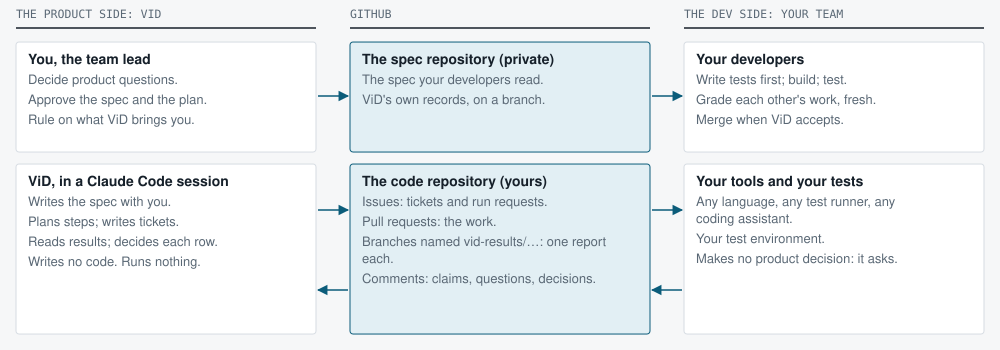
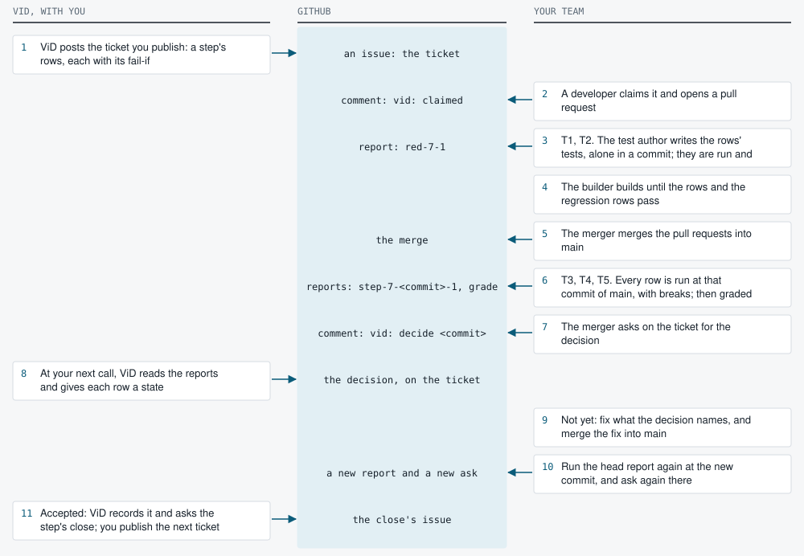

# ViD in GitHub manual mode: an overview

For a team lead or a developer whose team will build a product from ViD's tickets, or a product manager with a stronger technical interest. This is the overview: read it once to see how the parts fit. A separate hands-on tutorial takes you through the same practice product step by step.

ViD works in three modes. In *local auto*, ViD's own agents build on your machine, with no GitHub. In *GitHub auto*, ViD's own agents build through GitHub tickets. In *GitHub manual*, your own developers build through GitHub tickets, ViD keeps to the product side, and you, the lead, start each of ViD's turns by hand. **This document is about GitHub manual.**

**What you will know after reading this:**

1. How the two sides work together, with GitHub between them.
2. What every file on ViD's side is, and which ones your developers see.
3. How a first spec is written with ViD, and how it is changed later.
4. What a ticket asks, and what ViD needs back to accept it.

Every example here is about a small practice product, **JobDigest**: two job feeds merged into one list, and a daily email of new matches for each saved search. The excerpts come from a real run of it, but for those marked *illustrative*, whose commit ids, names and counts are made up. Where one is shortened, `…` marks the cut. Repository names are changed. That run was made in this mode's older form, where one long session decided each pull request and the dev side sent more evidence. GitHub manual keeps its product, its rows and its tests; where it shows something else, the text says so.

---

## 1. The idea in one page

ViD splits building a product into two sides that meet only on GitHub.



**The product side is ViD.** You, the team lead, sit in its seat with a Claude Code session beside you. ViD writes the spec with you, plans the work, writes each ticket you choose to send, reads what comes back, and decides. ViD writes no code, keeps no copy of yours and runs none of it. Its one review of a ticket reads what the ticket's pull requests changed, as GitHub shows it.

**The dev side is your team.** Your developers pick up a ticket, build what it asks, test it, and send the test results back. How you build, with which tools, in which test environment, is yours.

**GitHub is the record.** Tickets are issues. The work is your team's pull requests, merged into `main`. Results are small branches. Claims, questions and decisions are comments; ViD's decisions go on the ticket.

**You start every one of ViD's turns.** Nothing runs on its own. Each time you type `/vid:vid-next`, ViD reads GitHub, does its own work if you have switched it on, and shows you what is new and what you may do next: its *moves*. Nothing reaches your developers but what a move you name, in your own words, sends.

Three rules make the split work:

1. **Every requirement that asks the product to do something says how it could fail.** That sentence is its *fail-if*. It is the requirement's acceptance criterion (requirements engineers say *fit criterion*), written as what would break it.
2. **Every fail-if becomes one or more rows.** A *row* is one checkable promise with an id, such as `ROW-019`. A tester would call it a *test condition*. A ticket is a handful of rows.
3. **ViD accepts a row on evidence, not on a report that says "done".** The evidence is the row's test passing in your team's own results, at a commit of `main`, with ViD's own review of the ticket, made once.

The rest of this overview is those three rules in detail.

---

## 2. What is on the product side

ViD keeps its work in a folder of plain text files, under git, on your machine. Part of it is published for your developers.

| File | What it holds | Who writes it | Do your developers see it? |
|---|---|---|---|
| `PRD.md` | The product spec: what the product is for, its users, and its requirements | ViD with you, in an interview | Yes |
| `INVENTORY.md` | The test inventory, in effect a requirements traceability matrix: every row (test condition) the product will ever be checked against | ViD, from the PRD; you approve it | Only a ticket's own rows, inside that ticket |
| `STAGES.md` | The cut of the product into stages (releases), each one usable on its own | ViD proposes; you choose | Its stage names, in tickets |
| `DECISIONS.md` | Technical decisions ViD made and logged, with reasons | ViD | Yes |
| `BASELINE.md` | The stack and the fixed constraints | ViD with you | Yes |
| `ARCHITECTURE.md` | The modules, what each owns, and where the product runs | ViD with you | Yes |
| `GRADING-CHECKLIST.md` | A short list of things a reviewer must look for in this product | ViD; you approve it | Yes |
| `CLAUDE.md` | The project's standing rules, when it has any | ViD with you | The rules that bind the product, quoted in each ticket under "Laws" |
| `design/` | The screens, when the product has a face | You, from a brief ViD writes | Yes |
| The plan | The steps, their order and their rows | ViD; you approve it | Each ticket shows its own step |

**Two repositories on GitHub.**

- **The spec repository** is private and is ViD's. Its main branch holds the files marked "Yes" above, and `TEST-DIFFERENCES.md`, the list of known differences between tests and production. Your developers read it and never write to it. With one repository (`layout: one`) there is none: the spec goes into a folder of the code repository, published by ViD's pull request or by your own process, and ViD keeps its own line of exports in the project, saved with its records.
- **The code repository** is your team's. ViD opens issues and writes comments there, and never pushes code to it.
- **ViD's own state repository,** a third one, private too, holds ViD's lock and its saved records. It is neither of the other two, and your developers never need it.

### 2.1 A requirement, read closely

This is one requirement of JobDigest, exactly as it stands in `PRD.md`:

```
REQ-012 | functional | T2 | Every digest footer carries a support contact address that reaches a person. | fail-if: the footer lacks a support address, or mail to it bounces | serves: a stuck subscriber has a path that is not silent churn | authority: authoritative | source: thesis | covers: DIM-nfr-operability/support | phase: pilot | feature: FEAT-03
```

Read it field by field. The first four fields have fixed places; the rest are labelled and may come in any order.

| Field | Here | What it means |
|---|---|---|
| Id | `REQ-012` | Never reused, never renumbered |
| Type | `functional` | What kind of item it is (table below) |
| Tier | `T2` | How bad a failure is. `T0`: must never break or leak. `T1`: core; wrong is a defect. `T2`: desirable; wrong is a fix-round item |
| Statement | "Every digest footer carries…" | The promise, in product words |
| `fail-if:` | "the footer lacks a support address, or mail to it bounces" | The acceptance criterion, turned round: how a wrong build would break the promise. Each "or" is a separate way to fail |
| `serves:` | "a stuck subscriber has a path…" | Why it matters. This is what you weigh when someone asks to drop it |
| `authority:` | `authoritative` | Whose word it rests on. `authoritative`: yours. `provisional`: ViD proposed it and you have yet to confirm. `pending`: an open question holds it |
| `confirms_via:` | (absent here) | On an item that is not yet authoritative: what will settle it, such as a decision of yours or a measurement |
| `source:` | `thesis` | Where it came from: your first description (the seed), an answer of yours (`A-006`), or the agreed summary of the product (the thesis) |
| `covers:` | `DIM-nfr-operability/support` | Which line of the content contract (below) this item satisfies |
| `phase:` | `pilot` | When it is due |
| `feature:` | `FEAT-03` | Which named part of the product it belongs to. A feature is what agile teams call an epic |
| `plain:` | (not in this example) | The rule in one plain sentence, at most 30 words, for you to read and approve beside the rule itself. A spec written today carries it on every requirement; JobDigest's spec was written before this field existed |

**Not every item has a fail-if.** Items come in two families:

| Family | Types | Fail-if? |
|---|---|---|
| Things the product must do or be | `functional`, `nfr` (a quality, such as backup), `ux_flow`, `data_entity` | Always |
| The frame around them | `invariant` (must always hold), `non_goal`, `risk`, `hypothesis`, `outcome`, `metric`, `constraint` | Never. An invariant is checked by trying to break it (the *hostility* rows of 2.2) |

The parts of `PRD.md`, in order:

| Part | What it is |
|---|---|
| Seed | Your own first words about the product, kept unchanged |
| Thesis | The product in a page: summary, users, what the first version must do, what it must not |
| Actors and journeys | Who uses it, step by step |
| Mechanisms | How each goal is meant to be met, each tied to your own words or to an answer of yours |
| Content contract | A checklist of subjects this product's requirements must cover (notifications, consent, backup and so on), each marked covered or, with your word, not applicable. It is how ViD shows you that nothing obvious was forgotten |
| Criticality tiers | What `T0`, `T1` and `T2` mean |
| Items | The named features, then the requirements, as above |
| Answer ledger | Every question asked and every answer, dated, marked `human` (you) or `model_proposed` (ViD suggested it; you were shown it) |
| Open decisions | Questions still waiting for you |
| Findings | What ViD's own reviews of the spec found, and what was done about each |
| Ratifications | The dates of your three approvals |
| Appends | Every change made after approval. Section 5 is about this part |

### 2.2 From a requirement to rows (test conditions)

A requirement is a promise. A row is one way to check it: a test condition. The tests your team later writes for a row are its test cases, and the inventory as a whole is a requirements traceability matrix, every requirement set against what checks it. ViD derives the rows from the PRD, the design and the product's pages, and you approve the whole list once, before any code. This is `REQ-012`'s main row in `INVENTORY.md`:

```
ROW-019 | behavior | REQ-012 | anonymous | n/a | Every digest's footer gives a support address that reaches a person. Fails if a digest's footer has no support address. | REQ-012 | owed: spec-only — first stage | origin: REQ-012 | …
```

It says: this is a *behavior* row, it checks `REQ-012`, as an *anonymous* visitor, and it is *owed*: nothing checks it yet. A row stops being owed when a ticket builds it and ViD accepts it.

Not every promise can be checked by one test. So the inventory holds several kinds of line:

| Kind | What it checks or records | An example from JobDigest |
|---|---|---|
| Behavior | One thing the product does | `ROW-019`, above |
| Surface | One screen in one state, as the design draws it | `ROW-003`: the "saved" state shows the saved search, its address and the line "Check your inbox to confirm" |
| Shell | Something every page carries | `ROW-006`: every page shows the header with the product's name, and the footer with the support address |
| Reachability | That a page or action can really be reached from where a user starts | `ROW-007`: a digest's unsubscribe link opens the unsubscribe page with no sign-in |
| Journey | A path through several screens, one *transition* at a time. Each transition has its own id: `ROW-004-T1`, `ROW-004-T2`, … | `ROW-004`: a new subscriber saves a search, confirms it and reads the next morning's digest |
| Rule | Something that must hold **everywhere**, counted over every place it applies. Zero places counts as a failure. Elsewhere this is called a fitness function | `RULE-001`: every digest carries the support address in its footer |
| Hostility | Something that must never happen, checked by trying to make it happen: a negative test, or abuse case. Tickets call such a row a *protection* row | `HOS-001`: send the same job on both feeds at once; expect exactly one listing |
| Seam | A real action through an outside service, checked on the test site: an integration test against the real thing | The mail provider really sends |
| Difference | A known difference between your tests and production, written down so nobody is surprised | `DIF-003`: tests use a fake mail provider that records each message |
| Exception | One named place where a rule does not apply, with the reason | `EXC-001`: the unsubscribe confirmation email is a one-off reply, not a digest, so `RULE-001` does not bind it |
| Suppression | A place a rule's count cannot yet see, with when that will end | `SUP-001`: a digest footer the counting cannot read yet |

When you read an inventory, the question to ask of each requirement is: **is every "or" of its fail-if covered by some line?** For `REQ-012`, the first half (no address in the footer) is `ROW-019` and `RULE-001`. The second half (mail to it bounces) cannot be tested with a fake mail provider, and `DIF-003` says so openly. That is a correct inventory: nothing is silently left out.

### 2.3 The plan: stages and steps (releases and stories)

A **stage** is a slice of the product that is usable on its own: a release, in most teams' words. A **step** is one piece of work inside a stage: a few rows that belong together and that one person can make pass. It is close to a user story, with its rows as the story's acceptance criteria. Two differences: a step is derived from the approved spec and is not negotiated, and it always names the steps it depends on. This is part of JobDigest's plan:

```
step S01 | name: save a search and read the first digest | modules: web digest | builds-on: - | rows: ROW-003 ROW-004 | … | kind: skeleton
step S07 | name: a support address in every digest's footer | modules: digest | builds-on: S01 | rows: ROW-019 | …
step S02 | name: new jobs only, each listed once | modules: ingest digest | builds-on: S01 | rows: ROW-001 ROW-005 ROW-008 … | …
step S03 | name: the footer, unsubscribe and the mail provider | modules: web mail | builds-on: S01 | rows: ROW-007 ROW-010 … | …
```

- **The first step is always the skeleton** (`kind: skeleton`), a walking skeleton: the thinnest working product, end to end, with its test setup. Everything else builds on it. Its ticket has rules of its own (4.10).
- `builds-on:` names the steps whose code must exist first. `S02` and `S03` both build on `S01` and on nothing else, so two developers can take them at the same time.
- Each step becomes one ticket. You publish a step's ticket when you choose, by a move of `/vid:vid-next`. ViD shows a warning beside the move when it sees a risk, such as a step of a later stage, and never holds one back.

---

## 3. Writing the first spec

You do this once, with ViD, in a Claude Code session in an empty folder.

**What you need:** Claude Code, signed in; git; and a GitHub account with the `gh` command signed in (`gh auth login`). Then, inside Claude Code:

```
/plugin marketplace add VisionDeliveryAi/vid
/plugin install vid@vid
```

| You say | What happens | What you decide |
|---|---|---|
| `/vid:vid-init` | ViD asks you about the product in one batch of questions, each of which changes something downstream. It then writes `PRD.md` in three passes, stopping after each for your approval: the summary of the product with its content contract, the answers to the gaps it found, and the final set of requirements with their fail-ifs. Then it asks the technical questions and writes the other files. If the product has screens, it writes a design brief and you bring back the screens. It derives the inventory and shows it to you as one table. Last, it proposes how to cut the product into stages | Product questions only: what the product must do, what it must not, which stage cut you want. Technical choices ViD makes and logs in `DECISIONS.md` |
| `/vid:vid-next`, the first call | No plan is approved yet, so the call plans first. ViD asks where the code lives (your code repository), where the spec goes (the private spec repository, or a folder of the code repository), who is on the team, and who works the tickets. For your own developers that last answer is left open: the switch below gives it. It writes the plan as steps and shows it to you as a page | Whether the plan is right |
| Your yes, in the same call | The call switches the project to GitHub manual. It takes the plan it just wrote and asks only what it cannot find: GitHub manual's setup, ViD's own state repository among it. It shows the plan page, records the mode on your yes, and makes the repositories you named, private. It also writes one page, `.vid/plan/TEAM-REPORTS.md`, that tells your team what to send, and shows it to you | Your yes, in your words, approves the plan. The page for the team is yours to hand over; `/vid:vid-accept-step reports` shows it again |
| `/vid:vid-next` | Each call reads GitHub, does ViD's own work once you have switched it on, and shows what is new and the moves you may name. `/vid:vid-next <move> "<your words>"` does a move: `publish <the skeleton's step> "<your words>"` sends the first ticket, and the spec reaches the spec repository with it. Between your calls nothing is read, decided or sent | Each move, in your words, and whatever it shows you (section 6) |

**ViD's own work.** At your first call, switch it on: `/vid:vid-next own-work on "<your words>"`. From the next call on, each call decides each ask your team made on a ticket, making ViD's own review of the ticket when it is due, asks a step's close and a stage's full run, grades the stage, and posts the okays. With it off, a call does none of these: it shows each ask with the command that decides it, `/vid:vid-accept-step <ticket> <commit>`.

Three things to know about approving a spec:

1. **Read the fail-ifs, not the statements.** A statement almost always sounds right. The fail-if is where a spec is too weak ("the page loads") or too strong ("never fails").
2. **`model_proposed` in the answer ledger means ViD decided for you and showed you.** Read those lines. They are the ones most likely to be wrong for your product.
3. **After the final approval the base of the PRD does not change.** Every later change is an append (section 5). This is what lets a ticket quote the spec and stay true.

---

## 4. One ticket, start to finish

The example is JobDigest's step `S07`, "a support address in every digest's footer": one row, `ROW-019`. It is an ordinary step ticket. Your very first ticket will be the skeleton, which differs a little; read 4.10 before you start it.

**The whole answer:** a ticket is accepted when two things are true at one commit of `main`: every row's test passes in your team's own results there, and ViD's own review of the ticket is in. (GitHub auto's dev side, which is ViD's own, sends more: a failing run first, breaks, a grade and a sort. The results format has its rules.)



### 4.1 The ticket arrives

When you publish the step, ViD opens an issue in your code repository. This is how the real one begins:

```
…
# Step ticket S07: a support address in every digest's footer

## Header

- number: 7
- kind: step
- step: S07
- stage: 1, The daily digest
- plan: 7ed60d31f3b7
- base: 7eba56f9edaddb776f81a08032bb3d88ef5c5ffd
- export: f7be9362c248f57e0d83b2d8fb239440c57d47ab
- rows: ROW-019
```

`base` is the commit of your code the work starts from. `export` is the commit of the spec repository this ticket was written against, so you can read the spec exactly as ViD saw it. `plan` identifies the version of the plan.

A ticket is long because it carries everything a developer needs and nothing that tells them how to code. Its sections:

| Section | What it gives you |
|---|---|
| The step | The step's line from the plan, and the modules it touches |
| **Rows** | The rows to build, each with its fail-if. **This is the work** |
| Requirements, Decisions, Rules, Laws, Non-goals | The parts of the spec these rows rest on, quoted |
| Engines | The browsers your team runs, the first the *primary*. Your results need no file for each; the step's close run names them |
| **Regression rows** | Earlier rows that must still pass when you are done |
| Faulted rows | The rows a deliberate break (4.5) would tell most about. None is required |
| Rows a ruling reached | Rows whose requirement changed since their tests were written (section 5) |
| Grading checklist | What a reviewer must look for in this product, and the known test differences |
| History, Test lessons, Known | What happened to these rows before, mistakes not to repeat, and findings the lead has already ruled known |
| Roles | The labels the asks use for your team's work (4.2) |
| **Asks** | What to send back, `T1` to `T4`; `T2` and `T4` are read if you make them |

A ticket never holds code, a file path or a test command. Those are yours.

### 4.2 Who does what, in a team of people

ViD needs to know only this:

| Work | Who |
|---|---|
| Writing tests, building, your own code review, merging, running the tests, asking | Your team, shared out as you like |
| The review that counts for acceptance, the decision, the stage's grade | ViD |
| Product questions, rulings on a held row | You, the lead |

The ticket's roles are eight two-letter labels its asks use: `DM` manager, `TA` test author, `TM` test manager, `AN` test analyst, `BU` builder, `FX` fixer, `MR` merger, `DP` deployer. You need not staff them. Each report's first line says who made it, `by:` and a person, a group or an automated build.

With the labels come four rules, in which ViD takes your word and checks nothing. Two habits sum them up, and make tests worth more:

- Someone other than the builder writes a row's test, from the row and its fail-if, before the product code.
- The builder does not change or weaken a test to make it pass. If a test is wrong, its author corrects it.

**Your team grades and sorts nothing.** No grade, no second review and no failing run is a condition of acceptance.

### 4.3 Claim it, and write the tests (T1)

1. **Claim the ticket** with a comment whose first line is `vid: claimed`. Assigning the issue, or opening a sub-issue under it, says the same.
2. **Write at least one test for each row,** from the row and its fail-if. **A test's name must contain its row's id,** so ViD can match it: `test_ROW_019_footer_one_job` matches `ROW-019` (in a name, `-`, `_` and `.` count as the same character, and the id has neither a letter nor a digit right before or after it). **A journey needs at least one test for each transition,** named with the transition's id: `test_ROW_004_T1_…`, `test_ROW_004_T2_…`. A single `test_ROW_004_journey` matches no transition.
3. **Do what the ticket adds for a row.** A *protection row*'s failure message carries a line of its own reading `vid-forbidden-effect: <row id>`, when the forbidden thing itself happened. A *rule row*'s report gives a `covers:` count if you can; zero fails the row.
4. **Open pull requests** into `main`, as many as you need, from any branch. Each description must begin `ticket: #7` (the ticket's number, or a sub-issue's), and holds a Decisions section: a line `Decisions:` and under it one line for each technical decision of the branch, `- <what was chosen> | why: <the reason>`, or the one line `Decisions: none`. ViD's review (4.6) reads the changes of the pull requests that name the ticket, so one with no such line may not be seen. Do not write "closes #7" for the ticket itself.

**Optional: a run that failed first** (T2: "if you make one, it is read"). Commit the tests alone, run them before the product code exists, see them fail on their own assertion, and push that run as the report `red-7-1`, with a `rows: ROW-019` line. It is shown beside the decision, and missing it counts against nothing. A test that has been seen to fail for the right reason is a test that can see the promise. This is from the real failing run for `ROW-019`:

```
AssertionError: ROW-019: a digest of one job: the footer names [], not support@jobdigest.example
```

### 4.4 How a report travels

A **result report** is **one folder, pushed as a branch of the code repository.** The branch is named `vid-results/<id>`, and the folder has the same `<id>`. ViD reads that folder alone, and downloads nothing else of the branch.

The id is yours to choose, but it must not begin `red-`, `req-`, `grade-`, `sort-`, `deploy-` or `stopped-`. An id that ends with the first 12 characters of its commit and an attempt number, as `step-7-2b90c4e71da5-1`, can be sent again as the next attempt; only the newest is read. Illustrative, with two test suites:

```
vid-results/step-7-2b90c4e71da5-1   (the branch)
└── step-7-2b90c4e71da5-1/
    ├── results.txt
    ├── unit.xml
    └── screens.xml
```

```
by: the main build
commit: 2b90c4e71da58f3360b7c19e4da25f8817c6e03b
```

Every line `results.txt` can hold:

| Line | When | What it says |
|---|---|---|
| `by: <anyone>` | Always, first | Who made the report |
| `commit: <full id>` | Always | The commit the tests ran on, from a clean checkout of it |
| `covers: <rule row id> <number>` | If you can, one for each rule row | How many places the rule's test covered. Zero means the row fails; no line stops nothing |
| `stand-in: <what> — <test value> — <production value>` | When the tests use something other than the real thing | For example, a fake mail provider in place of the real one |
| `engines: <browser> …` | With the skeleton's results (4.10) | The browsers you run, the primary first |
| `environments: <n>` | With `engines:` | How many test environments your team runs |
| `rows: <ids>` | In a run that failed first | The rows it covers |

A **results file** is any `.xml` file of test cases at the folder's top, of any name, from any suite: the XML test report most test runners can write (often called JUnit XML), one `testcase` per test, with a `failure` inside it when it failed. Put in as many as you have. You do not write it by hand; you ask your test runner for it. A test that could not run at all errors with a message that begins `setup:`.

One way to push a report without touching your working branch. Use a new empty folder for each report:

```bash
id=step-7-2b90c4e71da5-1
d=$(mktemp -d) && mkdir "$d/$id" && cp results.txt *.xml "$d/$id/"
cd "$d" && git init -q && git add "$id" && git commit -qm "$id"
git push <your code repository's address> HEAD:refs/heads/vid-results/$id
```

A branch that does not hold such a folder is left out, alone: ViD says which and why, to you and in the decision, and reads the others. The full rules are in one document that ships with ViD, **ViD results format 1** (`docs/RESULTS-FORMAT.md`), in its section on GitHub manual. The switch of section 3 writes them for your team in one page, `TEAM-REPORTS.md`.

### 4.5 Build, merge, then run at the commit of main (T3)

5. **Build** until the ticket's rows and the regression rows pass. **Merge** the ticket's pull requests into `main`, by your own process, with any kind of merge. The merge is your team's; ViD records it, and it decides nothing.
6. **Run the tests at a commit of `main`** that holds the ticket's work, and push the results as a report. That commit must be on `main`'s own line (its first-parent line): a merge commit, a squashed commit or `main`'s newest is, a pull request's last commit is not.

**When a report counts.** You ask about one commit of `main`. A report counts there when its `commit:` is that commit, or holds exactly the same files. So a pull request's last run counts after a squash merge, if nothing else came in. A test that passed at other files is no proof there, and the decision says `passed at <commit12>, not at this commit`.

**How a row is read.** All the result reports at the commit are read as one, whoever made them. A row passes when at least one file has a test of it, every test of it in that file passed, and no file has a failed or errored one. A test skipped in another file, or one that stopped at `setup:`, stops nothing. No results file per browser is asked.

**Optional: a deliberate break** (T4: "if you make one, it is read"). This is mutation testing, one row at a time: change the product so that a row's fail-if is true (for `ROW-019`, delete the address from the footer), run that row's test and one other that should keep passing (the *control*), and throw the change away. It goes in the report as `faults/ROW-019/`: its results file, and `control.txt` naming the control. A break the test **misses** makes the row `failing, a weak test`. Making none counts against nothing.

### 4.6 The ask, and ViD's own review

7. **Ask** once the results are in: one comment on the **ticket's issue**, its first line `vid: decide <the full id of that commit of main>`, and nothing more.
8. **ViD makes its own review,** the first time every row passes at a commit you ask about. Your team does nothing for it, and it happens once: a later commit of the ticket is not reviewed again.

A fresh reviewer, who saw none of the work, reads:

- the ticket, its rows, and the spec items they cite;
- the names, results and messages of the test cases at that commit;
- **what the ticket's merged pull requests changed,** tests and product, as GitHub shows it. ViD keeps no copy of your code, and runs none of it.

When the reviewer doubts a row or a test, a second fresh reader, also ViD's, sorts each doubt once: it is worth a test, it needs a real check on the test site, it goes to the lead as a note, or it is dropped.

**A doubt never fails a row by itself.** A row fails only on a run. A doubt worth proving comes to you as a `request` line in that one decision, which then reads `not yet`: add a test with the row's id in its name. If it passes, the doubt is closed. If it fails, the row fails, and you fix the product. A later ask is not held by it.

If no merged pull request names the ticket, there is nothing to review, and the decision says so: add the ticket line to a description, and ask again.

### 4.7 ViD decides

The ask waits on the ticket until the lead's next `/vid:vid-next`. With ViD's own work on, that call reads the reports, makes the review when it is due, and answers on the ticket's issue, for the commit asked. Illustrative:

```
vid: decision 2b90c4e71da58f3360b7c19e4da25f8817c6e03b
ticket: not yet
ROW-019 accepted
ROW-003 passing
ROW-004 passing
ROW-006 passing
request ROW-019 — a digest sent again after a failed send is a digest, and no test sends one again
requests open — each request above asks for one added test, this once: a later ask is not held by it
```

Read it this way:

- `ROW-019 accepted`: the ticket's own row passes in the team's results, at this commit.
- `ROW-003 passing`: a regression row that still passes.
- `request ROW-019`: ViD's review asks for one added test.
- `ticket: not yet`: add the test, fix what it shows, merge into `main`, push the results at that new commit, and ask there.

What a decision can say:

| Words | Meaning | What you do |
|---|---|---|
| `accepted` | The row is done | Nothing |
| `passing` | A regression row that still passes | Nothing |
| `failing, a product failure` | Its test failed | Fix the product |
| `failing, a weak test` | You gave a deliberate break, and the test missed it | Strengthen the test; look at the rows after `siblings:` too |
| `evidence missing — …` | No result for the row was read at this commit | Send what it names |
| `request <row> — …`, `requests open` | The review asks for one added test each | Add it, and ask at the new commit |
| `review missing — …` (against no row) | ViD's review is not in | If it says no merged pull request names this ticket, add the ticket line |
| `no Decisions section — #<pull request>` (against no row) | The ticket asks for the section, and a pull request merged under it has none | Add it to that pull request's description, or `Decisions: none`, and ask again |
| `report left out — vid-results/<id>: <why>` (against no row) | That branch could not be read | Put its files in a folder of the branch's own id, and push again |
| `not on main — <commit>` (against no row) | The commit asked is not on `main`'s own line | Ask again at a commit of `main` |
| `question open` | A blocking question on this row waits | Wait for the answer |
| `held` | The row has failed more than once and now waits for the lead | Wait; the lead rules on it (section 6) |
| `owed` | It can only be proved on the deployed product, later | Nothing now |
| `known limit`, `accepted by ruling` | The lead ruled on it | Nothing |

**`ticket: accepted` is the acceptance itself.** Your team's pull requests are in `main` by then, so nothing more is merged for it. ViD records the acceptance at that commit, and when it is the step's last ticket the step's close is owed there (4.9). The next ticket goes out when the lead publishes it.

A held row is how something that runs cannot settle reaches a decision: once, with its record. In the practice run one row failed at two heads, was held, was ruled a known limit, and its ticket was accepted.

### 4.8 Questions

When a row is unclear, ask in a comment on the ticket, a pull request of it, or a run's issue. The first line begins `Question:` and names the rows or the step it concerns.

- **If you can go on with a sensible default, do, and say the default in the question.** In GitHub manual every question goes to the lead: the lead's next call shows it, and the lead's answer is posted on GitHub as a comment that begins `RM:`.
- **If you cannot go on, add the `blocked` label to the issue.** That row waits; the others go on.

Two real questions from this ticket's test author, each with its default (a "test value"):

> 1. ROW-019, REQ-012: what is a digest's footer? The design draws no digest. Test value: the words after the last job listed. …

> 2. ROW-019, D-004: does a digest's text part need the footer as well as its HTML part? Test value: yes, test_ROW_019_footer_text_part. If no, that case goes.

These are good questions. Each names its row, says what the spec does not say, and says what the test assumed meanwhile. Never decide a product question silently in code.

### 4.9 The step close

When every ticket of a step is accepted, the lead's next call (with ViD's own work on) opens one more issue, labelled `run`, that asks your team to run the step's rows and its regression rows again at the commit of the step's last acceptance, in every browser your team named, in small groups called *chunks*. Where a row must be run against the product as it really starts, the issue says so in a line of its own. The real one:

```
close: S07
commit: 5f5b4adf3fb3574db2447b9598a5efb05e45116d
engines: chromium

Run these rows at the commit above, chunk by chunk, in the engines each chunk names … 

- chunk p1c1, chromium: ROW-019
- chunk p1c2, chromium: ROW-004
- chunk p1c3, chromium: ROW-006
…
```

Someone comments `vid: started`, sends each chunk as its own report, and comments `vid: reported <chunk>-<attempt>` after each. The report has the form of 4.4, by anyone and with any results files; its id is fixed here, `req-<this issue's number>-<chunk>-<attempt>`, and its commit is the asked one itself. Run at least the tests your accepted results held for each row. If everything is green, the step is closed at the next call, and each of its tickets still open gets the comment `vid: closed — the step's close passed at <commit12>` and is closed. If a row is red, its fix goes out as **one fix ticket**, on the lead's word, and the close is asked again once the fix is accepted.

### 4.10 Your first ticket is the skeleton, and it differs

The skeleton ticket builds the thinnest working product and your test setup. It is accepted as any ticket is (4.5 to 4.7), and differs in two ways:

1. **No failing run first is spoken of (no T2),** because there is no product yet for a test to fail against in a meaningful way.
2. **Its results declare your setup, when they can:** the `engines:` line, with the browsers you run, the primary first, and the `environments:` line. The ticket has no "Engines" section, because you are the one declaring them. Without that line the skeleton is accepted all the same, but the next ticket cannot be written and no close is asked until you, the lead, name the browsers by the move `engines "<primary> <other>…" "<your words>"`.

**What follows the skeleton's acceptance is also different.** The skeleton is a stage of its own, stage 0, so its acceptance completes a stage. Two things follow in turn, each asked on an issue at the lead's calls:

1. **The stage's full run** (label `run`): every row of the stage at the accepted commit, in chunks as in 4.9, with one more chunk for every other test of your suite. When no other test exists, that chunk's results file holds no test case, its `results.txt` holds the line `none left`, and that is a correct report. While the run is out, ViD grades the stage itself, with one fresh reader of the changes of its tickets' pull requests. Your team is asked for no grade.
2. **A deploy to your test site** (label `deploy`): ViD gives the okay for that commit; your team deploys and reports it. ViD deploys nothing.

**Nothing is held.** In GitHub manual no stage waits on that deploy: the next ticket goes out when the lead publishes it. A team with no test site yet leaves the deploy issue open.

One more special case you will meet later: a row marked *deploy-owed* can only be proved on the deployed product. For such a row you write the test (T1), and nothing more is asked on the ticket; it is proved later, on the test site.

---

## 5. Changing the spec

A spec that cannot change is useless, and a spec that changes silently is worse. ViD lets you change it in one way.

**When you can change it.**

- **During `/vid:vid-init`, before your final approval:** say what to change; ViD rewrites and shows you again.
- **Once the plan exists** (after the first `/vid:vid-next` call's plan): as below. A change is drafted, counted and asked, it lands on your yes, and it reaches your developers only when you apply it.

**The real example.** During JobDigest's run this correction was made: "a support address that reaches a person" was too loose, and should say *within one working day*.

1. **Say the change to ViD in plain words, in a Claude Code session in the spec folder:** for a correction, `/vid:vid-fix` and the correction; for a new feature, `/vid:vid-add` and the feature.
2. **ViD drafts it and counts what it touches.** It changes nothing yet. It asks you one question, a numbered line of your queue (section 6). The real one:

```
This changes 1 row, adds 0, and reaches 2 more: ROW-006, RULE-001. Land it?
```

   - *Changes*: rows whose own words change (`ROW-019`).
   - *Adds*: new rows.
   - *Reaches*: rows whose words stay but whose requirement changed, so their tests must be looked at again (`ROW-006`, `RULE-001`).
3. **On your yes, ViD lands it:** `/vid:vid-next answer Q<n> yes "<your words>"`. The spec files change, in ViD's folder alone. Before it writes anything ViD tries the change on a scratch copy. If that trial refuses the draft (a new row that is in no step of the plan, for example), nothing is written: ViD makes a corrected draft and asks again as a new question, and your first yes is not carried over.
4. **You apply it.** A landed change waits for you. Your next call lists the move `planning-analysis`: `/vid:vid-next planning-analysis` writes ViD's proposal for what the change does to the plan and to the published tickets, and shows it as a page, recording and posting nothing. Then `/vid:vid-next implement-replan "<your words>"` applies it as shown: the spec repository gets a new export, and each ticket the change reaches is amended or sent, as below. When the change adds nothing to place, no analysis is needed, and the call asks before it makes the proposal (`proposal due`: what it covers, and how long it takes). Your yes is `implement-replan` itself: named once it makes the proposal, shows it and applies nothing; named again, it applies what it showed.

The same words can be drafted in more than one fair way. In a second run of this practice product the same correction was drafted as a new row, proved on production, with no row changed: `This changes 0 rows, adds 1, and reaches 3 more: ROW-006, ROW-019, RULE-001. Land it?` Read the draft, not only the count.

**What changes in `PRD.md`.** The original line stays where it is. A new line is appended at the end, under "Appends", beneath a dated heading. The real one:

```
REQ-012 AMENDED | functional | T2 | Every digest footer carries a support contact address that reaches a person within one working day. | fail-if: the footer lacks a support address, or mail to it bounces, or goes unanswered for more than one working day | serves: a stuck subscriber has a path that is not silent churn | authority: authoritative | source: thesis | covers: DIM-nfr-operability/support | phase: pilot | feature: FEAT-03 | arms: 1 retained, 2 strengthened
```

- **`AMENDED` restates the whole requirement.** Every clause the change does not touch is kept word for word.
- **Later appends win** over the base and over earlier appends. To know what a requirement says today, read its last `AMENDED` line.
- `arms:` says what happened to each "or" of the old fail-if, in order: `retained`, `strengthened`, `moved` to another requirement, or `withdrawn` on an answer of yours.

**What your developers see,** once you apply it. Three things, depending on where each touched row is:

- **A ticket not yet published** quotes the new text, and lists the reached rows under their own heading with the new requirement.
- **A ticket already open** is amended in place: its header gains a line `amended:`, and a comment beginning `vid: amended` says what changed. Earlier results for its changed rows do not count. Read a ticket's comments, not only its first version.
- **A row already accepted,** in a ticket closed since, goes out again in a *follow-up ticket* of its step: its title begins *Follow-up ticket*, its header names the ticket it follows in a line `follows:`, and ViD makes no review of it. Its asks say what to send. (The practice run sent such a row in a reached-rows ticket of its own; the apply's follow-up is what GitHub manual sends.)

The section that names such a row, from the practice run's ticket:

```
## Rows a ruling reached

- ROW-006, its requirement REQ-012 changed:
> REQ-012 | functional | T2 | Every digest footer carries a support contact address that reaches a person within one working day. | fail-if: the footer lacks a support address, or mail to it bounces, or goes unanswered for more than one working day | …
```

For a reached row, someone must look at its test against the changed clause: keep it when the clause is not one it tests; otherwise, or when unsure, rewrite it. Then results at a commit of `main`, and the ask.

**Rules for a good amendment.**

1. **Change the fail-if, not only the statement.** "Within one working day" in the statement with the old fail-if would have changed nothing that anyone checks.
2. **Look at the count before you say yes.** A change that reaches twenty rows is a different decision from one that reaches two.
3. **One change, one question.** Do not batch unrelated changes into one draft; land them one after the other.

---

## 6. What comes to you as the lead

At each `/vid:vid-next`, ViD shows you a short list of things only you can settle. Each is one numbered line, `Q1`, `Q2`, …, and stays until you answer it, with a move of the next call: `/vid:vid-next answer Q<n> <your answer> "<your words>"`.

| What comes | Your choices |
|---|---|
| **A held row.** A row that failed more than once. ViD shows what the row promises, what it still needs, and a recommendation | Accept it (only when its tests pass and only evidence is missing); allow more rounds; rule it a known limit; or amend it (section 5) |
| **A question from your developers.** In GitHub manual every question is yours, named by its place, `#<issue>:<comment>` | Your answer, in your words: `/vid:vid-next answer "#<issue>:<comment>" "<your answer>"`. ViD posts it on the ticket, begun `RM:` |
| **Findings** from ViD's review of a ticket or its grade of a stage: things its readers saw outside the rows | For each: fix it, make it a row, mark it known, or no |
| **A close that could not finish** | Ask again, or rule a limit |
| **A drafted change** to the spec | Yes or no |
| **A move:** a step to publish, a ticket to amend or withdraw, a change to apply | Name it in a call, in your words, when you want it done. Left alone, it is shown again |

**A ticket your team finished and you accepted outside ViD** is recorded in your words, `/vid:vid-accept-step <ticket> <commit of main> accepted "<your words>"`; ViD posts nothing, and its step's close is owed as any.

Each call also writes the plan page: where each step stands, what is left, and what waits on you. In the Claude desktop app, the panel beside the chat shows one lasting list of everything open, in your order, and the parts of a long call as they happen; `/vid:vid-answer backlog` prints the list anywhere. There is nothing to pause or to continue: nothing goes out but what a move you name sends, and nothing is read or decided between your calls. Call `/vid:vid-next` whenever you want ViD to read what your team has sent.

A session can be closed or lost without harm. ViD keeps its lock and its records in its own state repository, and each call restores them.

---

## 7. What to expect, honestly

- **The first ticket takes longest.** The skeleton ticket sets up your test environment, your test runner's XML output and your way of pushing a report. After that, a report is a few commands.
- **The new habits are few.** The row's id in the test's name, the ticket's number and a Decisions section in each pull request's description, and the results pushed as a branch. An automated build that pushes a report for each commit of `main` is always right.
- **The review costs your team nothing,** but for the tests it asks for. It is where doubts about weak tests come from.
- **A failing run first and a deliberate break are worth making** for the rows that matter most. Neither is required.
- **Expect "not yet".** A first decision that accepts everything is rare, and the review may ask for a test once. One or two rounds on a ticket is normal.
- **Nothing moves between your calls.** A decision, a close or an answer comes at the lead's next `/vid:vid-next`, so the team's pace is the lead's too.
- **Ask early.** A question with a stated default costs nothing. A product decision buried in code costs a fix ticket later.

**What this overview did not cover:** rule rows and their counts in detail; the stage close and the test site beyond what 4.10 says, and production, which follow the same pattern (ViD asks on an issue, your team does and reports, ViD reads); and the two modes in which ViD's own agents build (local auto and GitHub auto), which have guides of their own. For anything a report must hold beyond what is here, the results format document is the reference.

---

## 8. Words used here

| ViD's word | Meaning | Elsewhere |
|---|---|---|
| Requirement | One item of the product's spec, in `PRD.md`, with an id such as `REQ-012` | Requirement |
| Fail-if | The sentence in a requirement or row that says how it could fail | Acceptance criterion; fit criterion |
| Row | One checkable promise, in `INVENTORY.md`, with an id such as `ROW-019` | Test condition |
| Test inventory | The list of every row, each set against its requirement and what can check it | Requirements traceability matrix |
| Transition | One step of a journey row, with its own id such as `ROW-004-T1` | A step of an end-to-end scenario |
| Protection row | A row that names something that must never happen | Negative test; abuse case |
| Owed | Not yet checked by anything | Pending |
| Deploy-owed | Can only be proved on the deployed product | |
| Feature | A named part of the product that groups requirements | Epic |
| Stage | A slice of the product that is usable on its own | Release; increment; milestone |
| Step | One piece of work in a stage; one ticket | User story; backlog item |
| Skeleton | The first step: the thinnest working product, with its test setup | Walking skeleton |
| Ticket | An issue ViD opens, asking for a step's rows | Ticket; issue |
| Result report | One folder of test results at one commit, pushed as a branch of its own | A test run report |
| Unit | One pull request of a ticket's work; a ticket may have several | Pull request |
| Move | One thing a `/vid:vid-next` call does, named by the lead in their words: publish a ticket, answer a line, apply a change | |
| Engine | A place a test runs; for a web product, a browser | Browser |
| Red run | A run that shows the new tests failing before the code exists; optional | The "red" of red, green, refactor |
| Fault | A deliberate break of one row, to prove its test can fail; optional | Mutation testing; a mutant |
| Control | A test that must keep passing while a fault is in place | Control |
| Regression row | An earlier row that must still pass | Regression test |
| Review | ViD's own reading of a ticket's changes, once, by a fresh reader; a second one sorts its doubts | Independent review |
| Grade | ViD's own reading of a stage, at its end | Independent review |
| Request | A test ViD's review asks for, in one decision | |
| Held | A row that failed more than once and waits for the lead | Escalated |
| Append | A dated change to the PRD after its approval | Change record; amendment |
| DevAgent | ViD's own dev side, in GitHub auto; a command or a record may use the name for your team | The development team |
| RM | ViD's run manager: the part of ViD that speaks to the lead, and posts the lead's answers begun `RM:` | |
