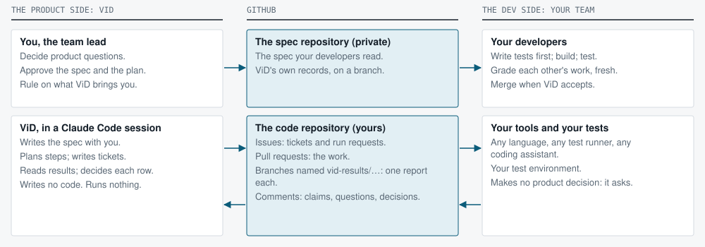
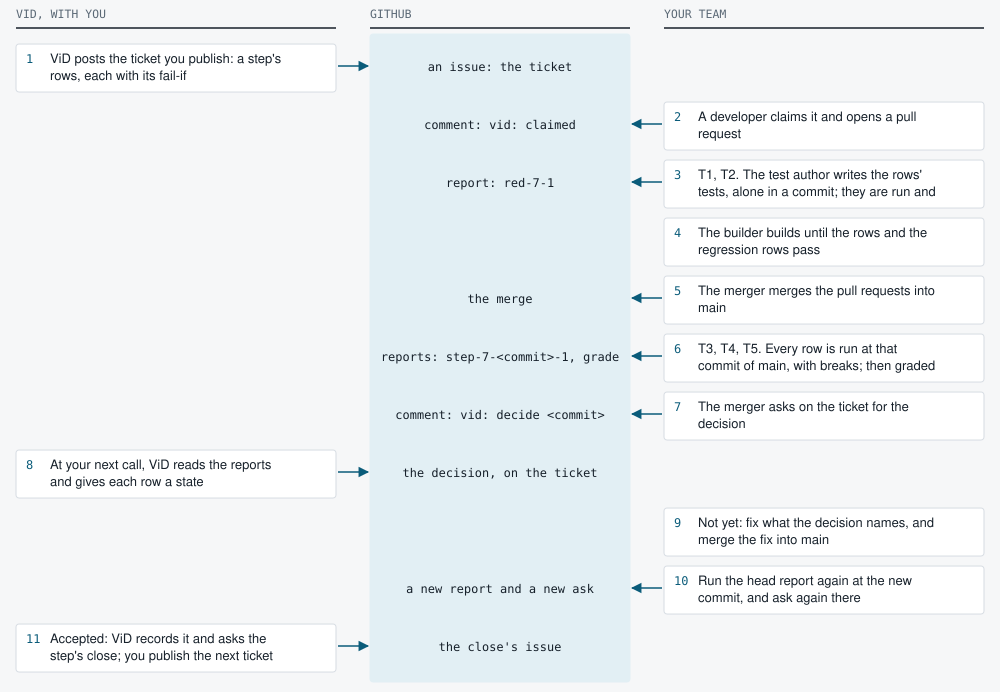

# ViD in GitHub team mode: an overview

For a team lead or a developer whose team will build a product from ViD's tickets, or a product manager with a stronger technical interest. This is the overview: read it once to see how the parts fit. A separate hands-on tutorial takes you through the same practice product step by step.

ViD works in three modes. In *local auto*, ViD's own agents build on your machine, with no GitHub. In *GitHub auto*, ViD's own agents build through GitHub tickets. In *GitHub team*, your own developers build through GitHub tickets and ViD keeps to the product side. **This document is about GitHub team.**

**What you will know after reading this:**

1. How the two sides work together, with GitHub between them.
2. What every file on ViD's side is, and which ones your developers see.
3. How a first spec is written with ViD, and how it is changed later.
4. What a ticket asks, and what ViD needs back to accept it.

Every example here comes from a real run of a small practice product, **JobDigest**: two job feeds merged into one list, and a daily email of new matches for each saved search. The excerpts are real. Where one is shortened, `…` marks the cut. Repository names are changed.

---

## 1. The idea in one page

ViD splits building a product into two sides that meet only on GitHub.



**The product side is ViD.** You, the team lead, sit in its seat with a Claude Code session beside you. ViD writes the spec with you, plans the work, writes one ticket at a time, reads what comes back, and decides. ViD writes no code, reads none of your code to decide, and runs nothing.

**The dev side is your team.** Your developers pick up a ticket, build what it asks, test it, and send the results back in a fixed form. How you build, with which tools, in which test environment, is yours. Tickets call your side *DevAgent*; that is only the name ViD uses for "whoever works the ticket".

**GitHub is the record.** Tickets are issues. The work is a pull request. Results are small branches. Questions and decisions are comments.

Three rules make the split work:

1. **Every requirement that asks the product to do something says how it could fail.** That sentence is its *fail-if*. It is the requirement's acceptance criterion (requirements engineers say *fit criterion*), written as what would break it.
2. **Every fail-if becomes one or more rows.** A *row* is one checkable promise with an id, such as `ROW-019`. A tester would call it a *test condition*. A ticket is a handful of rows.
3. **ViD accepts a row on evidence, not on a report that says "done".** The evidence is a test that failed before the code existed and passes after it: the red and the green of test-driven development.

The rest of this overview is those three rules in detail.

---

## 2. What is on the product side

ViD keeps its work in a folder of plain text files, under git, on your machine. Part of it is published for your developers.

| File | What it holds | Who writes it | Do your developers see it? |
|---|---|---|---|
| `PRD.md` | The product spec: what the product is for, its users, and its requirements | ViD with you, in an interview | Yes |
| `INVENTORY.md` | The test inventory, in effect a requirements traceability matrix: every row (test condition) the product will ever be checked against | ViD, from the PRD; you approve it | Only a ticket's own rows, inside that ticket |
| `STAGES.md` | The cut of the product into stages (releases), each one usable on its own | ViD proposes; you choose | Its stage names, in tickets |
| `DECISIONS.md` | Technical decisions ViD made and logged, with reasons | ViD | Yes |
| `BASELINE.md` | The stack and the fixed constraints | ViD with you | Yes |
| `ARCHITECTURE.md` | The modules, what each owns, and where the product runs | ViD with you | Yes |
| `GRADING-CHECKLIST.md` | A short list of things a reviewer must look for in this product | ViD; you approve it | Yes |
| `CLAUDE.md` | The project's standing rules, when it has any | ViD with you | The rules that bind the product, quoted in each ticket under "Laws" |
| `design/` | The screens, when the product has a face | You, from a brief ViD writes | Yes |
| The plan | The steps, their order and their rows | ViD; you approve it | Each ticket shows its own step |

**Two repositories on GitHub.**

- **The spec repository** is private and is ViD's. Its main branch holds the files marked "Yes" above, and `TEST-DIFFERENCES.md`, the list of known differences between tests and production. Your developers read it and never write to it.
- **The code repository** is your team's. ViD opens issues and writes comments there, and never pushes code to it.

### 2.1 A requirement, read closely

This is one requirement of JobDigest, exactly as it stands in `PRD.md`:

```
REQ-012 | functional | T2 | Every digest footer carries a support contact address that reaches a person. | fail-if: the footer lacks a support address, or mail to it bounces | serves: a stuck subscriber has a path that is not silent churn | authority: authoritative | source: thesis | covers: DIM-nfr-operability/support | phase: pilot | feature: FEAT-03
```

Read it field by field. The first four fields have fixed places; the rest are labelled and may come in any order.

| Field | Here | What it means |
|---|---|---|
| Id | `REQ-012` | Never reused, never renumbered |
| Type | `functional` | What kind of item it is (table below) |
| Tier | `T2` | How bad a failure is. `T0`: must never break or leak. `T1`: core; wrong is a defect. `T2`: desirable; wrong is a fix-round item |
| Statement | "Every digest footer carries…" | The promise, in product words |
| `fail-if:` | "the footer lacks a support address, or mail to it bounces" | The acceptance criterion, turned round: how a wrong build would break the promise. Each "or" is a separate way to fail |
| `serves:` | "a stuck subscriber has a path…" | Why it matters. This is what you weigh when someone asks to drop it |
| `authority:` | `authoritative` | Whose word it rests on. `authoritative`: yours. `provisional`: ViD proposed it and you have yet to confirm. `pending`: an open question holds it |
| `confirms_via:` | (absent here) | On an item that is not yet authoritative: what will settle it, such as a decision of yours or a measurement |
| `source:` | `thesis` | Where it came from: your first description (the seed), an answer of yours (`A-006`), or the agreed summary of the product (the thesis) |
| `covers:` | `DIM-nfr-operability/support` | Which line of the content contract (below) this item satisfies |
| `phase:` | `pilot` | When it is due |
| `feature:` | `FEAT-03` | Which named part of the product it belongs to. A feature is what agile teams call an epic |
| `plain:` | (not in this example) | The rule in one plain sentence, at most 30 words, for you to read and approve beside the rule itself. A spec written today carries it on every requirement; JobDigest's spec was written before this field existed |

**Not every item has a fail-if.** Items come in two families:

| Family | Types | Fail-if? |
|---|---|---|
| Things the product must do or be | `functional`, `nfr` (a quality, such as backup), `ux_flow`, `data_entity` | Always |
| The frame around them | `invariant` (must always hold), `non_goal`, `risk`, `hypothesis`, `outcome`, `metric`, `constraint` | Never. An invariant is checked by trying to break it (the *hostility* rows of 2.2) |

The parts of `PRD.md`, in order:

| Part | What it is |
|---|---|
| Seed | Your own first words about the product, kept unchanged |
| Thesis | The product in a page: summary, users, what the first version must do, what it must not |
| Actors and journeys | Who uses it, step by step |
| Mechanisms | How each goal is meant to be met, each tied to your own words or to an answer of yours |
| Content contract | A checklist of subjects this product's requirements must cover (notifications, consent, backup and so on), each marked covered or, with your word, not applicable. It is how ViD shows you that nothing obvious was forgotten |
| Criticality tiers | What `T0`, `T1` and `T2` mean |
| Items | The named features, then the requirements, as above |
| Answer ledger | Every question asked and every answer, dated, marked `human` (you) or `model_proposed` (ViD suggested it; you were shown it) |
| Open decisions | Questions still waiting for you |
| Findings | What ViD's own reviews of the spec found, and what was done about each |
| Ratifications | The dates of your three approvals |
| Appends | Every change made after approval. Section 5 is about this part |

### 2.2 From a requirement to rows (test conditions)

A requirement is a promise. A row is one way to check it: a test condition. The tests your team later writes for a row are its test cases, and the inventory as a whole is a requirements traceability matrix, every requirement set against what checks it. ViD derives the rows from the PRD, the design and the product's pages, and you approve the whole list once, before any code. This is `REQ-012`'s main row in `INVENTORY.md`:

```
ROW-019 | behavior | REQ-012 | anonymous | n/a | Every digest's footer gives a support address that reaches a person. Fails if a digest's footer has no support address. | REQ-012 | owed: spec-only — first stage | origin: REQ-012 | …
```

It says: this is a *behavior* row, it checks `REQ-012`, as an *anonymous* visitor, and it is *owed*: nothing checks it yet. A row stops being owed when a ticket builds it and ViD accepts it.

Not every promise can be checked by one test. So the inventory holds several kinds of line:

| Kind | What it checks or records | An example from JobDigest |
|---|---|---|
| Behavior | One thing the product does | `ROW-019`, above |
| Surface | One screen in one state, as the design draws it | `ROW-003`: the "saved" state shows the saved search, its address and the line "Check your inbox to confirm" |
| Shell | Something every page carries | `ROW-006`: every page shows the header with the product's name, and the footer with the support address |
| Reachability | That a page or action can really be reached from where a user starts | `ROW-007`: a digest's unsubscribe link opens the unsubscribe page with no sign-in |
| Journey | A path through several screens, one *transition* at a time. Each transition has its own id: `ROW-004-T1`, `ROW-004-T2`, … | `ROW-004`: a new subscriber saves a search, confirms it and reads the next morning's digest |
| Rule | Something that must hold **everywhere**, counted over every place it applies. Zero places counts as a failure. Elsewhere this is called a fitness function | `RULE-001`: every digest carries the support address in its footer |
| Hostility | Something that must never happen, checked by trying to make it happen: a negative test, or abuse case. Tickets call such a row a *protection* row | `HOS-001`: send the same job on both feeds at once; expect exactly one listing |
| Seam | A real action through an outside service, checked on the test site: an integration test against the real thing | The mail provider really sends |
| Difference | A known difference between your tests and production, written down so nobody is surprised | `DIF-003`: tests use a fake mail provider that records each message |
| Exception | One named place where a rule does not apply, with the reason | `EXC-001`: the unsubscribe confirmation email is a one-off reply, not a digest, so `RULE-001` does not bind it |
| Suppression | A place a rule's count cannot yet see, with when that will end | `SUP-001`: a digest footer the counting cannot read yet |

When you read an inventory, the question to ask of each requirement is: **is every "or" of its fail-if covered by some line?** For `REQ-012`, the first half (no address in the footer) is `ROW-019` and `RULE-001`. The second half (mail to it bounces) cannot be tested with a fake mail provider, and `DIF-003` says so openly. That is a correct inventory: nothing is silently left out.

### 2.3 The plan: stages and steps (releases and stories)

A **stage** is a slice of the product that is usable on its own: a release, in most teams' words. A **step** is one piece of work inside a stage: a few rows that belong together and that one person can make pass. It is close to a user story, with its rows as the story's acceptance criteria. Two differences: a step is derived from the approved spec and is not negotiated, and it always names the steps it depends on. This is part of JobDigest's plan:

```
step S01 | name: save a search and read the first digest | modules: web digest | builds-on: - | rows: ROW-003 ROW-004 | … | kind: skeleton
step S07 | name: a support address in every digest's footer | modules: digest | builds-on: S01 | rows: ROW-019 | …
step S02 | name: new jobs only, each listed once | modules: ingest digest | builds-on: S01 | rows: ROW-001 ROW-005 ROW-008 … | …
step S03 | name: the footer, unsubscribe and the mail provider | modules: web mail | builds-on: S01 | rows: ROW-007 ROW-010 … | …
```

- **The first step is always the skeleton** (`kind: skeleton`), a walking skeleton: the thinnest working product, end to end, with its test setup. Everything else builds on it. Its ticket has rules of its own (4.10).
- `builds-on:` names the steps whose code must exist first. `S02` and `S03` both build on `S01` and on nothing else, so two developers can take them at the same time.
- Each step becomes one ticket. ViD publishes a step's ticket when the steps it builds on are done.

---

## 3. Writing the first spec

You do this once, with ViD, in a Claude Code session in an empty folder.

**What you need:** Claude Code, signed in; git; and a GitHub account with the `gh` command signed in (`gh auth login`). Then, inside Claude Code:

```
/plugin marketplace add VisionDeliveryAi/vid
/plugin install vid@vid
```

| You say | What happens | What you decide |
|---|---|---|
| `/vid:vid-init` | ViD asks you about the product in one batch of questions, each of which changes something downstream. It then writes `PRD.md` in three passes, stopping after each for your approval: the summary of the product with its content contract, the answers to the gaps it found, and the final set of requirements with their fail-ifs. Then it asks the technical questions and writes the other files. If the product has screens, it writes a design brief and you bring back the screens. It derives the inventory and shows it to you as one table. Last, it proposes how to cut the product into stages | Product questions only: what the product must do, what it must not, which stage cut you want. Technical choices ViD makes and logs in `DECISIONS.md` |
| `/vid:vid-plan` | ViD asks where the code lives (your code repository), where the spec goes (the private spec repository), who is on the team, and who works the tickets (here: your own developers, which is GitHub team). It writes the plan as steps and shows it to you as a page. After your approval the spec is published to the spec repository (in the practice run, right at the approval) | Whether the plan is right. Your yes approves it and allows publishing |
| `/vid:vid-run` | ViD publishes the first ticket (and the spec, if it is not yet published), then starts its loop: it waits for your team's results, reads them, decides, and publishes the next ticket. It runs as one long session; when nothing is new it waits without using the model | Whatever it brings to you (section 6) |

Three things to know about approving a spec:

1. **Read the fail-ifs, not the statements.** A statement almost always sounds right. The fail-if is where a spec is too weak ("the page loads") or too strong ("never fails").
2. **`model_proposed` in the answer ledger means ViD decided for you and showed you.** Read those lines. They are the ones most likely to be wrong for your product.
3. **After the final approval the base of the PRD does not change.** Every later change is an append (section 5). This is what lets a ticket quote the spec and stay true.

---

## 4. One ticket, start to finish

The example is JobDigest's step `S07`, "a support address in every digest's footer": one row, `ROW-019`. It is an ordinary step ticket. Your very first ticket will be the skeleton, which differs in three ways; read 4.10 before you start it.



### 4.1 The ticket arrives

ViD opens an issue in your code repository. This is how the real one begins:

```
…
# Step ticket S07: a support address in every digest's footer

## Header

- number: 7
- kind: step
- step: S07
- stage: 1, The daily digest
- plan: 7ed60d31f3b7
- base: 7eba56f9edaddb776f81a08032bb3d88ef5c5ffd
- export: f7be9362c248f57e0d83b2d8fb239440c57d47ab
- rows: ROW-019
```

`base` is the commit of your code the work starts from. `export` is the commit of the spec repository this ticket was written against, so you can read the spec exactly as ViD saw it. `plan` identifies the version of the plan.

A ticket is long because it carries everything a developer needs and nothing that tells them how to code. Its sections:

| Section | What it gives you |
|---|---|
| The step | The step's line from the plan, and the modules it touches |
| **Rows** | The rows to build, each with its fail-if. **This is the work** |
| Requirements, Decisions, Rules, Laws, Non-goals | The parts of the spec these rows rest on, quoted |
| Engines | Which browsers to run the tests in. The first is the *primary*. Only the primary is asked until some row fails in one browser and passes in another; from then on every browser is asked |
| **Regression rows** | Earlier rows that must still pass when you are done |
| Faulted rows | Rows for which ViD asks a deliberate break (4.5) |
| Rows a ruling reached | Rows whose requirement changed since their tests were written (section 5) |
| Grading checklist | What a reviewer must look for in this product, and the known test differences |
| History, Test lessons, Known | What happened to these rows before, mistakes not to repeat, and findings the lead has already ruled known |
| Roles | The role names, and which roles must not be the same person |
| **Asks** | The five things to send back, `T1` to `T5` |

A ticket never holds code, a file path or a test command. Those are yours.

### 4.2 The roles, for a team of people

Every ticket lists ten role names and eight rules about them, because ViD was first built to talk to a team of software agents. A team of people has to keep the same rules. The ones that decide who may do what:

| The rule, in the ticket's own terms | In plain words |
|---|---|
| `TA`, `TM` and `GR` are never `BU` or `FX` | Whoever writes the tests, runs the reported test runs, or grades, does not build or fix the product |
| `BU` and `FX` never write, change or weaken a test | If a test is wrong, the test author corrects it |
| `GR` is separate from `TA` and `TM`, and comes fresh | A grader reads the code, the tests and the results, and never the reasoning of those who made them |
| `SR` is fresh, and is none of the ticket's `GR`, `BU`, `FX` or `TA` | The one who sorts the grade's doubts has no stake in them |

The roles you will sign reports with:

| Name | Role | Who can share a head |
|---|---|---|
| `TA` | Test author: writes each row's tests before any code | `TA` and `TM` may be one person |
| `TM` | Test manager: runs every test run that is reported, and plants each deliberate break | |
| `BU`, `FX` | Builder; fixer of an open pull request | May be one person, never `TA`, `TM` or `GR` |
| `GR` | Grader: gives each row its verdict, and writes each deliberate break's change | Two of them, each working alone |
| `SR` | Second reviewer: sorts the grade's doubtful lines | One, fresh |
| `MR` | Merger: asks ViD for its decision and merges | Anyone |
| `DM`, `AN`, `DP` | Manager, test analyst, deployer | Anyone; they sign only what they report |

**So one ticket needs five separate heads:** a test author who also runs the tests, a builder, two graders and a second reviewer. A "head" may be a person, or a new session of your own coding assistant given only what that role may see: for a grader, the ticket, the code, the tests and the results. A team of three people can do it with one person on tests, one building, one merging and overseeing, and three fresh assistant sessions for the two grades and the sort.

ViD takes your word that these rules were kept. It checks the form of what you send, not how you produced it.

### 4.3 Claim it, and write the tests first (T1, T2)

1. **Claim the ticket** with a comment whose first line is `vid: claimed`.
2. **`TA` writes at least one test for each row,** from the row and its fail-if, before any product code exists. **A test's name must contain its row's id,** so ViD can match it: `test_ROW_019_footer_one_job` matches `ROW-019` (in a name, `-`, `_` and `.` count as the same character). **A journey needs at least one test for each transition,** named with the transition's id: `test_ROW_004_T1_…`, `test_ROW_004_T2_…`. A single `test_ROW_004_journey` matches no transition.
3. **`TA` commits the tests alone,** on the ticket's branch. No product code in that commit. This is the *tests-first commit*.
4. **Open a pull request** from that branch. Its description must begin `ticket: #7`.
5. **`TM` runs the tests** at that commit, in the primary browser. They must fail, and fail on their own assertion: this is the *red run*, the red of red, green, refactor. A test that fails because something is not set up does not count as a red; report such a failure with a message that begins `setup:`.
6. **`TM` sends the red run back** (the form is in 4.4).

Why this matters: a test that has been seen to fail for the right reason is a test that can see the promise. This is from the real red run for `ROW-019`, where three tests failed on their assertion, as they should:

```
AssertionError: ROW-019: a digest of one job: the footer names [], not support@jobdigest.example
```

### 4.4 How a report travels

Every report is **one folder, pushed as one branch that holds nothing else**. The branch is named `vid-results/<id>`, and the folder has the same `<id>`. For the red run of ticket 7, first attempt, the id is `red-7-1`:

```
vid-results/red-7-1          (the branch)
└── red-7-1/
    ├── results.txt
    └── cases-chromium.xml    (one file per browser, named cases-<browser>.xml)
```

`results.txt` for that real run:

```
by: TM
commit: 899b486c33d11ce283ad1c16872194ff658e0f29
engines: chromium
environments: 3
rows: ROW-019
```

Every line `results.txt` can hold:

| Line | When | What it says |
|---|---|---|
| `by: TM` | Always, first | The role that made the report |
| `commit: <full id>` | Always | The commit the tests ran on, from a clean checkout of it |
| `engines: <browser> …` | Every head report of the skeleton ticket; later only when it changes | The browsers you run, the primary first |
| `environments: <n>` | With `engines:` | How many test environments your team runs |
| `rows: <ids>` | In a red run | The rows this red run covers |
| `covers: <rule row id> <number>` | One line for each rule row that was run | How many places the rule's test covered. Zero means the row fails |
| `retested: <ids>` | In a head report, when it applies | Rows whose test, or a helper it uses, changed after the red run so that it now checks something different. Such a row needs a deliberate break (4.5) |
| `stand-in: <what> — <test value> — <production value>` | In a head report, one line for each test difference first used at this head | For example, a fake mail provider in place of the real one |

`cases-<browser>.xml` is the XML test report most test runners can write (often called JUnit XML): one `testcase` per test, with a `failure` inside it when it failed. You do not write it by hand; you ask your test runner for it. A failure's message should begin with the assertion's own line: what was promised and what was seen.

One way to push a report without touching your working branch. Use a new empty folder for each report: a branch that holds two folders is not read.

```bash
d=$(mktemp -d) && mkdir "$d/red-7-1" && cp results.txt cases-chromium.xml "$d/red-7-1/"
cd "$d" && git init -q && git add red-7-1 && git commit -qm "red-7-1"
git push <your code repository's address> HEAD:refs/heads/vid-results/red-7-1
```

The ids of the reports you will send for a ticket:

| Report | Id | Signed |
|---|---|---|
| The red run (T2) | `red-<ticket>-<attempt>` | `by: TM` |
| The head report: the run at the finished code, with any deliberate breaks (T3, T4) | `pr-<pull request>-<first 12 characters of the commit>-<attempt>` | `by: TM` |
| The grade (T5) | `grade-pr-<pull request>-<first 12 characters>-<attempt>` | `by: GR` |
| The sort (T5) | `sort-pr-<pull request>-<first 12 characters>-<attempt>` | `by: SR` |

A report that is not in this form is not read, and ViD says why in a comment. You then send it again as the next attempt, with the next number. The full rules are in one document that ships with ViD, **ViD results format 1** (`docs/RESULTS-FORMAT.md`). Keep it open beside your first tickets; this overview covers what an ordinary step ticket needs.

### 4.5 Build, then run at the head, with deliberate breaks (T3, T4)

7. **`BU` builds** until the ticket's rows and the regression rows pass. `BU` does not edit the tests.
8. **`TM` runs every row and every regression row** at the newest commit of the pull request (its *head*), from a clean checkout, in each browser the ticket asks. This is the *head report*.
9. **Deliberate breaks, where they are needed.** This is mutation testing, done one row at a time: change the product so that a promise is broken, and see whether the test notices. A *fault* is a small change that makes one row's fail-if true and nothing else: for `ROW-019`, deleting the address from the footer. `GR` writes that change. `TM` applies it, runs that row's test in the primary browser, and expects it to **fail on its assertion**. `TM` also runs one other test, the *control*, and expects it to still **pass**. Then the change is thrown away.

**A fault is needed for:** a row that had no red run; a row named in a `retested:` line; a row the ticket lists under "Faulted rows"; and a row whose test a grader doubted (4.6). It answers one question: can this test fail at all? A test that still passes with the promise broken sees nothing.

**The control** is a row, or another test of the faulted row, that passed in this same head report. `TM` picks it.

The faults go inside the head report's folder. From the real run:

```
pr-8-032e923e5dd7-2/
├── results.txt
├── cases-chromium.xml                 (the run at the head)
└── faults/
    ├── ROW-003/
    │   ├── cases-chromium.xml         (the faulted row's test and the control's, with the break in place)
    │   └── control.txt                (its first line is the control's id, alone: here, ROW-006)
    └── ROW-004-T3/
        ├── cases-chromium.xml
        └── control.txt
```

Two more things about faults:

- **A protection row** (the ticket marks it) must fail in a particular way: its test's failure message carries a line of its own reading `vid-forbidden-effect: <row id>`. That line says the test saw the forbidden thing itself happen, and not some unrelated error. Without it the fault proves nothing.
- **A break you could not plant** gets `faults/<row id>/inconclusive.txt` with one line saying why, in place of the cases file.

### 4.6 The grade, the decision and the sort (T5)

10. **Two graders grade every row,** once, at the first finished head. A grade is an independent review: of the product and of its tests, against each row. Each works alone, reads the ticket, the code, the tests and the results, and writes one line per row (one per transition for a journey). Their lines are joined into one `grade.txt`: where both keep a row, the first one's line; where one breaches it, that line. From the real one:

```
by: GR
commit: 032e923e5dd7bff59e1b2ee6af5209b50d81bc34
ROW-019 kept — send_digest is the only digest sender … and both parts end with the support address … so a footer without the address, in either part or at either size, fails …
ROW-003 breached test — "as drawn" is compared only as far as colour, font family, visibility, opacity, the box, the words and stray controls … a state drawn otherwise passes …
…
finding: bug medium — Unsubscribing and confirming both act on a plain GET, so a mail scanner that opens links can end a subscription or confirm one nobody asked for — … — Fetch a digest's unsubscribe link with no browser, as a scanner does: the address is unsubscribed.
```

A row's line is the row's id, one of four verdicts, a dash and the reason:

| Verdict | Meaning |
|---|---|
| `kept` | The promise holds, and the test would catch its breaking |
| `breached product` | The product is wrong |
| `breached test` | The test cannot see the promise |
| `unclear` | The row cannot be judged as written; the line ends with the question |

After the rows, a `finding:` line is anything the grader noticed outside the rows: `finding: bug <high|medium|low> — <what> — <where it shows> — <how to reproduce>` for one case, or `finding: rule — <one line>` for something that should hold everywhere.

11. **A `breached test` line is settled by a deliberate break.** `TM` plants a break aimed at what the line says, as in 4.5, and sends the head report again as its next attempt, with the fault folder added, before the decision is asked. **Only the newest attempt of a report is read, so a new attempt holds every file again,** not only what is new. If the test fails under the break, the doubt was unfounded. If it still passes, the test is weak. A break that could not be planted is reported as inconclusive (4.5), and that also closes the line. Only a `breached test` line with no fault folder at all, or one on a deploy-owed row, goes to the sort.
12. **`MR` asks for the decision** with a comment on the pull request whose first line is `vid: decide <the head's full commit id>`, and nothing more.
13. **After that first decision, `SR` sorts what the grade left open:** each `breached product` or `unclear` line, and any `breached test` line that step 11 did not close, once. The report is `sorted.txt`, one line for each such line of the grade:

```
by: SR
commit: <the head read>
ROW-13 test it — <one-line reason> — <the grade line, word for word>
ROW-14 note it — <one-line reason> — <the grade line, word for word>
ROW-15 drop it — <one-line reason> — <the grade line, word for word>
```

   - `test it`: `TA` adds a test under that row's id, in a commit of tests alone, and the head is run again. If the new test fails, the row is failing, a product failure. If it passes, the doubt is closed.
   - `note it`: the line reaches the lead as a finding.
   - `drop it`: it stays on the report and goes no further.
   - A line on a deploy-owed row is never `test it`.

14. **After the sort is pushed, `MR` asks again:** the same `vid: decide <head>` comment. ViD decides only when asked.

If the grade leaves no such line open, there is no sort. While a grade or a sort that is owed is missing, the decision reads `not yet` with a line that says so.

**A grader's doubt never fails a row by itself.** A row fails only on a run: a test that fails, or a deliberate break that the tests miss. A doubt becomes a break or a test, and the run decides. This keeps a ticket from going round forever on opinions.

### 4.7 ViD decides

ViD reads the reports and answers on the pull request. The first real decision on this ticket:

```
vid: decision 032e923e5dd7bff59e1b2ee6af5209b50d81bc34
ticket: not yet
ROW-019 accepted
ROW-003 failing, a weak test — its fault not proven, pr-8-032e923e5dd7-2 — siblings: ROW-001, ROW-004, ROW-005, ROW-008, ROW-012, and any other test with the same data pattern
ROW-004 passing
ROW-006 passing
```

Read it this way:

- `ROW-019 accepted`: the ticket's own row is done. It had its red run and passes at the head.
- `ROW-003 failing, a weak test`: a regression row. A grader had doubted its test (the `breached test` line in 4.6), a break was planted, and the test still passed. So the test cannot see what it claims to check. `TA` strengthens it; the row is run again.
- `siblings:` names rows whose tests may share the weakness. `TA` looks at those too.
- `ticket: not yet`: fix what is named, push, run again at the new head, and ask for a decision there.

What a decision can say:

| Words | Meaning | What you do |
|---|---|---|
| `accepted` | The row is done | Nothing |
| `passing` | A regression row that still passes | Nothing |
| `failing, a product failure` | Its test failed | `FX` fixes the product |
| `failing, a weak test` | A break was planted and the test missed it | `TA` strengthens the test |
| `evidence missing — …` | A report or a folder is absent or was not read | Send it |
| `sort evidence missing — …` (against no row) | The grade or the sort is owed | Send it, then ask again |
| `question open` | A blocking question on this row waits | Wait for the answer |
| `held` | The row has failed more than once and now waits for the lead | Wait; the lead rules on it (section 6) |
| `owed` | It can only be proved on the deployed product, later | Nothing now |
| `known limit`, `accepted by ruling` | The lead ruled on it | Nothing |

On `ticket: accepted`, for that exact head, **your team merges the pull request**. ViD records the merge, closes the issue, and publishes the next ticket the plan allows.

In the practice run, `ROW-003` failed again at the next head and was held. It was then ruled a known limit, and the ticket was accepted. A held row is how a doubt that runs cannot settle reaches a decision: once, with its record.

### 4.8 Questions

When a row is unclear, ask in a comment on the ticket, the pull request, or a run's issue. The first line begins `Question:` and names the rows or the step it concerns.

- **If you can go on with a sensible default, do, and say the default in the question.** ViD's run manager answers from the spec when the spec answers, with a comment that begins `RM:`. If only the lead can answer, it goes to the lead.
- **If you cannot go on, add the `blocked` label to the issue.** That row waits; the others go on.

Two real questions from this ticket's test author, each with its default (a "test value"):

> 1. ROW-019, REQ-012: what is a digest's footer? The design draws no digest. Test value: the words after the last job listed. …

> 2. ROW-019, D-004: does a digest's text part need the footer as well as its HTML part? Test value: yes, test_ROW_019_footer_text_part. If no, that case goes.

These are good questions. Each names its row, says what the spec does not say, and says what the test assumed meanwhile. Never decide a product question silently in code.

### 4.9 The step close

When every ticket of a step has merged, ViD opens one more issue, labelled `run`, that asks your team to run the step's rows and its regression rows again at the merged commit, in every browser, in small groups called *chunks*. Where a row must be run against the product as it really starts, the issue says so in a line of its own. The real one:

```
close: S07
commit: 5f5b4adf3fb3574db2447b9598a5efb05e45116d
engines: chromium

Run these rows at the commit above, chunk by chunk, in the engines each chunk names … 

- chunk p1c1, chromium: ROW-019
- chunk p1c2, chromium: ROW-004
- chunk p1c3, chromium: ROW-006
…
```

`TM` comments `vid: started`, sends each chunk as its own report (`req-<this issue's number>-<chunk>-<attempt>`, with `by: TM`, the asked commit, and a cases file for each browser of the chunk), and comments `vid: reported <chunk>-<attempt>` after each. If everything is green, the step is closed. If a row is red, ViD writes **one fix ticket** for it, and asks the close again after the fix merges.

### 4.10 Your first ticket is the skeleton, and it differs

The skeleton ticket builds the thinnest working product and your test setup. Because there is no product yet for a test to fail against in a meaningful way, three things change:

1. **There is no red run (no T2).** A deliberate break stands in for it.
2. **Its break has no control.** `GR` writes the change that makes the skeleton's rows' fail-if true; `TM` plants it and runs those rows' tests in the primary browser.
3. **Its head report declares your setup:** the `engines:` line, with the browsers you run, the primary first, and the `environments:` line. The ticket has no "Engines" section, because you are the one declaring them. A skeleton head report without its `engines:` line is not read.

The grade and the sort are as for any ticket.

**What follows the skeleton's merge is also different.** The skeleton is a stage of its own, stage 0, so its merge completes a stage. Three things follow in turn. The first two are asked on an issue; the third is on no issue, and only the lead sees it:

1. **The stage's full run** (label `run`): every row of the stage at the merged commit, in chunks as in 4.9, with one more chunk for every other test of your suite. When no other test exists, that chunk's report holds no test case, and that is a correct report.
2. **A deploy to your test site** (label `deploy`): ViD gives the okay for that commit; your team deploys and reports it. ViD deploys nothing.
3. **A hold.** By default the next stage waits until that deploy has passed once, and no new ticket is published. The lead's `continue` (section 6) builds on without it; say in full what you are continuing past, since in the practice run the one word alone was taken to mean "go on waiting". A team with no test site yet says so, and goes on.

One more special case you will meet later: a row marked *deploy-owed* can only be proved on the deployed product. For such a row you write the test (T1) and it is graded (T5), with no red run and no break; it is proved later, on the test site.

---

## 5. Changing the spec

A spec that cannot change is useless, and a spec that changes silently is worse. ViD lets you change it in one way.

**When you can change it.**

- **During `/vid:vid-init`, before your final approval:** say what to change; ViD rewrites and shows you again.
- **Once the plan exists** (after `/vid:vid-plan`): as below. A change is drafted, counted and asked, and it lands when you say yes in `/vid:vid-run`.

**The real example.** During JobDigest's run this correction was made: "a support address that reaches a person" was too loose, and should say *within one working day*.

1. **Say the change to ViD in plain words, in the session where `/vid:vid-run` is running:** for a correction, `/vid:vid-fix` and the correction; for a new feature, `/vid:vid-add` and the feature.
2. **ViD drafts it and counts what it touches.** It changes nothing yet. It asks you one question. The real one:

```
This changes 1 row, adds 0, and reaches 2 more: ROW-006, RULE-001. Land it?
```

   - *Changes*: rows whose own words change (`ROW-019`).
   - *Adds*: new rows.
   - *Reaches*: rows whose words stay but whose requirement changed, so their tests must be looked at again (`ROW-006`, `RULE-001`).
3. **On your yes, ViD lands it:** the spec files change, the plan is updated, the spec repository gets a new export, and the tickets that follow carry the change. Before it writes anything ViD tries the change on a scratch copy. If that trial refuses the draft (a new row that is in no step of the plan, for example), nothing is written: ViD makes a corrected draft and asks again as a new question, and your first yes is not carried over.

The same words can be drafted in more than one fair way. In a second run of this practice product the same correction was drafted as a new row, proved on production, with no row changed: `This changes 0 rows, adds 1, and reaches 3 more: ROW-006, ROW-019, RULE-001. Land it?` Read the draft, not only the count.

**What changes in `PRD.md`.** The original line stays where it is. A new line is appended at the end, under "Appends", beneath a dated heading. The real one:

```
REQ-012 AMENDED | functional | T2 | Every digest footer carries a support contact address that reaches a person within one working day. | fail-if: the footer lacks a support address, or mail to it bounces, or goes unanswered for more than one working day | serves: a stuck subscriber has a path that is not silent churn | authority: authoritative | source: thesis | covers: DIM-nfr-operability/support | phase: pilot | feature: FEAT-03 | arms: 1 retained, 2 strengthened
```

- **`AMENDED` restates the whole requirement.** Every clause the change does not touch is kept word for word.
- **Later appends win** over the base and over earlier appends. To know what a requirement says today, read its last `AMENDED` line.
- `arms:` says what happened to each "or" of the old fail-if, in order: `retained`, `strengthened`, `moved` to another requirement, or `withdrawn` on an answer of yours.

**What your developers see.** Three things, depending on where each touched row is:

- **A ticket not yet published** quotes the new text, and lists the reached rows under their own heading with the new requirement.
- **A ticket already open** is amended in place: its header gains a line `amended:`, and a comment beginning `vid: amended` says that the text it quotes changed and that earlier results for its changed rows do not count. Read a ticket's comments, not only its first version.
- **A row already accepted and merged** gets a ticket of its own, a *reached-rows ticket* (`kind: reached`). It asks T1, T3 and T4: no red run and no grade.

From the real ticket:

```
## Rows a ruling reached

- ROW-006, its requirement REQ-012 changed:
> REQ-012 | functional | T2 | Every digest footer carries a support contact address that reaches a person within one working day. | fail-if: the footer lacks a support address, or mail to it bounces, or goes unanswered for more than one working day | …
```

For a reached row, `TA` keeps the test if the changed clause is not one it tests, and rewrites it otherwise. When unsure, rewrite. A rewritten test goes in the head report's `retested:` line and takes a deliberate break (4.5), since it has no red run of its own.

**Rules for a good amendment.**

1. **Change the fail-if, not only the statement.** "Within one working day" in the statement with the old fail-if would have changed nothing that anyone checks.
2. **Look at the count before you say yes.** A change that reaches twenty rows is a different decision from one that reaches two.
3. **One change, one question.** Do not batch unrelated changes into one draft; land them one after the other.

---

## 6. What comes to you as the lead

While `/vid:vid-run` is going, ViD brings you a short list of things only you can settle. Each is one numbered line, `Q1`, `Q2`, …, and stays until you answer it.

| What comes | Your choices |
|---|---|
| **A held row.** A row that failed more than once. ViD shows what the row promises, what it still needs, and a recommendation | Accept it (only when its tests pass and only evidence is missing); allow more rounds; rule it a known limit; or amend it (section 5) |
| **A question from your developers** that the spec does not answer | Your answer, in your words. ViD posts it on the ticket |
| **Findings** from a grade: things the graders saw outside the rows | For each: fix it, make it a row, mark it known, or no |
| **A close that could not finish** | Ask again, or rule a limit |
| **A drafted change** to the spec | Yes or no |

Three more things you can say at any time: **"where are we"** (ViD prints the status: each step, what is left, what waits on you), **"pause"** (nothing new is published; decisions and merges go on) and **"continue"**.

After you have typed anything in that session, look again a minute later: if it sits idle at its prompt and is not waiting inside a command, say `/vid:vid-run` again. In the practice run the session stopped its loop after some answers, and nothing was read or decided until it was started again.

A session can be closed or lost without harm. ViD keeps its records on a branch of the spec repository; `/vid:vid-run` picks up where it stopped.

---

## 7. What to expect, honestly

- **The first ticket takes longest.** The skeleton ticket sets up your test environment, your test runner's XML output and your way of pushing a report. After that, a report is a few commands.
- **Tests first, the red run and the head run are light.** Most teams that write tests already do most of this. The new habits are: tests in their own commit before the code, the row's id in the test's name, and a report in a fixed form.
- **Deliberate breaks, the grade and the sort are the heavy part.** Plan for them. A break is a few minutes for a row. A grade is two fresh heads reading a ticket's work with care, and a third to sort what they doubt; it is the step most likely to be skipped under pressure. It is also where doubts about weak tests come from, as with `ROW-003` above.
- **A ticket needs five separate heads** (4.2). With fewer people than that, plan which heads are fresh sessions of your coding assistant.
- **Expect "not yet".** A first decision that accepts everything is rare. One or two rounds on a ticket is normal.
- **Ask early.** A question with a stated default costs nothing. A product decision buried in code costs a fix ticket later.

**What this overview did not cover:** rule rows and their counts in detail; the stage close and the test site beyond what 4.10 says, and production, which follow the same pattern (ViD asks on an issue, your team does and reports, ViD reads); and the two modes in which ViD's own agents build (local auto and GitHub auto), which have guides of their own. For anything a report must hold beyond what is here, the results format document is the reference.

---

## 8. Words used here

| ViD's word | Meaning | Elsewhere |
|---|---|---|
| Requirement | One item of the product's spec, in `PRD.md`, with an id such as `REQ-012` | Requirement |
| Fail-if | The sentence in a requirement or row that says how it could fail | Acceptance criterion; fit criterion |
| Row | One checkable promise, in `INVENTORY.md`, with an id such as `ROW-019` | Test condition |
| Test inventory | The list of every row, each set against its requirement and what can check it | Requirements traceability matrix |
| Transition | One step of a journey row, with its own id such as `ROW-004-T1` | A step of an end-to-end scenario |
| Protection row | A row that names something that must never happen | Negative test; abuse case |
| Owed | Not yet checked by anything | Pending |
| Deploy-owed | Can only be proved on the deployed product | |
| Feature | A named part of the product that groups requirements | Epic |
| Stage | A slice of the product that is usable on its own | Release; increment; milestone |
| Step | One piece of work in a stage; one ticket | User story; backlog item |
| Skeleton | The first step: the thinnest working product, with its test setup | Walking skeleton |
| Ticket | An issue ViD opens, asking for a step's rows | Ticket; issue |
| Head | The newest commit of a pull request | Head commit |
| Engine | A place a test runs; for a web product, a browser | Browser |
| Red run | The run that shows the new tests failing before the code exists | The "red" of red, green, refactor |
| Head report | The run of every row at the head, with any deliberate breaks | A test run report |
| Fault | A deliberate break of one row, to prove its test can fail | Mutation testing; a mutant |
| Control | A test that must keep passing while a fault is in place | Control |
| Regression row | An earlier row that must still pass | Regression test |
| Grade | Two fresh graders' verdict on each row | Independent review |
| Sort | A second reviewer's ruling on each doubtful grade line: test it, note it or drop it | Triage of review findings |
| Held | A row that failed more than once and waits for the lead | Escalated |
| Append | A dated change to the PRD after its approval | Change record; amendment |
| DevAgent | The name tickets use for the dev side: your team | The development team |
| RM | ViD's run manager: the part of ViD that answers questions and speaks to the lead | |
