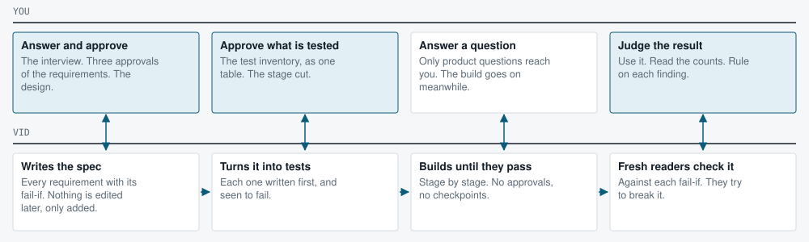
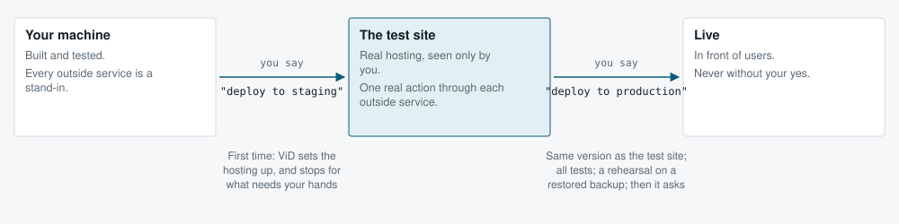

# ViD in local auto mode: an overview

For a product manager, or an engineer with an interest in the product, who will use ViD to get a product built. You do not need to read code. This is the overview: read it once to see how the parts fit. A separate hands-on tutorial takes you through a small practice product step by step.

ViD works in three modes. In *local auto*, ViD's own agents build on your machine, with no GitHub; the finished product is still hosted wherever you choose. In *GitHub auto*, ViD's own agents build through GitHub tickets. In *GitHub team*, your own developers build through GitHub tickets and ViD keeps to the product side. **This document is about local auto.**

**What you will know after reading this:**

1. What you decide, what ViD decides, and where to read what it decided.
2. What every file of the spec is, and which ones are worth your time.
3. What happens during a build, what it asks of you, and how to see where it stands.
4. How to tell whether what came back is right.
5. How to change the product afterwards.
6. What it takes to put the product on a test site, and then live.

Every example here comes from a real run of a small practice product, **JobDigest**: a visitor saves a job search, and gets one email a day of new jobs that match. Its spec came to 10 requirements and 114 test conditions, approved in 66 minutes of sittings. The first thing that could be opened and clicked, the skeleton, took 4 hours 18 minutes more. The practice run stopped there.

---

## 1. The idea in one page

Most of what goes wrong when software is built from a description goes wrong quietly. The description was vague, somebody filled the gap with a guess, and nobody wrote the guess down. ViD is built to stop that, in four moves.

1. **You say what the product must do, and what must never happen.** ViD interviews you once, asks only the questions whose answers change something, and writes the result as a spec. Every requirement in it carries a *fail-if* (an acceptance criterion): one sentence that says what would prove the requirement broken.
2. **The spec becomes tests before any code exists.** ViD derives a list of test conditions from the requirements, called the *test inventory*, and shows it to you. You approve the list, not the test code.
3. **ViD's agents build until the tests pass.** Each test is written first and seen to fail, then the product is built until it passes. You approve nothing along the way. The only thing that reaches you is a product question.
4. **Fresh readers check the result against the spec.** Agents that saw none of the building read the product against each fail-if and try to break it. What they find comes to you as a table, and you rule on each line.



Three things follow from this, and they are the ones to remember.

- **Your work is at the start and at the end.** At the start you answer and approve. At the end you judge. In between you answer a question when one comes.
- **Nothing is edited after you approve it.** A change to the product is added to the spec as a new dated line, and the old line stays. That is how anyone, later, can see what was promised and when.
- **ViD reports counts, never scores.** It tells you how many test conditions are kept, breached or owed. It does not tell you the product is "92% done", because no such number means anything.

---

## 2. What you decide, and what you do not

### What is yours

Product questions are yours, always: what the product does, who it is for, what it must never do, what waits for later. ViD does not guess these. When it meets one during a build it stops building whatever depends on the answer, asks you, and carries on with everything else.

You are asked at fixed points. In order:

| When | What you are shown | What you do |
|---|---|---|
| **The interview** | One batch of questions, each with ViD's recommendation where it has one. Among them, one challenge to your scope: what this first version could ship without | Answer in your own words, accept a recommendation, or say "all recommended" |
| **First approval** | The product in summary, its features, the list of qualities the spec must cover, the objections a critical reader raised, and the decisions ViD took for you, most consequential first | Fix or overrule each objection. Change any decision ViD took, or let it stand |
| **Second approval** | The gaps ViD found, as questions. One sentence on how big the spec has become. Every requirement as one plain sentence beside its rule | Answer the gaps. Cut, if it has grown |
| **Third approval** | The final wording, and anything still open | Approve. From here the spec's base does not change |
| **Two optional hints** | "Any directional hints on design?" and "Any directional hints on architecture and technical stack?" | Say what you care about, or "you pick" |
| **Where it will run** | Where the finished product will be hosted: the platform, the addresses, a spend cap, how ViD would get access | Answer what you know; say what is not decided yet |
| **The design** (if the product has screens) | A brief listing every screen and state that must exist | Design it yourself from the brief, or let ViD draw it |
| **The test inventory** | One table of test conditions, with the exceptions first | Confirm, strike or amend rows, at reading speed |
| **The stage cut** | A ladder of ways to deliver the product, from many small stages to one | Pick a rung |

During the build you are asked only product questions. At the end you are shown what the fresh readers found, and you rule on each line: accept it, dispute it, or defer it.

### What is not yours

Technical choices are ViD's: the language, the database, how the parts are arranged. It makes them, and it writes each one down in a file named `DECISIONS.md`, marked so you can tell a choice you made from one made for you. The one exception is a technical choice that forces a product trade-off, such as "instant search or cheap hosting, pick one". That one comes to you.

You are shown the decisions made for you more than once: at the first approval, ranked; at the end of the interview stage; in the running summary of the build, under *Decided for you*; and in the final report, under *Decisions made on your behalf*, one line each in plain language. You can overrule any of them at any time.

### Keeping it small

A spec grows. This is the most useful thing to know before your first interview, and the practice run shows it: a first try started from three sentences, accepted ViD's sensible defaults, and reached 47 requirements at the second approval and 64 at the third. The second try started from one paragraph that named what was out as plainly as what was in, said "later" to six of the 18 decisions ViD had taken, and asked in plain words for at most 10 requirements. It got 10.

It grows for honest reasons. ViD checks the spec for gaps and asks about each, and every answer you give becomes a requirement. Nothing in that process pushes back on scope, so ViD gives you three tools, and you have to use them.

1. **The scope challenge in the interview.** One question names what your first version could ship without, with a recommendation to cut or keep each and what keeping it costs. Take it seriously. It is the only time ViD argues for less.
2. **The size sentence at the second approval.** ViD tells you how many requirements the spec holds, and which features are the largest. It reads: *"This PRD holds N requirements … The largest features are X (n) and Y (m); moving one to "later" is the cheapest cut."*
3. **"Later".** Any requirement can be marked *later*. It stays in the spec, it constrains nothing today, it is not built, and it is not counted as missing. Saying "later" is free. Saying yes is not.

A small first version comes back sooner, costs less of your attention, and teaches you what to ask for next.

---

## 3. The spec, file by file

After the interview stage your project folder holds the spec, ViD's own checking scripts and records, and no product: no code, no tests. ViD says so in its last words: *"the spec is ratified; there is no code, no test harness and no written test yet"*.

| File | What it is | Worth your time? |
|---|---|---|
| `PRD.md` | The requirements. Each has a fail-if and one plain sentence. Also your starting paragraph, word for word; each of your answers, restated as one line for each decision; and every later change | Yes: the plain sentences and the fail-ifs |
| `DECISIONS.md` | Every choice ViD made, and whether you saw it | Skim it once, for the ones marked as made for you |
| `INVENTORY.md` | The test inventory: every test condition the product will ever be held to | Yes, once, at the sitting where you approve it |
| `GRADING-CHECKLIST.md` | Lines that every fresh reader is given, in your words | Yes: it is short, and it is yours |
| `STAGES.md` | The stages (releases), one plain-language card each | Yes |
| `DESIGN-BRIEF.md`, `design/` | What must exist visually, and the screens once approved | Yes, if the product has screens |
| `BASELINE.md`, `ARCHITECTURE.md` | The technical foundation, and the things that must never break | No, apart from the must-never-break list |
| `README.md` | What the product is, and how to start it on your machine | Yes, when the build is done |

### 3.1 A requirement, read closely

This is the requirement about the daily email, as the spec holds it, shortened:

```
REQ-005 | functional | T1 | Once a day at 07:00 UTC each confirmed subscriber who has new matching jobs is sent one email, and a subscriber with none is sent nothing; no subscriber is sent two daily emails in one UTC day; … | fail-if: a confirmed subscriber with new matching jobs is sent no email that day while the feed was readable and the run succeeded, or a subscriber with no new matching jobs is sent an email, or a subscriber receives two daily emails in one UTC day, or … , or a daily email from a run that did not fail is sent before 07:00 UTC or more than one hour after it | serves: one email a day, only when there is something new, is what keeps every email worth opening | … | phase: pilot | feature: FEAT-05 | plain: Each subscriber with new matching jobs gets exactly one email a day at 07:00 UTC, and nobody gets an email on a day with nothing new.
```

| Part | What it is |
|---|---|
| `REQ-005` | Its name. Tests, tickets and reviews all point back to it |
| `T1` | How much it matters. `T0` is a must-never-break rule; `T1` and `T2` follow |
| The statement | The promise, in full |
| `fail-if:` | What would prove it broken: a list of cases joined by "or". Any one of them is a failure |
| `serves:` | Why it exists. A requirement that serves nothing should not be there |
| `phase: pilot` | It is in this version. The other value is `later` |
| `feature:` | The part of the product it belongs to |
| `plain:` | The same promise in one sentence of your words. This is what you approve |

**Read the fail-if, not the statement.** A statement almost always sounds right. The fail-if is where a requirement turns out to be too weak ("the page loads") or impossible ("never fails"). In the practice run one was too weak, and this is how it was strengthened: the sentence promised 07:00, and no case in the fail-if failed if the email went out at 15:00. The product manager wrote: *"REQ-005's fail-if is too weak: its rule promises the email goes out at 07:00 UTC, but nothing in the fail-if fails if it goes out at 15:00. Add: a daily email from a run that did not fail is sent before 07:00 UTC or more than one hour after it."* That is the last case in the line above. It was right, and it had a price: at a later sitting it collided with the promise to retry a failed run the same day, and ViD brought the collision back for a ruling.

**The plain sentence is your handle.** Every requirement has one sentence of at most 30 words, in your language, with no codes in it. You approve that sentence beside its rule. If the sentence is not what you meant, the rule is wrong, however precise it looks.

### 3.2 From a requirement to rows (test conditions)

A requirement says what must hold. A *row* says one thing that will be tested to show it. One requirement usually has several. Five of the rows of the requirement above:

```
ROW-033 | behavior | REQ-005 | … | at the 07:00 UTC run each confirmed subscriber with new matching jobs is sent exactly one email and a subscriber with none is sent nothing; …
ROW-034 | behavior | REQ-005 | … | however many times the daily run starts in one UTC day, no subscriber receives two daily emails that day
ROW-035 | behavior | REQ-005 | … | an email is built only from a feed read that succeeded in its run; if no read succeeds that UTC day nothing is sent and the jobs appear in the next day's email
ROW-036 | behavior | REQ-005 | … | when the 07:00 run fails or is missed and a later run that UTC day can succeed, every subscriber with new matching jobs receives that day's email; …
ROW-037 | behavior | REQ-005 | … | no daily email from a run that did not fail is sent before 07:00 UTC or more than one hour after it
```

Each case of the fail-if has its row. The practice product's 10 requirements made 114 rows: 87 of behaviour, 17 of screens and their states, 4 journeys from start to finish, and 6 of structure. Beside them stand 10 rules that must hold everywhere, 5 attempts to break the must-never-break rules, and 41 agreed examples of what matches and what does not ("nurse" does not match "Nursery").

You approve rows, not tests. The sitting is built for reading speed: a table, with the exceptions first, and you confirm, strike or amend. Two parts of it deserve slower reading.

- **What must never happen.** ViD lays out the product's main things (a saved search, a subscriber, an email) against the states each can be in, and asks, for each cell, what must never happen there. Its own answers are filled in. You tick, strike, or add a line. In the practice product the two must-never-break rules were: no daily email is ever sent to an address that did not confirm; and one click on unsubscribe deletes everything held for that address, at once. Five rows are attempts to break those two.
- **What is deliberately not tested, and why.** Every gap in the testing is listed with its reason. A gap you did not know about is a decision somebody else made.

A row is never deleted or weakened later to make a build pass. A row that seems wrong is a product question, and it comes to you.

### 3.3 The stage cut (releases)

ViD proposes how to deliver the product in *stages*: each one usable by somebody, safe to release, and whole. It shows the choices as a ladder. The bottom rung is the finest cut, with the most stages. Each rung above it merges neighbours, up to a single stage. For the practice product the ladder had a single rung, and ViD said why: *"Sign-up without the daily email is not usable: you'd sign up for nothing. Daily emails without one-click unsubscribe are not safe to release: your must-never-break rule has to hold from the first email."* A larger product shows several rungs.

A coarser cut means, in ViD's words, *"fewer stage closes and deploys, a later or bigger first release, a risk tested later"*. It recommends the finest cut unless a stage would be too small to be worth releasing by itself.

Two more things are settled at this sitting.

- **Stage 0, the walking skeleton.** A first, technical stage: the thinnest path through the whole product, working end to end, never released to users. Recommended when the product will be deployed and uses an outside service. The practice product took it. Its thin path: sign up, the confirmation email is captured, press Confirm, a job enters from the feed, and exactly one daily email lists it. Four rows prove it.
- **A standing permission.** *"May ViD set up the test site and put each finished stage on it on its own? Going live always waits for you."* You can give or withdraw it at any time. Going live is never automatic.

### 3.4 The design

If the product has screens and you want it designed, the design becomes part of the spec, with the same standing as the requirements: what the product *is*, beside what it *does*. You can also put the design off, and the tests are then derived from the requirements alone. ViD writes a brief listing every screen and every state of it (empty, loading, error, confirmation). Then you draw it, in your own tool, from the brief. ViD offers to draw it for you only when it can see its own drawings in your session; when it cannot, it says so.

ViD recommends that you draw it. If ViD draws it, expect to reject some of it on taste; that is normal. Either way the result is checked against the brief screen by screen. A screen the brief asks for and the design lacks, or one the design has and no requirement asks for, is put to you: draw it, drop it, or make it a requirement. In the practice run two ready-made screens were brought in. The brief asked for sixteen things to be drawn; the two screens covered three. ViD would not alter the files by itself, proposed three marker lines to tie each drawing to its requirement, and listed the other thirteen for a ruling. All thirteen were marked *owed*: the builder makes them plain, using only the two screens' colours and spacing. A fresh reader then compared the screens' words with the requirements and brought back two disagreements, each ruled in one line.

---

## 4. How a build runs

You start it with one command, and from then on it runs without you.

**First, the code skeleton.** ViD sets up the product's foundation and its test harness, then writes a test for every approved row that can be tested before the product is deployed, and runs it. In the practice run that was 104 of the 114 rows. Every test fails, because nothing is built. That is the point: a test that has been seen to fail can be believed when it passes.

**Then it builds, stage by stage.** Inside a stage ViD plans its own steps. It does not show you the plan for approval and it does not stop at checkpoints. Each step builds until its tests pass.

**A product question does not stop the build.** When ViD meets something only you can decide, it writes the question down with a number, asks you in plain language, and goes on with everything that does not depend on the answer. It does not guess, and it does not build what the question gates. Only when nothing else is left does the build stop and wait. If your answer would change a requirement, the question tells you the price first: how many rows it resets, and how many of those were already passing. The practice build asked four questions before its first stage closed. Two were about the product, and they show the mechanism well:

> **Q2 — which form of the address does the confirmation email go to?** When someone types `Ana.Smith@Example.com`, the product saves the address and sends the email in lower case … **(a) Lower case is acceptable — my recommendation.** … **(b) Exactly as typed.** … **(c) Record it as a known limit.**

A fresh reader had found that a row's promise could be read two ways, and the code had picked one. The answer, "(a), lower case is fine", took seconds. A second reader, who had seen nothing of the first review, then found that the test could not tell the two readings apart, which produced the next question and a stronger test. The other two questions were not about the product at all; see section 8.

**Nothing pops up.** This is the one habit local auto asks of you. A waiting question, a stop, or a build that died is written into the project's records, and nothing is sent to you. You have to look. And ViD never restarts a build by itself: if the session ends, it stays ended until you start it again, and it picks up from its records, not from memory.

**Asking where things stand.** Ask in the session, in your own words. ViD answers at the end of its current piece of work, not at once: in the practice run the answer to "Where does the build stand?" came 40 minutes later. It prints one table and never writes a status of its own: what is done, where the build is, what is left, your open questions, and an estimate with how it was worked out. Early on there is no estimate. From the practice run, shortened, at the moment its first question arrived:

```
Stage      | 0 of 1, Walking skeleton
Passing    | 0 of 1 steps passing. 0 rows passing
Left       | every step started. 104 rows not yet passing …
Tests      | 0 of 3 environments busy
Test state | written 104 · passing 0 · proven 0, of 114 rows
```
 It also keeps a running summary in your language, a section for each piece of work, under three headings: *Working now*, *Went back*, *Decided for you*.

**What you can say during a build:**

| You say | What happens |
|---|---|
| "pause" | ViD stops after its current step |
| "hold after this stage" | The build stops when the current stage closes |
| "continue" | A pause or a hold ends |

**The end of a stage.** When a stage's steps are done, ViD runs every test of the product so far and has fresh readers grade what is new. A stage is ready only when every row in it passes and has been graded as kept, and no open question touches it. Rows that can only be proved on the deployed product are listed as owed, not required. You are told in one line. Then the next stage starts, unless you asked for a hold. The practice run's stage 0 closed with these words:

> Stage 0 is closed: the four rows of the first sign-up step pass the full suite and a grader judged each one kept. The build has stopped there to wait for staging, as planned. … **What's next:** staging hasn't been set up yet, and you haven't given me standing permission to deploy there on my own. When you're ready, say "deploy to staging", then "continue".

So the first stage does not run on into the next by itself. Until a test site has passed once, a stage's close waits for it. With the standing permission, ViD sets the test site up itself and goes on. Without it, as here, the build stops and waits for you, and "continue" moves on without the test site.

**The end of the build.** "Done" is computed, not announced. The final report opens with the count of rows in each state and then says either *complete* or *not complete*, with the reasons. Any open question keeps it not complete, and ViD says so plainly. Then come what was built, what the tests did not cover, what was decided on your behalf, and the fresh readers' findings for you to rule on.

---

## 5. How you know it is right

You have four ways, from the most direct to the most thorough.

**1. Use it.** Ask ViD, in the session, how to try the product yourself in your browser. The project's `README.md` gives a command that starts the product as it was tested, but in the practice run that command did not make it reachable from a browser, and a product that sends email and reads a feed needs help to be tried at all: there is no real mailbox, feed or clock on your machine. ViD wrote a small helper when asked. In the practice run, eleven minutes after asking: start the helper; open the page; save the search "nurse" with an address; open the captured confirmation email; follow its link and press Confirm, and the page says "Active"; add a nursing job to the stand-in feed; move the stand-in clock to 07:00 the next day; open the captured daily email, which lists the new job and not the old one; press Unsubscribe, and the page says the search and details are deleted. Every step outside the browser was a command in a terminal, which a product manager would ask ViD to run.

**2. Read the counts.** Every report starts with one line:

```
rows: kept 41 · unverdicted 0 · breached 0 · red 0 · owed 0 · deploy-owed 2
```

*Kept* rows pass their tests and a fresh reader agreed. *Breached* rows were found wanting by a reader. *Red* rows fail their tests. *Owed* rows are not yet proved, each with its reason. *Deploy-owed* rows can only be proved on the deployed product. At the practice run's stage 0 close the report read: 13 test cases run, 13 passed, 4 rows kept, no debt, no open question, and "next: stage 1, JobDigest — 9 requirements, 110 rows".

**3. Open the project viewer.** One command makes a set of pages that open with a double-click and work offline. They show what is being built, how far it has got, the evidence behind it, your open and answered questions, the decisions taken for you, and how all of that changed over time. It changes nothing in the project, and it is safe to make while a build runs. In the practice run it took 12 seconds and made nine snapshots and an index, in a folder of its own outside the project. The page for "now" showed, among other things:

> 3 Goals · 7 Capabilities · 13 Requirements · 114 Acceptance criteria
> Progress: 61 of 114 criteria pass their test · 4 confirmed by review
> Stage 0 · Walking skeleton · technical, never released · Closed and held
> Stage 1 · JobDigest · Not started

Three of those numbers need a word. "13 requirements" counts the two constraints and the metric with the ten. "61 passing" where stage 0 holds four rows is because the builder built ahead: most of the sign-up, the daily email and the unsubscribe already work. And "4 confirmed by review" is the number that counts: a row is done when its test passes *and* a fresh reader has agreed.

**4. Read the grade.** A grade is an independent review. Agents that saw none of the build read the product against every fail-if and try to make it fire. One more uses the running product with no script, as a curious user would. For each requirement the verdict is one of four words:

| Verdict | Meaning |
|---|---|
| **PASS** | The fail-if cannot be shown to fire |
| **PARTIAL** | The behaviour exists, but the fail-if fires on a path a user can reach |
| **FACADE** | It looks implemented, and fails in practice |
| **ABSENT** | It is not there |

The findings come as one table, ranked by consequence, in plain words. Each row has an empty cell for your ruling: *accept*, *dispute* or *defer*. Nothing is fixed until you rule. Accepted rows are fixed, disputed rows are dropped, deferred rows stay as open questions. The practice run stopped before its end-of-build grade, so it has no findings table to show. What it does show is the same review at the scale of one row. Stage 0 had four rows. The first reader kept three and breached the fourth, the one about where the confirmation email goes: the row could be read two ways. That became a question to the product manager. A second reader then found that the product was right but the test could not have caught it being wrong, so the test was made stronger. A third reader kept the row, and proved it by breaking the product on purpose and watching the test fail. Three readers, two questions, one stronger test, for one row.

A grade is not a test. A test gives the same answer every time. A grade is a careful reader, and two careful readers can differ. That is why its findings come to you and are never applied by themselves.

---

## 6. Changing the product

A built product changes in two ways, and each has one command.

**A correction** is something that is wrong or too loose. You say it in plain language. ViD appends it to the spec under a dated heading, either as a new requirement or as a full restatement of the old one, with its fail-if written as the harm to prevent and not as the one case you noticed. A test for it is written and seen to fail. Then the fix is made, and the parts of the product it touched are graded again, because a fix can break something beside it. The practice run did not reach a correction; what follows is from ViD's own instructions.

If the product already does what you asked, or your correction contradicts something you approved earlier, ViD shows you both and you decide which way the spec goes.

**A feature** is new behaviour. ViD runs a short interview on the feature alone, appends its requirements, and shows you what changes in the test inventory as a difference: new rows to approve, changed rows, rows that no longer apply. You place it in a stage. Then the build runs as it always does, on the new rows. The practice run did not reach a feature either.

In both cases the old lines of the spec stay where they are. To know what a requirement says today, read its latest line.

**Do not patch by hand.** If something is wrong, say so to ViD. A change made around the spec is a change nobody tested and no record explains.

---

## 7. From your machine to live

A finished build leaves a tested product on your machine. Two more places remain: a *test site* (staging), where the product runs on real hosting with made-up data before any user is sent to it, and *live* (production). The practice runs did not go there, so this section is taken from ViD's own instructions and not from a run.



### First, what only you can do

ViD's rule is one line: *the owner authenticates; the agent operates.* It builds and runs things on the platform, through a log-in that you made. It never creates an account, accepts terms, or enters a secret.

| Yours to do | When |
|---|---|
| Choose the hosting platform and its region. ViD calls this a product question: where your users are, and whose law applies | Asked during the interview. In the practice runs "not chosen yet" was accepted there; the choice is needed now |
| Create the accounts: the hosting platform, and each outside service the product uses, such as one that sends email. Accept their terms. Add payment details | Before the first deploy |
| Log in to the platform's command line, in your browser. Or keep a token in a named setting on your machine, and tell ViD the name | Before the first deploy, and again whenever the log-in lapses: ViD stops and names the command |
| Enter each secret value in the platform's own dashboard | When ViD names it |
| Choose the web addresses, and publish any domain record ViD has no access to publish | When ViD names it |
| Set a spending cap on the hosting account and on every paid service | Before going live |

**Never type a password or a key into the conversation.** ViD's own words: *"Never type a password or a token here — say which log-in, or the name of the variable that holds it."* If you paste one by mistake, ViD does not record it and tells you to treat it as exposed and replace it.

### Step 1. The test site

Say "deploy to staging", or type `/vid:vid-deploy`. A bare deploy always means the test site, never live. You can do it as often as you like.

**The first time, ViD sets the hosting up.** It builds both environments, the test site and the live one; the database; made-up data for the test site; and the settings each outside service needs, by name. Whenever something needs your hands (a log-in, an account, a value) it stops and names it. Do that thing, say "deploy to staging" again, and it carries on with only what is still missing.

**Then it checks two things.**

1. **The tests.** The first time, all of them. After that, the ones for whatever changed since the last full pass.
2. **One real action through each outside service that is switched on there,** on the test site itself: one real log-in, one real email to your own address, one real upload. A service you left as a stand-in on the test site is not tried, so do not take a passed deploy as proof of it. This is the only place such things can be tried. On your machine every outside service was a stand-in, which is what let the tests run at all.

The test site must match live in everything except a short list of declared differences. A difference that is not on the list stops the deploy.

**At the end** ViD reports which exact version the test site runs, and says: *say "deploy to production" when staging looks good.*

**What "looks good" means is yours to judge.** ViD does not prescribe it. Two things worth doing come from the note it leaves in your project's `README.md`: read the email the product sent you, and check each must-never-break rule by hand, once, on the real thing. A third is this guide's own suggestion: walk the main journey yourself, as a user.

**Outside services move in up to three steps:** a stand-in on your machine; then, for each one you choose, restricted on the test site, while the others stay stand-ins there; then live. A new email service starts restricted: for its first week everything the product sends goes to your own inbox, so that you read what it would have sent to strangers.

### Step 2. Live

Say "deploy to production". Only your word starts it. No schedule does, and no build does. If a build is running, say "pause" first.

**What must be true before ViD will go on:**

- The version going live is exactly the one the test site already runs.
- The whole test suite passes on it.
- Every row that changed since the last full pass has been reviewed again.

A failing row ends the deploy. It becomes a correction, then the test site again, then live again. Before the very first go-live ViD also recommends a full independent review, and offers to run it.

**From the second go-live on, ViD rehearses first.** It restores the latest backup of the live data into a sealed copy on your machine, applies the release's data changes, starts the product, checks every must-never-break rule and walks the main journey on that real-shaped data. Then the copy is destroyed. A side effect, by design: every release proves that your backups can be restored.

**Then it asks you, every time, even when everything is green:**

> deploy vN to prod? migration: yes/no; providers changing: <list or none>

A no leaves live exactly as it was. If the release would delete data, a second question names it: *this drops X — confirm.*

**After your yes,** the first time: ViD deploys, records the release, checks the live product with a short test, and shows you how to follow the product's logs. Every later time it first backs up the live data and applies the release's data changes within the downtime you allowed, then deploys, checks and records.

**If a release goes wrong,** the way back is chosen from what failed, not by habit: put the previous version back when the data still fits it; fix forward when it does not; restore a backup only when the data itself is damaged, and then ViD tells you first that everything written since that backup will be lost.

### How this fits with stages

- **Rows that wait for a host are proved here.** The tutorial's practice product ended with ten such rows. Each names the step that proves it, and ViD does not ask for your yes to go live while a row of the stages going live is still owed to an earlier step. Rows of later stages wait for their own stage.
- **With the standing permission** (section 3.3) ViD puts each finished stage on the test site by itself and tells you in one line. It never goes live by itself.
- **A correction after going live** is the same path, shortened: say what is wrong, ViD fixes it test-first, then the test site, then live.

### The note in your README

ViD writes ten reminders into the project's `README.md`. Four are enforced by the steps above. Six are left to you.

| Reminder | Who makes sure |
|---|---|
| Restore one backup before you trust backups | ViD, at every go-live after the first |
| Send a week of outgoing email to your own inbox first, and read it | ViD redirects it; the reading is yours |
| Try one real outside service end to end before switching them all on | You. ViD tries one real action through each service that is switched on at the test site |
| Replace any secret an agent ever saw | ViD is built to see none; replacing one you pasted is yours |
| Agents never hold the keys to live; going live happens from your hands | ViD: the question it asks at every go-live |
| Put a spending cap on every paid service and on the hosting account | You |
| Check each must-never-break rule by hand once, on the real thing | You |
| Keep a copy of the spec and the decisions somewhere off the server | You |
| In the first week, read the logs every day | You |
| When something is wrong, tell ViD; do not patch by hand | You |

**What ViD's instructions do not say:** how long a first setup or a deploy takes; what exactly to check on the test site; and when a restricted outside service is switched to live, and on whose word. Expect to ask.

---

## 8. What to expect, honestly

- **The interview stage produces no product.** It ends with a spec, an approved test inventory and a stage cut. Budget your patience accordingly: the first thing you can click arrives with stage 0. In the practice run the interview stage took 66 minutes, across 13 messages typed.
- **A build takes hours, not minutes.** In the practice run, a product of 10 requirements took 4 hours 18 minutes to reach its skeleton: 39 minutes to set the project up, 1 hour 14 minutes to write all the tests and see them fail, 28 minutes to build the thin path, and 1 hour 57 minutes to close the stage, with three reviews, four full test runs and four questions. The main stage, the other 110 rows, was not run. It needs Docker running on your machine for all of that time.
- **You have to check in.** Nothing notifies you of a waiting question or a stopped build. Look once in a while, and ask where things stand.
- **"Local" is where the product is built, not where it lives.** The building happens on your machine; the product is meant to be hosted. So ViD asks early where it will run: the platform, the addresses, a spend cap. Answer what you know, and say plainly what is not decided yet. The practice run answered that it will be hosted, that nothing is chosen yet and no account exists, and took ViD's default on the one question that has one. ViD recorded each open item as a step only the owner can take, to be done before the product goes on a test site.
- **The first report will probably say "not complete".** That is the report being honest about open questions and unruled findings, not the build failing.
- **A grade finds things.** The fresh readers are told to break the product. A table with findings in it is the method working. In the practice run one row in four was breached at its first review.
- **Never type a password or a key into the conversation.** If ViD needs access to something, it asks which log-in to use, not for the secret.

**Three places where the practice run did not go as ViD's own instructions say.** They are defects, they are reported, and you may meet them.

1. **It asked the product manager about itself.** Two of the build's four questions were about ViD's own bookkeeping: whether it may rename its tests so that results are credited to the right rows, and whether it may fix one line of its own checking in the project. Each came with a recommendation, and the only useful answer was yes.
2. **Questions arrived late.** The build went on working for up to 20 minutes after it had started waiting on an answer, before it asked.
3. **The skeleton was not thin.** Stage 0 was planned as four rows. The builder built well past it, and one message said a feature "isn't built yet" that in fact worked.

**What this overview did not cover:** importing an existing document as the starting point; the details of each hosting platform; and the other two modes, which have documents of their own.

---

## 9. The three modes, and when to move

| Mode | Where the work travels | Who builds | Choose it when |
|---|---|---|---|
| **Local auto** | Your machine, for the building. The product itself is hosted where you choose | ViD's own agents | You are alone or a small group, you want a working product from an idea, and nobody else needs to follow the work as it happens |
| **GitHub auto** | GitHub tickets. Today the product ends as local copies on your machine, not on a host | ViD's own agents | You want the same building done for you, with every piece of work visible as a ticket and a pull request, so that others can follow, review and step in |
| **GitHub team** | GitHub tickets | Your own developers | You have a team. ViD keeps the spec, writes the tickets and checks what comes back; your people build |

The spec is the same in all three: the same requirements, the same inventory, the same stages. What changes is who does the building and where the record of it lives.

---

## 10. Words used here

| ViD's word | The standard word | What it means |
|---|---|---|
| PRD | Product requirements document | The spec: what the product must do |
| Fail-if | Acceptance criterion, fit criterion | The sentence that says what would prove a requirement broken |
| Plain sentence | | A requirement in at most 30 of your words |
| Row | Test condition | One thing that will be tested |
| Test inventory | Requirements traceability matrix | Every row, each tied to its requirement |
| Must-never-break | Critical requirement, invariant | A protection whose failure is not acceptable at any time |
| Stage | Release, increment | A part of the product that is usable and whole |
| Stage 0, skeleton | Walking skeleton | The thinnest path through the whole product, working end to end |
| Step | User story, backlog item | A piece of a stage that ViD builds in one go |
| Code skeleton | Project scaffold | The foundation and the test harness, with every row as a failing test |
| Grade | Independent review | Fresh readers checking the product against each fail-if |
| Kept, breached | Pass, fail (on review) | A reader's verdict on one row |
| Finding | Defect, issue | Something a reader saw that is wrong |
| Append | Change record | A dated line added to the spec; nothing is edited in place |
| Later | Deferred, out of scope for now | In the spec, not built, not counted as missing |
| Hold | Release hold | The build stops at the end of a stage until you say continue |
| Test site | Staging environment | The product on real hosting, with made-up data, for you to try before users are sent to it |
| Live | Production | The product in front of its users |
| Deploy-owed row | Post-deployment verification | A test condition that only the hosted product can prove |
