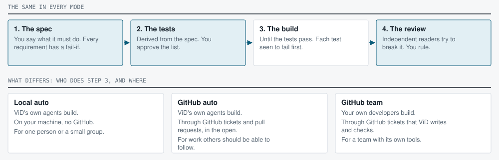

# ViD: start here

ViD is a way to get software built from a description without the description quietly turning into guesses. It runs inside Claude Code. You say what the product must do, ViD turns that into a spec and into tests, the product is built until the tests pass, and reviewers who saw none of the building check the result against the spec.

This page is the map. It gives the idea, the three ways to run ViD, and which document to read next. It takes five minutes.

---

## The idea

1. **You say what the product must do, and what must never happen.** ViD interviews you once and writes the spec. Every requirement carries a *fail-if* (an acceptance criterion): one sentence saying what would prove it broken.
2. **The spec becomes tests before any code exists.** ViD derives the list of everything that will be tested and shows it to you. You approve the list, not the test code.
3. **The product is built until the tests pass.** Each test is written first and seen to fail. Then the building is done, by ViD's own agents or by your developers.
4. **Independent reviewers check the result.** They read the product against each fail-if and try to break it. What they find comes to you, and you rule on each line.

Your work is at the start, where you answer and approve, and at the end, where you judge. In between, the only thing that reaches you is a question about the product.

---

## What is the same in every mode

- **The spec is yours.** Product questions are always put to you. Technical choices are made for you and written down where you can read and overrule them.
- **Nothing is edited after you approve it.** A change is added to the spec as a new dated line. Anyone can see later what was promised, and when.
- **Tests come first.** A test that has been seen to fail can be believed when it passes.
- **A passing build is not the end.** An independent review follows every build. In one practice run every test passed, and the review still found a serious fault that none of them could see.
- **Counts, never scores.** ViD reports how many test conditions are kept, breached or owed. It does not say "92% done".

---

## Three ways to run it

The spec is the same in all three. What changes is who builds, and where the record of the work lives.

| Mode | Who builds | Where the work travels | Choose it when |
|---|---|---|---|
| **Local auto** | ViD's own agents | Your machine. No GitHub. The finished product is hosted where you choose | You are one person or a small group, and you want a working product from an idea |
| **GitHub auto** | ViD's own DevAgent, the dev side that ships with ViD | GitHub: every piece of work is a ticket and a pull request you can read, and nothing merges without ViD's acceptance. The finished product runs as local copies on your machine: no real host today | You want the same building done for you, with the work on GitHub so that others can follow it, or as a first step toward a team |
| **GitHub manual** | Your own developers | GitHub: ViD writes the tickets and checks what comes back, at each call you make | You have a team. ViD keeps the product side; your people build, with their own tools |

---

## Where to go next

**You are a product manager, or an engineer with an interest in the product, and you want a product built.** Read local auto mode.

- [ViD in local auto mode: an overview](OVERVIEW-LOCAL-AUTO.md): what you decide, the spec file by file, how a build runs, how to judge the result. Twenty minutes.
- [ViD in local auto mode: the hands-on tutorial](TUTORIAL-LOCAL-AUTO.md): a small practice product from one paragraph to a built and reviewed product, in one long afternoon.

**You lead a team or are a developer on one, or you are a product manager with a stronger technical interest.** Read GitHub manual mode.

- [ViD in GitHub manual mode: an overview](OVERVIEW-GITHUB-MANUAL.md): the two sides with GitHub between them, what a ticket asks, what ViD needs back.
- [ViD in GitHub manual mode: the hands-on tutorial](TUTORIAL-GITHUB-MANUAL.md): three tickets worked by hand on a practice product, with copy-ready files.

**You want ViD to build your product through GitHub.** Read GitHub auto mode. Its spec is written the same way as in local auto, and its tickets are the ones the GitHub manual documents describe.

- [ViD in GitHub auto mode: an overview](OVERVIEW-GITHUB-AUTO.md): the two sides with GitHub between them, what you decide, how a run goes, and where the mode ends today.
- [ViD in GitHub auto mode: the hands-on tutorial](TUTORIAL-GITHUB-AUTO.md): the same small practice product as in local auto, from one paragraph to a product built through tickets by ViD's own DevAgent. Written from ViD's scripts and from recorded runs; not yet walked from end to end.

---

## What it asks of you

- **Your attention at the start.** A spec of three requirements took about an hour of sittings in the practice run, most of it answering "as recommended" and a few answers that were not.
- **Patience in the middle.** That same product took two and a quarter hours to build. A product of ten requirements took more than four hours to reach its first clickable page. The size is yours to set, in one sentence, early on.
- **Your judgement at the end.** You try the product and rule on what the reviewers found.
- **Your own hands for hosting.** Building happens on your machine, and the product then goes to a test site and to live. Choosing the host, creating the accounts and saying yes to each go-live are yours; the local auto overview has the path. In GitHub auto the test site and the live copy are local copies on your own machine today, and a real host is a step you take yourself.
- **A machine that stays on.** Claude Code, and Docker for the tests. Nothing notifies you when the build has a question: you look.

---

## Five words you will meet

| Word | The standard word | What it means |
|---|---|---|
| Fail-if | Acceptance criterion | The sentence that says what would prove a requirement broken |
| Row | Test condition | One thing that will be tested |
| Test inventory | Requirements traceability matrix | Every row, each tied to its requirement |
| Stage | Release, increment | A part of the product that is usable and whole |
| Grade | Independent review | Fresh readers checking the product against each fail-if |
