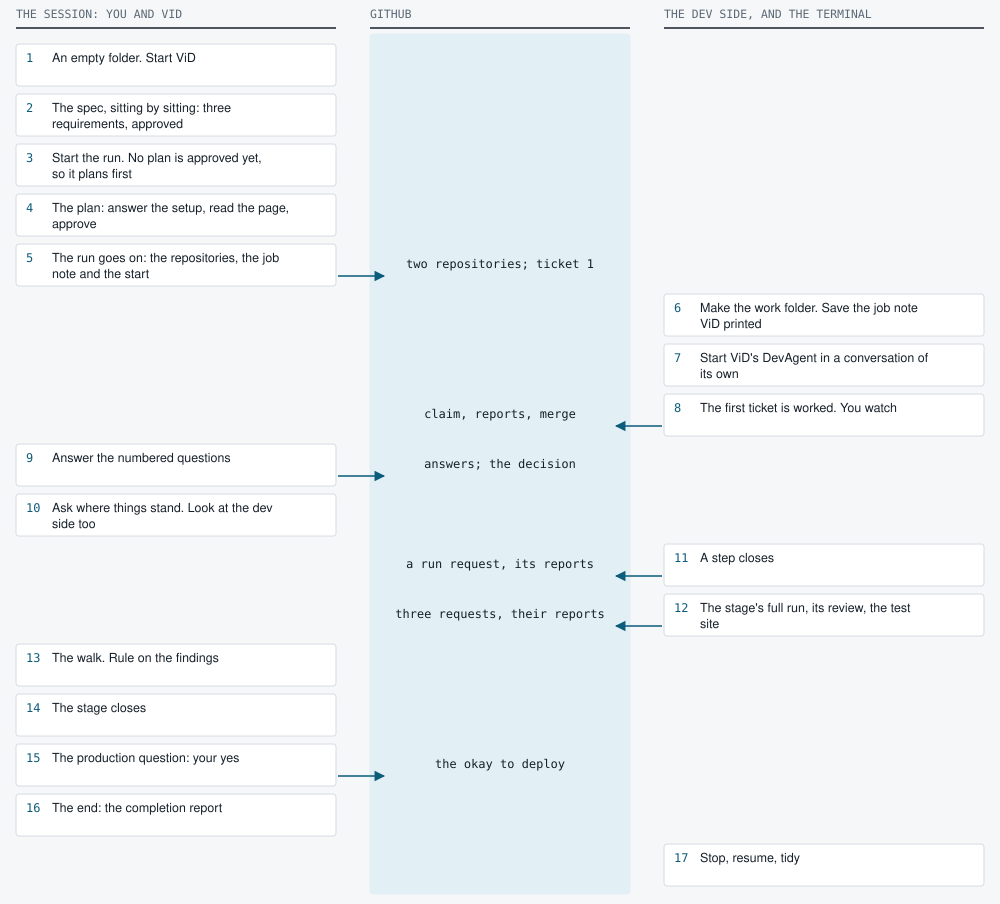

# ViD in GitHub auto mode: the hands-on tutorial

For a product manager, or an engineer with an interest in the product. You take a small practice product from one paragraph to an approved spec, have it built through GitHub by ViD's own DevAgent, read the tickets as they are worked, answer what reaches you, and end with the product running on your machine. You type into two Claude Code conversations and, now and then, a terminal. You read no code.

This is ViD's *GitHub auto* mode: ViD builds your product through GitHub. Every piece of work is a ticket and a pull request you can read, nothing merges without ViD's acceptance, and ViD's own DevAgent, the dev side that ships with ViD, does the building. The companion document, *ViD in GitHub auto mode: an overview*, explains what each thing is and why. This one is what you type. Read the overview first, or keep it open beside this.

---

## What you will do

**The practice product is JobDigest search,** the same one as in the local auto tutorial: one page where a visitor types words and sees the jobs whose titles contain them all. If you have done that tutorial, the first part here will be familiar, and you can compare the two modes on one product.

**At the end you will have:**

1. An approved spec of three requirements.
2. A plan in steps, approved by you.
3. Two private repositories on GitHub: one for the spec, one for the code.
4. ViD's DevAgent started, followed and stopped by your own hand.
5. Read a ticket and a decision on GitHub.
6. Answered numbered questions and ruled on findings.
7. Closed a stage, and said yes to the release.
8. The product running on your machine.

**The lab folder,** `github-auto-lab/`, beside this file, holds the paragraph you start from (`seed.md`), the prepared answers for the spec (`answers.md`), and, in its `README.md`, the job note that ViD prints for the dev side, read line by line.

**How this tutorial was made. Read this before you start.** This tutorial has not been walked from end to end. Nobody has yet taken JobDigest search through GitHub auto. Every stop is written from one of three sources, and says which:

- **ViD's own words.** What a command prints is quoted from ViD's scripts and instructions.
- **The local auto run.** Part 1, the spec, was done once on this product, in local auto mode. The spec is written the same way in every mode.
- **Recorded runs of other products.** A *small recorded run*: a small product with a confirmation email and a daily email, built by ViD's own dev side on real GitHub through two stages, to a live copy on the same machine. A *larger recorded run*: a larger product's first two steps. Times and examples from them are marked, and are not promises for this product.

Where no recorded run shows a step, the stop says so in a line that begins *Not seen in a recorded run*. Expect to meet things this text does not describe. The last table, *When something does not go as written*, is there for that.



---

## Before you start

### What you need

- **Claude Code,** signed in, with ViD installed (the two lines below this list, typed inside Claude Code). The dev side's agents are Claude Code sessions with no window, so the `claude` command must also be on your path and signed in. Stop 7 checks it.
- **git,** and the **GitHub command line,** `gh`, signed in (`gh auth login`; with HTTPS also `gh auth setup-git`) to an account where you may create two private repositories.
- **Docker,** installed and running. The dev side will not start without it, and normally runs the tests in it.
- **A browser installed on the machine.** ViD's walker drives it at stop 13 and installs nothing itself. In the small recorded run it drove Google Chrome.
- **On a PC:** WSL2, the Linux layer for Windows, with Docker Desktop's WSL2 integration switched on for it. Do everything inside it. Native Windows is not supported.

```
/plugin marketplace add VisionDeliveryAi/vid
/plugin install vid@vid
```

### Three seats

| Seat | Who you are there | What runs in it |
|---|---|---|
| **The session** | The product's owner, talking to ViD | A Claude Code conversation, in the project folder |
| **The DevAgent conversation** | Whoever runs the dev side | A second Claude Code conversation, in the dev side's work folder. You start ViD's DevAgent here, follow it, and stop it |
| **The terminal** | Either | A plain shell. You look at GitHub with `gh`, and you make two folders |

ViD's session never sees the dev side, and the dev side never sees the session. Everything between them goes through GitHub.

### Names used in the commands

Set these once in the terminal. The two conversations are other places and do not have them.

```bash
export ACCOUNT=<your GitHub account>
export REPO=$ACCOUNT/jobdigest-search
export PROJECT=$HOME/jobdigest-search
```

`PROJECT` is the folder where ViD keeps the spec. The dev side's work folder is another folder, outside it; ViD proposes one at stop 5.

**One rule for the whole tutorial,** the same as in local auto: when ViD offers more or less, choose less.

---

## Part 1. From one paragraph to an approved spec

This part is the local auto tutorial's stops 1 to 9, unchanged. It is given here in short. Each sitting's full text, with the reasons, is in that tutorial; every answer is in `answers.md`.

**If you have already done the local auto tutorial,** do not reuse its folder. That folder now holds a build, and ViD's planner refuses a project whose build is recorded and not complete. Start again in a new, empty folder.

### Stop 1. An empty folder

*Terminal.* Make the folder and start Claude Code in it. This Claude Code session is *the session* from here on.

```bash
mkdir $PROJECT && cd $PROJECT && claude
```

*Session:*

```
/vid:vid-init
```

Every ViD command has this form. Type `/vid` to see the list. ViD checks that the folder is empty and asks you to describe the product.

### Stop 2. The spec, sitting by sitting

Give ViD the paragraph from `seed.md`, and say what it is:

```
Here is my brief. It is my demand, and I have no other document.

JobDigest search, the smallest thing that is useful. One page. A visitor types one or more words and sees the jobs whose titles contain every one of those words, as whole words, upper or lower case alike. Each job shows its title, its employer, its location and a link to the posting. When nothing matches, the page says so. The jobs come from a list that ships with the product. Nothing else: no accounts, no email, no saved searches, no feed to read, no admin screens, nothing stored about the visitor.
```

Then answer each sitting from `answers.md`. ViD's questions are written by a model, so yours will not match word for word. Where a question matches, give the prepared answer. Where it does not, choose the smaller of what ViD offers; when nothing is smaller, accept its recommendation.

| Sitting | What you do | In `answers.md` |
|---|---|---|
| The interview | Answer one batch of questions in one message. Choose less | Section 2 |
| First approval | Rule on the objections. Say *later* to what your paragraph did not ask for. **State the size: at most 3 requirements** | Section 3 |
| Second approval | Read each fail-if. Make one stronger | Section 4 |
| Third approval | Settle the one contradiction ViD brings back. Approve | Section 5 |
| Technical questions | You bring no design. "You pick." Hosting is not chosen yet | Section 6 |
| The test inventory | Answer two questions. Approve the rows | Section 7 |
| Housekeeping | Approve the tidy form of the spec | Section 8 |
| The stage cut | One stage, no stage 0 | Section 9 |

**One answer reads differently in this mode.** At the stage cut the prepared answer ends: *do not set up the test site or put anything on it on your own.* That sentence is about ViD's own deploy command, which local auto uses. GitHub auto does not read it. Here the test site is always the product started on your own machine by the dev side (stop 12), and it is started without asking. Give the answer as written; it does no harm.

**How to tell it worked.** ViD closes with these words:

> the spec is ratified; there is no code, no test harness and no written test yet …

and then names the two ways on: building it itself, which is local auto, or sending the code skeleton out as a first ticket. You take the second. **Do not type `/vid:vid-develop`:** a project is built one way or the other, and each command refuses a project the other has started.

In the local auto run this part took 59 minutes, ten typed messages, and gave 3 requirements and 59 rows. Your counts will be near those and not equal to them.

---

## Part 2. Two repositories, a plan, a run

### Stop 3. The code repository

*Terminal.* Create one private repository, and leave it empty:

```bash
gh repo create $REPO --private
```

That is all. You do not clone it and you do not push to it. The dev side makes its first commit. ViD makes the second repository, for the spec, at stop 5.

**How to tell it worked.** `gh repo view $REPO` shows the repository, with nothing in it.

In the larger recorded run the code repository started empty in this way, and the dev side's first commit on it held. In the small recorded run the first commit was made by hand.

### Stop 4. The plan

*Session.* Use the session of Part 1, or start Claude Code again in the project folder.

```
/vid:vid-plan
```

**The setup questions.** Before it plans, ViD asks four things, once. Answer in one message, with your account's name:

```
The code repository is <your account>/jobdigest-search, and the spec repository is separate: <your account>/jobdigest-search-spec. ViD's own DevAgent works the tickets: this is GitHub auto. One team, your default: devagent, the whole product, one person. Steps by journey, your default.
```

| It asks | What your answer means |
|---|---|
| Where the code lives and the specs go | Two repositories. The spec repository does not exist yet; ViD makes it, private, at stop 5 |
| The teams | One team named `devagent` |
| Who works the tickets | ViD's own DevAgent, which is GitHub auto, or an outside team's, which is GitHub manual. Your answer is what makes ViD print the dev side's start at stop 5 |
| The step size | Steps by journey, the default. The other choice is finer steps |

ViD then checks, read only, what it can reach on GitHub, and tells you what is not ready. It may say that the spec repository cannot be reached. That is expected at this stop.

**The page.** ViD writes the plan and shows it as one page, or gives you the path of a file to open in your browser. It tells you in plain words what the plan holds: the stages, the steps, the rows in each, and anything it has flagged.

*Not seen in a recorded run for this product.* In the small recorded run a plan read: 3 stages, 4 steps, 34 tests. Yours has one stage. ViD aims at about 30 rows a step, so 59 rows will most likely come as the skeleton and two or three more steps. The planner is a model, and it plans afresh each time.

**Check two things before you approve:**

1. The first step is the skeleton: the thinnest working product and its test setup. Every other step builds on it.
2. The page shows no flag. A flag is something ViD's own check of the plan found; ViD does not record an approval while one stands.

If you want a change, say it in words, and ViD plans again.

**Approve.** Your words are recorded as the approval, so say what you mean:

```
Yes, I approve this plan as it stands on the page. Publish from it.
```

**How to tell it worked.** ViD answers in one line: the stages, steps and rows counted, that the plan is approved, and that `/vid:vid-run` publishes from it. The plan itself publishes nothing. GitHub is still empty.

### Stop 5. Start the run

*Session,* in the project folder:

```
/vid:vid-run
```

**This session stays open until the end.** It publishes tickets, reads what the dev side sends, decides, and brings you whatever only you can answer. At its start it does four things you will notice:

1. **It makes the spec repository,** private, and publishes the spec there.
2. **It may ask a numbered question,** `Q1`: may ViD set this project's compaction point, so that the long session summarises itself before it grows large. If you said yes to this at the housekeeping sitting of Part 1, it is not asked again. If it is asked, either answer is fine:

```
Q1: yes.
```

3. **It prints how to start the dev side.** The print begins: *DevAgent, ViD's own dev side, works this project's tickets (you answered GitHub auto). You start it, on this machine; ViD starts nothing and does not wait for it.* Then come three numbered steps: make the dev side's work folder; save the job note, which is printed filled in for this project, at the place it names; and start the dev side, in a conversation of its own or, instead, in the background. Last come one line each for checking the dev side, listing what is alive, reading its time and turns, and stopping it. Each line carries the real path of your install, so you copy and never type a path. Keep this print on screen, or copy it into a file: stops 6, 7, 10 and 17 use it.
4. **It publishes the first ticket.**

*Terminal.* Look:

```bash
gh issue list -R $REPO
gh issue view 1 -R $REPO
```

**How to tell it worked.** There is one open issue, labelled `ticket`. It is long, and it begins with a header:

```
- number: 1
- kind: skeleton
- step: …
- stage: …
- plan: …
- base: none
- export: <a commit of the spec repository>
- rows: …
```

`base: none` means the code repository is empty. The ticket says so in words: *The code repository is empty: start main with your first commit, then work from it.* `export` is the version of the spec the ticket quotes. The rows are the ones your plan gave the skeleton.

In both recorded runs the first ticket was on GitHub three minutes after the run started. *Not seen in a recorded run:* the spec repository being made from nothing (in the small recorded run it already existed), and the print of the job note and the lines, which is quoted here from the script that prints it.

**Nothing happens to this ticket yet.** Nobody is there to work it. That is the next part. The run does not wait for the dev side: it goes on reading GitHub.

---

## Part 3. The dev side

ViD's DevAgent ships inside ViD, in a folder named `devagent/`. It is started on its own, by you. ViD has told you how, in the print of stop 5.

### Stop 6. Make the work folder, and save the job note

ViD chose two places, both beside your project folder and outside it: a work folder for the dev side, named after the project with `-devagent` added, and a file for the job note, named the same with `-devagent-note.txt`. The print names both in full.

**The work folder.** *Terminal.* Make it, with the step ViD printed:

```bash
mkdir -p <the work folder, as printed>
```

**The job note.** The job note is a few lines that tell the dev side its repository, its work folder, its limits and its model. ViD printed it as a block, under the words *Save this job note, exactly as it is, to …*. Save the block as a file at the path it names, with any editor. For this project it reads:

```
repo: <your account>/jobdigest-search
labels-prefix:
work: <the folder that holds your project>/jobdigest-search-devagent
time-limit: 86400
agent-time-limit: 10800
agent-turn-limit: 500
model: claude-opus-5-5
```

| Line | What it is |
|---|---|
| `repo:` | The code repository, as account/name. ViD fills it in from your answer at stop 4 |
| `labels-prefix:` | A prefix for ViD's labels. Yours has none. The line must be there, with nothing after the colon |
| `work:` | The dev side's work folder, as a full path: the folder you have just made |
| `time-limit:` | The loop stops itself after this many seconds. 86400 is one day |
| `agent-time-limit:` | One agent is stopped after this many seconds. 10800 is three hours |
| `agent-turn-limit:` | One agent ends after this many turns |
| `model:` | The model every agent of the dev side runs on, written exactly as an agent's first message shows it. A short name such as `opus` is refused |

**About the three numbers.** Each is a default you may change, and ViD says so under the note. The agent limit is generous on purpose, in ViD's own words: *an agent stopped twice at its limit leaves its ticket for good, so a low limit costs a ticket, not a restart.* Leave the numbers as printed for this product.

A job note with a comment on each line also ships with ViD, as an example: `devagent/job-note.example`. Its numbers are smaller examples. The lab's `README.md` reads the note line by line.

*Not seen in a recorded run:* the printed note. In the recorded runs the job note was written by hand, and none of them is on record.

### Stop 7. Start ViD's DevAgent, in a conversation of its own

There are two ways to start the dev side. ViD prints both, this one first.

**The first way: a conversation you can follow.** Open a new Claude Code conversation in the work folder. *Terminal:*

```bash
cd <the work folder> && claude
```

*The DevAgent conversation.* Type the command ViD printed, with the path of the note you saved:

```
/vid:vid-devagent <the job note's path>
```

**What it does.** It checks what the dev side needs, starts the dev side's loop, and then follows it for you. The loop itself runs in the background, apart from the conversation. Once a minute it reads the code repository and, when it finds work, starts a fresh agent for it. The conversation shows each pass as it ends, in plain words: which ticket, what the dev side's manager did, and the report it pushed.

**How to tell it worked.** The conversation shows the check's last line, `ready`, and then the start's one line, `the loop runs, pid …`. After that it shows each pass as it ends. The first pass claims ticket 1.

**What to know about this conversation.** It says these things itself, in a short block at its start:

| What you do | What happens |
|---|---|
| Type `stop` | The dev side is stopped, and the conversation shows what the stop said. A word typed while it is waiting is read when its wait ends, within nine minutes |
| Press Esc | Only the waiting ends. The dev side runs on |
| Close the conversation, or quit Claude Code | Only the view ends. The dev side runs on. Stop it with `stop` here, or with the stop line ViD printed |
| Type the command again, in the work folder | It follows the loop that is running. If none runs, it starts one, which picks up where the last one stopped |
| Answer a permission prompt late | Only the view waits. The dev side runs on |

The conversation's own turns run on whatever model your Claude Code uses; they only follow. The agents run on the job note's model.

**The second way: in the background, with no conversation to watch it.** For a run you leave alone, paste the background line ViD printed. *Terminal:*

```
sh <where ViD is installed>/devagent/dev-manager/dm.sh up <the job note>
```

It checks, starts the same loop, and returns at once with one line:

```
the loop runs, pid <a number>, its output in <the work folder>/dm-loop.log. Stop it with: sh <the path>/dm.sh down <the job note>
```

Both ways start one and the same loop. Use one. If you used the second and want to watch after all, open the DevAgent conversation and type the command: it follows the loop that is running.

**If something is missing,** nothing is started, in either way. Each thing is named, one line each, then a count such as `2 missing`:

| Line | What to do |
|---|---|
| `missing: claude on the PATH` | Install Claude Code's command line, or open a new terminal |
| `missing: claude signed in (claude auth status)` | Run `claude` once in a terminal and sign in |
| `unchecked: claude's sign-in, …` | Your `claude` cannot show its sign-in without a model turn. Not counted as missing. Make sure yourself that `claude` starts signed in |
| `missing: gh signed in (gh auth status)` | `gh auth login` |
| `missing: write access to …, the note's repo:` | The `repo:` line is wrong, or stop 3 was skipped |
| `missing: Docker answering (docker info)` | Start Docker |
| `missing: the job note's …` | A line of the note is absent, or a limit is not a whole number |
| `missing: the job note's model:, the exact name a first message shows, as …` | The `model:` line holds a short or mistyped name. Write the name the line gives |
| `missing: the work folder …` | The work folder was not made. Do the first step of stop 6 |
| `missing: a work folder outside ViD's records: …` | The work folder is inside the project folder. Change the `work:` line, and make the new folder |

Mend what is named and start again. To check without starting anything, at any time, paste the check line ViD printed: it names what is missing in the same words, and ends `ready` when nothing is.

*Not seen in a recorded run:* the conversation way is new, and no recorded run shows it. The background command, its check and its stop have been proved in ViD's own test cases, with fakes in place of the real tools; no recorded run shows them with real tools either. In the small recorded run the same loop was started by hand in another way; in the larger one the dev side ran as one long session. If the start does not behave as written here, the table at the end says what to look at.

---

## Part 4. Watching the work

From here the two sides work without you. Your part is to look, and to answer.

### Stop 8. The first ticket, on GitHub

*Terminal.* Look at the ticket and at the pull requests:

```bash
gh issue view 1 -R $REPO --comments
gh pr list -R $REPO
```

The DevAgent conversation tells you each pass as it ends. GitHub shows the same work as it is recorded.

**What the dev side does, in the order you will see it on GitHub:**

| What appears | What it is |
|---|---|
| A comment `vid: claimed`, with `by: DM` under it | The dev side's manager has taken the ticket |
| A first commit on `main`, then a branch `ticket-1` | The empty repository is started, and the ticket's branch made |
| A draft pull request whose description begins `ticket: #1` | Where the work will be |
| Comments that begin `Question:` | The dev side asks what the spec does not say, and names the value it will go on with |
| Comments that begin `RM:` | ViD answers a question from the spec |
| Branches named `vid-results/…` | Reports: one branch for each test run and each review |
| A comment `vid: decide <a commit>`, with `by: MR` | The dev side asks ViD for its decision |
| A comment `vid: decision <that commit>`, then `ticket: accepted` or `ticket: not yet`, then a line for each row | ViD's decision |
| The pull request merged | Only after `ticket: accepted` for that exact commit |
| The issue closed | ViD records the merge and closes the ticket |

Every comment carries your GitHub name, because both sides use your sign-in. Tell them apart by their first lines: a `by:` line with two capital letters is a role of the dev side; `vid: decision` and `RM:` are ViD.

**If the decision reads `ticket: not yet`,** nothing is wrong. Each row short of accepted carries its reason. The dev side sends what is missing, or fixes what is named, and asks again. You do nothing, with two exceptions: a row that reads `held` or `question open` waits for you, and it is in your session as a numbered line (stop 9).

**How to tell it worked.** `gh pr list -R $REPO --state merged` shows the pull request, and `gh issue view 1 -R $REPO` shows the ticket closed.

*Not seen in a recorded run with these exact words.* The records of the recorded runs give times and counts for a ticket, not its comments; the forms above are the ones the dev side's instructions and ViD's scripts use. In the small recorded run the skeleton ticket was published at 21:24, the dev side asked five questions by 21:41, opened its pull request at 21:46, and merged at 22:05, after ViD accepted it: 41 minutes. In the larger recorded run the first two steps took 2 hours 10 minutes and 3 hours 50 minutes from published to merged.

### Stop 9. Questions that reach you

*Session.* While a ticket is worked, numbered lines appear in ViD's session. Each stays until you answer it. Answer by the number, in your own message. You can answer several in one message.

**A question from the dev side.** When the spec answers it, ViD answers on the ticket and you are not asked. When only you can say, it becomes a `Q` line, and the ticket gets this comment:

> RM: this question waits on the lead (Q2); go on with what it does not block.

"The lead" is you. Answer in your own words:

```
Q2: <your answer, in a sentence>
```

ViD posts your words on the ticket, as a comment that begins `RM:`. If your answer changes what a row says, ViD drafts the change to the spec, counts the rows it touches, and asks you once more, as a new `Q` line, before anything is written.

**A ticket's findings.** The reviewers of a ticket write down what they saw outside its rows. These come to you as one line for the ticket. For each finding you say one of four words:

| Word | Meaning |
|---|---|
| `fix` | It breaks something you asked for. ViD drafts the row that will show the defect, and a ticket follows |
| `row` | It should become a promise of its own. The same path |
| `known` | You have seen it, and it is not for now. Later tickets are told, so it is not reported again |
| `no` | It is not a fault |

When in doubt, `known`: it is recorded and not lost.

**A held row.** A row that failed more than once stops going round and waits for you, with what it promises, what it still needs, and ViD's recommendation as a letter. Take the recommendation unless you know better:

```
Q5: a
```

**When the session seems idle.** While nothing is new, the session sits inside a long quiet command. Type your message anyway, or press Esc first. After you have answered, look again a minute later. If the session is at its prompt, is not inside a command, and has told you that everything left waits on you, your next answer starts it again. If it sits idle and you have nothing left to answer, type:

```
/vid:vid-run
```

In the small recorded run the dev side asked five questions in the first ticket's first minutes, and ViD answered four of them from the spec. Before the ticket merged, two questions had reached the lead, with the compaction question and one line of findings (25 of them: 9 medium, 16 low, none high). A draft followed five minutes after the merge. The whole line of findings was ruled with one word, `known`. That run was driven by a script, which could not be answered while it worked; a typed session should take your message between its steps.

### Stop 10. Where things stand, on both sides

**ViD's side.** *Session.* Ask in your own words:

```
Where do things stand?
```

ViD prints one fixed block, and never a summary of its own. It begins:

```
== where things stand
tickets: open … · merged … · items for the owner … · steps waiting …
rows: …
steps closed: … · closes out: …
```

Further down, four lines are worth finding:

| Line | What it tells you |
|---|---|
| `now:` | Each open ticket, with how many of its rows are accepted |
| `left:` | Steps not started; rows failing, held, or not yet decided |
| `test state:` | Of all rows: how many were seen failing before the code, how many pass at the finished code, how many had a deliberate break caught |
| `end:` | `not yet, stage … of …`, then `complete`, or how many conditions are unmet |

One line begins `estimate:` and says there is none. In this mode ViD gives no estimate of the time left: the dev side's pace is its own.

**The dev side.** If you started it the first way, the DevAgent conversation is your view: it shows each pass as it ends. For a look at this moment, paste the two lines ViD printed for it. *Terminal:* the `list` line and the `used` line.

`list` begins with the loop, then names what is alive:

```
loop: alive, pid <a number>, for <minutes> min
dev manager: dev-manager-<number>, alive, for <minutes> min
alive <role>-<number> ticket <n> clone <a folder>
```

Its first line reads `loop: not running` when the loop has ended. After the manager, there is a line `alive …` for each agent at work, a line `run …` for each test run, and a line `ended …` for an agent that has finished and whose result the manager has not yet taken. `used` prints two lines:

```
loop: <seconds so far> s of <the time limit> s
agents: <seconds> s, <turns> turns; <n> ended, <k> running
```

**When the loop stops, you are told.** The loop stops at its time limit, when you stop it, and in two rarer cases below. With nothing to do it does not stop: it stays, and reads the repository every five minutes. When it stops, three things happen: the DevAgent conversation shows the stop with its words; a comment `vid: stopped <why>` is written on each open issue the dev side was working; and ViD tells you in its session that the dev side stopped, why, and how to start it again.

| The reason it gives | What happened | What to do |
|---|---|---|
| `the time limit: <seconds>s` | The loop reached `time-limit:` | Start it again |
| `the stop file: …` | You stopped it (stop 17) | |
| `a pass ended twice with the line it began with: …` | Two tries moved nothing on one ticket | Read that ticket's last comments, then start it again |
| `no dev manager could start: …` | The first agent could not be started. When the cause is the model, the line names the model the agent showed and the `model:` line to write | Mend what it names, start it again |

To start it again, do what you did at stop 7: type the command in the DevAgent conversation, or paste the background line. Either picks up where the loop stopped: its state is on the repository and in the work folder.

**Three more lines ViD may say,** each once, none of which stops anything: that no dev side has answered for some hours, when tickets are open and none is claimed; that nothing has moved on an open ticket for two hours; and that a ticket has been open for more than eight hours.

*Not seen in a recorded run:* `list`, `used`, the stopped comment and ViD's line about it. In the small recorded run, before a stop was announced in this way, a loop with a four-hour limit stopped with work still to do, and a test run that ViD had asked for waited until the loop was started again.

### Stop 11. A step closes

A merged ticket is not a closed step. After a step's last ticket merges, ViD asks for the step's rows and the earlier rows once more, at the merged commit. It asks with a new issue.

*Terminal:*

```bash
gh issue list -R $REPO --label run --state all
```

The issue is titled `Close run: …` and lists the rows in groups, called chunks. The dev side comments `vid: started`, runs each chunk, pushes each as a report, and comments `vid: reported <chunk>-<attempt>` after each. You do nothing.

**How to tell it worked.** ViD says in the session that the step closed on a run in every browser the product is tested in, and the issue is closed. The next step's ticket is published.

If a row is red in a close, ViD writes one fix ticket for it, and asks the close again after the fix merges. Only a row that is red again after its fix comes to you.

In the larger recorded run the first two closes took 4 and 6 minutes, and the next ticket went out within a minute of each.

**Stops 8 to 11 now repeat** for each step of your plan. Keep answering what reaches you. When the last step has closed, the stage ends.

---

## Part 5. The stage ends

Your product has one stage, so the end of the stage is the end of the build. The overview's section 4 draws what happens now, line by line.

### Stop 12. The full run, the review, the test site

ViD names the *candidate*: the merged commit that everything from here is checked at. It tells you once. Then it opens three issues, the third once the first has passed, and the dev side answers each. Their titles will be close to these:

*Terminal:*

```bash
gh issue list -R $REPO --state all --limit 30
```

| Issue title | Label | What the dev side does |
|---|---|---|
| `Close run: stage 1, candidate 1` | `run` | Runs the stage's rows again, and every other test of the suite. Rows that can only be proved on the running product are left for the run against the test site |
| `Stage grade: stage 1, candidate 1` | `grade` | A fresh reader gives each requirement one word: pass, partial, facade or absent |
| `Deploy to staging: stage 1, candidate 1` | `deploy` | Starts the product on your machine as the test site, and reports its address |

**The test site is on your machine.** The dev side's deployer starts the product locally, on a free port, and keeps it up. It is a local copy, not a host: nobody but you can reach it. When the deploy has passed, ViD tells you so in one line, with the test site's address:

```
test site: http://127.0.0.1:<a port>, up
```

The same line ends the stage's line of the status. The address is also on GitHub, on the `against:` line of the run that follows.

Open that address in your browser. This is your product. Try what the local auto tutorial tries at its stop 13: `nurse` lists the jobs with that word in their title; a word that matches nothing gives a line that says so; `night` does not find a title written "(Night Shift)", because you chose "only spaces separate words".

**The test site does not stay.** The dev side takes it down once the walk of stop 13 is done. Try it before then. After that, ViD shows the address with the words `taken down after its run`, never as live.

**A line you may see:** *Staging has not passed once yet. Stage 1 is the last stage, so nothing waits on it.* It needs no answer. In a product with more stages the next stage is held until the first test site has passed once; yours has no next stage.

*Not seen in a recorded run for a one-stage product,* and ViD's line with the address is not seen in any. In the small recorded run, at its first stage: the full run took 4 minutes; the test site came up at `127.0.0.1:47101`; from the okay to a passed run against it took about 20 minutes.

### Stop 13. The walk, and the findings

**The walk.** When the run against the test site has passed, ViD starts its *walker*: a session of its own that knows nothing of the code, the tests or the tickets. It opens the test site in a browser that is already on your machine and uses the product as a visitor would: the main journey, then unscripted use. You do nothing.

If the walk could not be done, it comes back as a question: *not done*, with the reason. When the reason is that the machine has no browser the walker can drive, you have two answers: install a browser and answer `again`, or answer `close without the walk`, and the stage then closes with the missing walk recorded as a known limit. For any other reason, such as a test site that could not be reached, the answer is `again`.

**The findings.** The stage's review and the walk each write down what they saw. Every finding reaches you as a `Q` line of its own. For each, one of four answers:

| Answer | Meaning |
|---|---|
| `row "<your words>"` | It should be a promise. ViD drafts the row, and a ticket follows |
| `known` | Seen, and not for now |
| `later <stage>` | For a later stage. Your product has none, so use `known` |
| `no` | It is not a fault |

Answer several at once:

```
Q14: known. Q15: no. Q16: row "A search of only spaces shows the same message as a search that matches nothing."
```

**The stage does not close while one finding is unruled.** This is the place where your time goes. Read each line; most are quick.

In the small recorded run: a walk took between 4 and 9 minutes, in Google Chrome, already installed, with nothing left running after it. The first stage's walks brought five findings; one read *the saved page stays at the form post's address, so a reload saves again*. That run's second stage could not close until 155 findings were ruled, which had gathered unruled on seven tickets over several test runs on the same repositories: 136 `known`, 19 `no`. Two reviewers often report the same thing, each in their own words.

### Stop 14. The stage closes

When every row of the stage is settled, the three runs and the walk are done, every requirement is reviewed and every finding ruled, ViD closes the stage and tells you in one line, with a short summary under three headings:

- **Working now:** each requirement that works, by name.
- **Went back:** what was built and then had to be changed, or "nothing".
- **Decided for you:** each decision taken on your behalf, one line each.

Then it prints the status block of stop 10.

**How to tell it worked.** The status has one line for the stage, in ViD's short codes. From the small recorded run, at an earlier moment: `D1 passed · CS green · paid 0 of 2`.

| Code | What it is |
|---|---|
| `C3` | The stage's full run |
| `S1` | The stage's review |
| `D1` | The test site's deploy |
| `CS` | The run against the test site |
| `W1` | The walk |
| `paid` | Rows that needed the running product, and are now proved on it |

**If ViD says the close is refused,** it names a condition by number. The two you can act on: *a finding without the owner's ruling* and *an item for the owner*. Answer what is open.

*Not seen in a recorded run with these headings quoted.* In the small recorded run both stage closes went through, each after ViD had rewritten its own summary once.

### Stop 15. The production question

After the close, ViD asks the dev side for a rehearsal of the release. Then one question reaches you. For a first release of a product that keeps no data it reads close to this:

> Rehearsal of <the commit>: no backup yet, the first deploy; migrates no; outside services changing: none. Deploy to production? yes or no · A grade of the whole product is offered first: answer grade, or yes without it.

For a first release it ends with *The test site was taken down after its run*, so there is nothing to open at this moment. Read what it names. If a release would delete or rewrite data, the question says which data, and ends that part with *confirm*. For JobDigest search there is none.

**Before the first go-live ViD offers a review of the whole product.** `grade` asks for it: a fresh reader on the dev side reviews the product as a whole, and the production question waits until you have ruled on what it finds. `yes` goes live without it. For this lab, either is a fair choice. With the question's own number:

```
Q21: yes.
```

Only your yes starts it. ViD never answers this question for you, and a no leaves everything as it is.

**What "production" is in this mode, today.** ViD's DevAgent deploys the test site, the rehearsal and production only as local copies on your machine. So after your yes the dev side's deployer starts the approved version once more on your machine, as the *live copy*, on a port of its own, and keeps it running. It then runs the rows that are proved on the live copy. ViD tells you once where the live copy's log is, and then, in one line, that the stage is in production, with the live copy's address:

```
live copy: http://127.0.0.1:<a port>
```

Open it in your browser. The same line ends the stage's line of the status.

**This is where the mode ends today.** The live copy is on your machine. No user can reach it. A deploy to a real host is not part of this mode today: ViD's README says it is done by your own developers' side, in GitHub manual mode, or comes in a later release. ViD's deploy command, which the local auto tutorial points to, refuses in a GitHub project and sends you back to the run. So to put JobDigest search in front of visitors now, deploy the `main` branch of your code repository to a host by your own means. The overview's section 8 says more.

In the small recorded run: the rehearsal read "no backup yet", the yes followed, the live copy came up at `127.0.0.1:47300`, the run against it was green, and the stage read "in production". One row there needed the host's own backups, which a local copy does not have; it came as a question and was ruled a known limit.

### Stop 16. The end

When the last stage is closed and no ticket, question or finding is open, ViD computes whether the run is complete. It writes a completion report and tells you, in plain words, what it says and where the file is. The report opens with the rows counted by state, then says *complete* or lists what is unmet, then what shipped by requirement, the rows that wait for a real host, the findings and the decisions taken for you.

- **Complete:** the session ends. The run is over.
- **Unmet:** the session names each unmet condition and waits for you.

The report is not an approval of anything. It is a count.

*Not seen in a recorded run:* no run on real GitHub has reached this point. The small recorded run ended with its second stage live and its third stage built and not closed.

### Stop 17. Stop, resume, tidy

**To stop the dev side.** *The DevAgent conversation:* type

```
stop
```

and it shows what the stop said. Or, *terminal:* paste the stop line ViD printed. Either way the loop obeys within a minute: it stops its own agents and test runs, says the stop on GitHub, and ends. The stop line waits up to two minutes and prints `the loop, pid …, ended`. If it prints `the loop, pid …, still runs after … s; it stops at its next tick`, wait a minute and stop again before you tidy.

Closing the DevAgent conversation does not stop the dev side. It ends only your view of it.

**To stop ViD's side.** *Session:* say `pause` to keep reading and deciding while nothing new is published, or end the Claude Code session. A closed session does no harm: ViD's records are saved on a branch of the spec repository.

**To resume.** The dev side: as at stop 7, the command in the DevAgent conversation, or the background line. ViD's side, *session,* in the project folder:

```
/vid:vid-run
```

Each side picks up from its records. Neither restarts by itself.

**What is left on your machine and on GitHub:**

- **The live copy,** still running, at the address ViD told you. The dev side's guide gives no command for you to take it down. If it runs in Docker, `docker ps` shows it, and stopping its containers stops it.
- **Docker images** the dev side built for the tests.
- **On the code repository:** the closed issues, the merged pull requests, and many branches named `vid-results/…`, one for each report. They are the record. Leave them.
- **On the spec repository:** the spec on `main`, and ViD's own records on other branches.

To tidy for good: delete the two repositories on GitHub, and the project folder, the work folder and the job note. Deleting a repository is permanent; check the name twice.

---

## What you have done

You wrote one paragraph and approved a spec, a plan and a release. Between those, two sides that never spoke to each other built the product through GitHub: every step a ticket, every ticket a pull request, every acceptance a comment that names its evidence row by row. You answered questions by number and ruled on findings. The product runs on your machine.

You have also seen the contract a team would work to. If you later hand the building to developers, the tickets are these tickets; the GitHub manual overview and tutorial are written for them.

---

## When something does not go as written

| What you see | What it is | What to do |
|---|---|---|
| `/vid plan` is not a command | The commands are `/vid:vid-init`, `/vid:vid-plan`, `/vid:vid-run` | Type `/vid` and pick from the list |
| The plan refuses and names a build | The folder was used for local auto | A new, empty folder, and Part 1 again |
| The plan asks its setup questions and plans nothing | It could not ask you directly | Answer the questions in your next message, as at stop 4 |
| The run stops at its start and names a missing setting | A setting from the plan's setup is not recorded | Give the answer it names, then `/vid:vid-run` again |
| The run refuses to start and names a lock | Another session of this project holds the run | End the other session. A lock not renewed for 15 minutes can be taken; the refusal says when |
| The start ends with a count of missing things | Each is named above the count | The table at stop 7 |
| The background line says `a loop runs already in …` | The loop is running | Nothing. To watch it, type the command in the DevAgent conversation: it follows the loop that runs |
| The start says `another dm.sh up is starting a loop … remove …/.up.lock` | An earlier start was interrupted | Remove the folder it names, if no start is running, and start again |
| The start says `the loop did not start` | The loop ended in its first seconds | Read `dm-loop.log` in the work folder |
| The DevAgent conversation says it is not in the work folder, and stops | The command was typed in a conversation opened somewhere else | It gives the line that opens the right one. Paste it, then type the command there |
| A ticket sits unclaimed | The dev side was not started, or it stopped | Stop 10: the `list` line says whether the loop is alive. Start it as at stop 7 |
| ViD says the dev side stopped, or that no dev side has answered | The same | The same |
| The stop reads `no dev manager could start: …` | The first agent could not be started | The line names the cause. For a model, write the `model:` line it gives. Otherwise read `dm-loop.log` in the work folder |
| You typed `/vid:vid-deploy` and it refused | In GitHub auto, deploys go through the run; in GitHub manual, through `/vid:vid-next` | Answer the run's own questions; stops 12 and 15 |
| Many lines of `agents.txt`, in the work folder, end with `time-limit` | Agents are being stopped at `agent-time-limit:` | Raise it in the job note, stop the dev side, and start it again |
| The session is idle at its prompt | It ended its turn, or everything waits on you | Answer what is open, or `/vid:vid-run` |
| A question sits unanswered on a ticket | It is a `Q` line in your session | Ask ViD which questions are open. The status gives only their count; ViD's records hold each line with its number. Answer by the number |
| The walk comes back "not done" | The walker could drive no browser, or could not reach the test site | Stop 13: `again`, or, with no browser, `close without the walk` |
| A comment `DM: …` on a ticket says it was left | An agent stopped twice on it. The dev side does not touch that ticket again by itself | Read the reason. ViD's instructions give no way to hand the ticket back; report it as ViD's guide to reporting issues asks |
| The stage will not close | A finding is unruled, or a question is open | Ask ViD what the close waits on, and which `Q` lines are open |
| The test site's address does not open | It was taken down after the walk, or it is not up yet | Use the live copy after stop 15. ViD tells you its address, and the status shows it |

---

## Your own product

The practice product was chosen to be small. For your own, two habits carry over from local auto, and three things are new.

**The same as in local auto:**

1. **Write what is out,** and state the size at the first approval. The row count at the inventory is the length of your run. No run of this mode has been timed on this product; in the larger recorded run the first two steps took 2 hours 10 minutes and 3 hours 50 minutes each, from published to merged.
2. **Say "later" freely.**

**New in this mode:**

3. **Stages.** A product with more than one stage is built stage by stage. Each stage ends as Part 5 does, and the next waits until the first test site has passed once. A technical stage 0 is the skeleton alone, with a test site and no release.
4. **Products that send email or wait for a clock.** The walker has a browser and nothing else. In the small recorded run the first two walks could not finish, because the test site gave no inbox and no way to reach the next day. The third finished only after the people running that run had given the test site both, and had added their addresses to the walker's brief, by hand. ViD's instructions give no way to do either. For such a product, expect the walk to come back "not done" for a reason that `again` alone does not mend, and report it.
5. **The limits in the job note.** A larger product needs a longer `time-limit:`, or a habit of starting the dev side again when ViD says it stopped.

**And when you have a team:** keep the product side exactly as it is, and let your developers take the tickets. That is GitHub manual mode, and it has its own overview and tutorial.

---

## The commands on one page

**In ViD's session**

| You type | When |
|---|---|
| `/vid:vid-init` | Once, in an empty folder: the spec |
| `/vid:vid-plan` | Once the spec is approved: the plan |
| `/vid:vid-run` | To start the run, and to start it again after any stop |
| `Q<n>: <your answer>` | To answer a numbered line |
| `Where do things stand?` | At any time |
| `pause`, `continue` | To hold back new tickets, and to release them |
| `/vid:vid-fix <the correction>`, `/vid:vid-add <the feature>` | To change the product during the run. ViD drafts, counts and asks |

**In the DevAgent conversation**

| You type | When |
|---|---|
| `/vid:vid-devagent <the job note's path>` | To start the dev side and follow it; again at any time, to follow a loop that is running or to start it after a stop |
| `stop` | To stop the dev side |

**In the terminal**

| You type | What it does |
|---|---|
| `gh repo create $REPO --private` | The code repository, once |
| `claude`, in the work folder | Opens the DevAgent conversation |
| The start line ViD printed, the background way | Starts the dev side with nothing to watch |
| The check line ViD printed | Says what the dev side lacks; ends `ready` |
| The `list` line ViD printed | Whether the loop is alive, and the agents and runs alive now |
| The `used` line ViD printed | Time and turns so far |
| The stop line ViD printed | Stops the dev side |
| `gh issue list -R $REPO`, `gh pr list -R $REPO` | What is open on GitHub |
