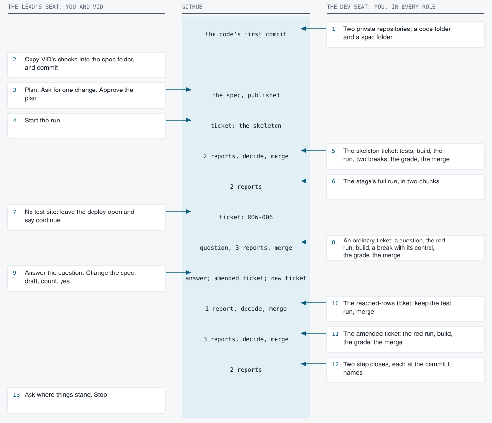

# ViD in GitHub manual mode: the hands-on tutorial

For a team lead or a developer, or a product manager with a stronger technical interest. You take a small practice product from an approved spec to three accepted tickets, one change to the spec and three closed steps, on GitHub, with ViD on the product side and yourself as the whole dev side.

This is ViD's *GitHub manual* mode: your own developers build through GitHub tickets, ViD keeps to the product side, and you start each of ViD's turns with `/vid:vid-next`. The companion document, *ViD in GitHub manual mode: an overview*, explains what each thing is and why. This one is what you type. Read the overview first, or keep it open beside this.

---

## What you will do

**You write no product code and no tests here.** The practice product's real tests and code come with the lab, one folder for each commit. You copy a folder, commit it, run one command and send a report. What you learn is the contract between the two sides: what a ticket asks, what you send back, and what ViD says to it.

**At the end you will have:**

1. Planned a product from its spec, switched it to GitHub manual and approved the plan.
2. Worked the first ticket, the skeleton (the walking skeleton), from claim to acceptance.
3. Run a stage's full test run, chunk by chunk.
4. Worked an ordinary ticket: the tests, a question to the product side, the merge, the results, ViD's own review, the decision.
5. Changed the spec as the lead, applied the change, and seen what it sends your developers.
6. Closed three steps, the last two by a close run of their own.

**You play every role alone,** one after the other. As the lead you talk to ViD. As the dev side you are, in turn, the manager (DM), the test author (TA), the test manager (TM), the builder (BU) and the merger (MR). These are the ticket's labels for a team's work; a real team shares them out as it likes, and does best when the person who writes a row's test is not the one who builds it. In this lab each comment and each report names the role that made it. ViD's own session makes the review.

**How this tutorial was checked.** Part 1 was done once, on this practice product, against real GitHub repositories, and every ticket was accepted, in this mode's older form: one long ViD session read GitHub by itself, and each decision was asked for and given in the pull request's comments, before the merge. GitHub manual keeps that run's rows, its code and its tests. What it changes is who starts ViD's turns (you, with `/vid:vid-next`), what reaches your developers (only what you publish or apply), where the work is decided (on the ticket, at a commit of `main`, after the merge), and what decides it (your own test results and ViD's own review; that run's dev side also sent failing runs, breaks and grades). Those parts are written here from ViD's own rules, its commands and its results format, and were not run for this tutorial. The excerpts are the checked run's; where GitHub manual shows something else, the text says so. The dev seat's commands are written from that run's record: shell variables stand where it had its own numbers, the lines that fill in a report's commit were written by hand there, and its false starts are left out. One thing here was not typed in that run and is marked where it comes: finding the `checks/` folder of an installed ViD. The lab's test command was run again on the lab's own files after this tutorial was written, at stop 5's commit. In that run ViD's session was driven by a script, not typed by a person. Where a typed session should behave differently (it asks you a question the script could not be asked, for example), the text says *typed session*. Part 2 was not run for this tutorial.

**Time.** Run by script without a pause, in the older form, Part 1 took 48 minutes. ViD's first plan took 4 minutes 25 seconds, and each of its other turns between one and two minutes. A call that makes ViD's review, or has much that is new to sort into your list, takes longer; neither time is measured yet. Reading as you go, allow an afternoon.

---

## Before you start

### What you need

- **Claude Code,** signed in, with ViD installed (the two lines below this list, typed inside Claude Code).
- **git,** and the **GitHub command line,** `gh`, signed in (`gh auth login`; with HTTPS also `gh auth setup-git`).
- **Docker,** running (Docker Desktop on macOS, or Docker Engine with the compose plugin on Linux), with about 1.6 GB of disk free. The practice product's tests run in it, in a real browser. The first test run fetches one base image and builds two; nothing is fetched after that.
- **A GitHub account** where ViD may create three private repositories for you, the code repository, the spec repository and one for its own records: it makes them in stop 4.

```
/plugin marketplace add VisionDeliveryAi/vid
/plugin install vid@vid
```

### The lab folder

Everything the lab needs is in `jobdigest-lab/`, beside this file:

| Folder | What it is |
|---|---|
| `spec/` | The starter project: the approved spec of the practice product |
| `code/` | The product's tests and code, one folder for each commit you will make |
| `env/` | The test setup: one command runs a commit's tests and writes the report; one command pushes a report |
| `reports/` | The few lines of each report that are written by hand, and, for the two optional kinds of evidence, the lines and patches they need |

**The practice product is JobDigest:** two job feeds merged into one list, and a daily email of new matches for each saved search. Its spec holds nine requirements and a test inventory. You will build three small pieces of it.

### Two terminals

| Terminal | Who you are there | What runs in it |
|---|---|---|
| **The lead's seat** | The team lead, talking to ViD | A Claude Code session, in the spec folder |
| **The dev seat** | Your developers | A plain shell, in the code folder. No Claude Code is needed here |

ViD never sees the dev seat, and the dev seat never sees ViD's session. Everything between them goes through GitHub. That is the point of the lab, so keep to it.

### Names used in the commands

Set these once in the dev seat. Every command below uses them. The lead's seat is another terminal and does not have them; the one path typed there is written out in full.

```bash
export ACCOUNT=<your GitHub account>
export LAB=<the full path of the jobdigest-lab folder>
export WORK=$HOME/jobdigest-work
export REMOTE=https://github.com/$ACCOUNT/jobdigest.git
mkdir -p $WORK/reports
```

Three more change with each ticket, and each stop sets them: `T`, the ticket's issue number; `P`, the pull request's number; `SHA`, the full id of the commit a report is about. The numbers given below are the ones GitHub gave in the checked run. In GitHub manual yours may differ, since you choose when each ticket goes out: read each one off GitHub and never assume it.



---

## Part 1. The practice product, from nothing to three closed steps

### Stop 1. The spec folder

*Dev seat.* You make no repository on GitHub: ViD makes them, private, at the switch of stop 4, under the names you give in stop 3. The code repository gets its first commit right after that switch.

The spec folder is a git repository of its own, on your machine, with everything committed. ViD refuses to plan from files that are not committed.

```bash
cp -R $LAB/spec $WORK/spec
cd $WORK/spec
git init -b main
git add -A && git commit -m "JobDigest: the starter spec"
```

You do not push the spec folder anywhere. ViD publishes from it to the spec repository when you publish the first ticket.

**Look at what you have.** `PRD.md` holds the requirements, each with its `fail-if` (its acceptance criterion). `INVENTORY.md` holds the rows (the test conditions), each tied to a requirement. `STAGES.md` cuts the product into three stages (releases): stage 0 is the skeleton, stage 1 the daily digest, stage 2 the search by other names of an occupation. The overview's section 2 reads these files closely.

### Stop 2. Give the spec folder ViD's checks

A ViD project carries a folder named `checks/`: ViD's own scripts, which it runs in the project. A project that ViD started itself already has it. The lab's starter spec does not, because the folder belongs to your installed ViD, so you copy it in by hand, once, and commit it alone.

*Dev seat.* Find the folder in your install. The folder above it is named by your ViD's version. (The checked run used ViD from a folder of its own, so this one line was not typed there; the copy and the commit were.)

```bash
ls -d $HOME/.claude/plugins/cache/*/vid/*/checks
```

Copy it and commit it, with the version from that path in the message:

```bash
cd $WORK/spec
cp -R <the path the command printed> ./checks
git add checks
VID_ROLE=fix git commit -m "Refresh checks/ to VID <the version>"
```

If you skip this stop, the plan refuses in its first minute and tells you the project's `checks/` needs refreshing. It will not copy the folder for you.

### Stop 3. The plan

*Lead's seat.* Start Claude Code in the spec folder and make ViD's first call:

```bash
cd $HOME/jobdigest-work/spec && claude
```

```
/vid:vid-next
```

Every ViD command is a slash command of this form. Type `/vid` to see the list. No plan is approved yet, so this first call plans before anything else: it is the planner's sitting, and nothing reaches GitHub before your approval in stop 4.

**The setup questions.** *Typed session:* before it plans, ViD asks where the code lives and where the specs go, who is on the team, who works the tickets, and how fine the steps should be. Answer:

| It asks | You answer |
|---|---|
| Where the code lives and the specs go | Two separate repositories: the code in `<your account>/jobdigest`, the spec in `<your account>/jobdigest-spec`. Neither exists yet: naming them is your yes for ViD to make them, private, at the switch of stop 4 |
| The teams | One team of one person, for the whole product |
| Who works the tickets | Your own developers. ViD leaves this one open: the switch of stop 4 answers it |
| The step size | Steps by journey, the default |

If it plans without asking (the scripted run did), it says it wrote the defaults and that the repositories are not named yet. Give them in your next message, as below.

**The draft.** After a few minutes (4 minutes 25 seconds in the checked run) ViD shows the plan as a page and says what it holds. In the checked run:

> **The plan:** 3 stages, 4 steps, 33 planned rows in 4 waves, one after another.
> - **S1, the skeleton (stage 0, 2 rows):** a visitor saves a search, confirms it and reads the first digest.
> - **S2 (stage 1, 6 rows):** the two feeds are read into one listing, each job listed once. …
> - **S3 (stage 1, 24 rows):** the daily digest per saved search, with the support address and the one-click unsubscribe. This is the largest step.
> - **S4 (stage 2, 1 row):** search also finds jobs listed under other names of the same occupation.

Your draft may be cut differently: the planner is a model, and it plans afresh. The skeleton will be the same, because the spec's stage cut names its two rows, ROW-003 and ROW-004.

**Ask for one change.** The lab has code for two small steps after the skeleton, so ask for those two as steps of their own. This is also what a lead really does with a plan: you say what you want built first, in words, and ViD re-plans. Type this, with your account's name:

```
The setup: the code repository is <your account>/jobdigest and the spec repository is <your account>/jobdigest-spec, both separate and private. One team of one person, steps by journey: your defaults are right. My own developers work the tickets: leave that question open, as I will switch this project to GitHub manual.

One change to the plan before I approve it. Right after the skeleton, put ROW-006 (the header and footer on every page) in a step of its own, and right after that ROW-019 (the support address in every digest's footer) in a step of its own, each building on the skeleton alone. Every other row stays where you put it.

On the page's questions: keep DIF-001, ROW-012 and ROW-018 where they are, for now.
```

Leave the last paragraph out if your page asks no such questions. The checked run's page asked three: rows that cannot be proven in the stage they sit in. Keeping them is a fair answer for a lab.

ViD answers with the new plan. In the checked run:

| Step | What it builds | Rows | Builds on |
|---|---|---|---|
| S1 | the skeleton: save a search, confirm it, read the first digest | 2 | nothing |
| S5 | the header and footer on every page (ROW-006) | 1 | S1 |
| S6 | the support address in every digest's footer (ROW-019) | 1 | S1 |
| S2 | the two feeds merged, each job listed once | 6 | S1 |
| S3 | the daily digest and the way out | 22 | S1, S2 |
| S4 | synonym-aware search | 1 | S2, S3 |

**Check three things before you approve:** the first step is the skeleton with ROW-003 and ROW-004; the next is ROW-006 alone; the one after is ROW-019 alone. The step names are the planner's and yours may differ (the new steps were numbered on, as S5 and S6). From here on this tutorial names a step by its row.

**Do not approve yet.** In the checked run the lead approved at this point and the spec was published at once. In GitHub manual the approval is made by the switch, in stop 4, in your words, and the spec reaches the spec repository with the first ticket you publish.

### Stop 4. Switch to GitHub manual, and publish the first ticket

*Lead's seat,* the same session: the call is still planning. You type no other command for the switch. Once the plan is as you want it, the call switches the project to GitHub manual itself, from the plan you just wrote, and asks only what it cannot find. Answer each in words:

| It asks | You answer |
|---|---|
| ViD's own state repository | `<your account>/jobdigest-state`. Your answer is also your yes for ViD to make it, private. It holds ViD's lock and saved records, and is neither of your two repositories |
| Any other setup question | As in stop 3 |

Then it shows the plan page again. **Approve.** Your words are recorded as the approval, so say what you mean:

```
Yes, I approve this plan as it stands on the page, for GitHub manual.
```

ViD says what it recorded, the mode last: GitHub manual, recorded. It also shows you one page, `.vid/plan/TEAM-REPORTS.md`: what your team sends, and when it counts. In real work you hand it to your team. If ViD says that no engines are named yet, leave it: the skeleton's results name them. The switch has made the three repositories, private; the code repository is empty. The call then goes on as every call does: it reads GitHub and sorts what is open into your list (below).

**The code repository's first commit.** *Dev seat.* Give it the lab's starter code on `main`, because the first ticket names the commit it starts from:

```bash
cd $WORK
gh repo clone $ACCOUNT/jobdigest code
cd code
cp -R $LAB/code/0-start/. .
git add -A && git commit -m "Initial commit"
git push -u origin main
```

*Lead's seat.* From here on, every turn of ViD's is a call you make, `/vid:vid-next`. It says that its own work is off, sorts what is open into your list, and ends with one line: how many things are yours, and the first of them. **The list** has numbered sections: My to do, Waiting, Changed, The rest, The plan, and one for each team, here your one. In the Claude desktop app it is the panel beside the chat, and an answer you press there goes into the chat as your own words. A terminal shows no panel; there you read the same sections as text:

```
/vid:vid-answer backlog
```

Now name two moves, each with your own words:

```
/vid:vid-next own-work on "ViD decides, asks and closes at each of my calls from now on." publish S1 "Publish the skeleton ticket."
```

`own-work on` lets each later call decide what your team asks on a ticket, ask a step's close and a stage's full run, and post the okays. `publish S1` sends the skeleton's ticket, and the spec reaches the spec repository with it. `S1` is the skeleton's step in the checked run's plan: use your plan's name for it.

**Look at the spec repository on GitHub now.** Its `main` holds the spec as your developers see it. *Dev seat:*

```bash
cd $WORK/code
gh issue list
gh issue view 1
```

**Read the ticket before you do anything.** It is long, and it is self-contained by design: a developer needs nothing but the ticket and the spec repository. In the checked run its header read:

```
- number: 1
- kind: skeleton
- step: S1
- stage: 0, The walking skeleton
- plan: b29641317ced
- base: 89c179fe969575d79cc91a4e20f39fece3036f7e
- export: bb722ec234c76c2daa5c8fd875a70cf84aa5ccdd
- rows: ROW-003 ROW-004
```

`base` is the commit your branch starts from: `main`, as you pushed it. `export` is the commit of the spec repository the ticket quotes. Then come the rows with their fail-ifs, the requirements they serve, the decisions and rules that bear on them, the stack, the roles, and last the asks.

A skeleton ticket asks three things, where an ordinary ticket asks four:

> - T1 (TA): write at least one test per row, per transition for a journey, its name matching the row's id.
> - T3 (TM): the tests pass in your own results at the commit of main you ask about: every row and every regression row, in results files of any name, made by anyone. The report declares the engines you run, the primary first, and how many test environments you run, when you can.
> - T4 (TM; if you make one, it is read): a deliberate break of a row, making its fail-if true and nothing else, with its test seen to fail under it. A test that still passes under its break is too weak, and its row fails.
>
> No grade is asked of you: once every row passes, ViD makes its own review of the ticket, once, from what its merged pull requests changed. Each test it then asks for is a request line of its decision.

These are ViD's own words for GitHub manual. In plain words: write the tests (T1); once your team has merged, run them at that commit of `main` and send the results (T3). ViD reviews the ticket itself. An ordinary ticket adds T2, a run of the tests before the product code, seen to fail. T2 and T4 are **optional**: read when you send them, and nothing is missing without them. This lab sends neither; `reports/README.md` says how to make each one, if you wish.

The ticket names no branch. You choose; this tutorial uses `ticket-<number>`. ViD ties your pull request to the ticket by the first line of its description, not by its branch. Its review reads the changes of the pull requests it finds that way.

### Stop 5. The skeleton ticket, worked by hand

*Dev seat,* all of it. Each block says which role you are.

**DM: claim the ticket.** One comment, two lines.

```bash
cd $WORK/code
T=1
gh issue comment $T --body "vid: claimed
by: DM"
```

**TA: the tests, alone in a commit, before any product code.**

```bash
git checkout -b ticket-$T
cp -R $LAB/code/1-skeleton-tests/. .
git add -A && git commit -m "tests: ROW-003 and ROW-004, the skeleton, before any product code"
```

Open `tests/test_journey_row_004.py` and look at a test's name: `test_ROW_004_T1_save_sends_confirmation`. The row's id is in the name. That is how ViD ties a test case in your report to a row; it never reads your test code. ROW-004 is a journey of three transitions, so it has at least one test for each: `ROW_004_T1`, `ROW_004_T2`, `ROW_004_T3`.

**DM: open the pull request.** Its description must begin with the line `ticket: #<number>`: the first line, with nothing above it. It also holds a Decisions section: one line for each technical decision the branch made, or the one line `Decisions: none`. The lab's builder made none you need to record; in your own work, list each one.

```bash
git push -u origin ticket-$T
gh pr create --base main --head ticket-$T --title "Ticket $T: the skeleton" --body "ticket: #$T

Decisions: none"
P=2        # the pull request's number, from the address gh printed
```

**BU: the product.**

```bash
cp -R $LAB/code/2-skeleton-build/. .
git add -A && git commit -m "save a search, confirm it, read the first digest"
git push
```

**MR: merge into `main`.** Your side merges, never ViD, and in GitHub manual the merge comes first: ViD decides the ticket at a commit of `main`.

```bash
gh pr merge $P --merge --body "Role: MR"
git checkout main && git pull
SHA=$(git rev-parse HEAD); H12=$(printf %s $SHA | cut -c1-12)
```

`SHA` is now the merge commit on `main`, on `main`'s own line. The report and the ask name it. (The pull request's own last commit is not on that line, and a decision asked there reads `not on main`.)

**TM: the run at that commit (T3).** A report is a folder named by the report's id. The id is yours to choose; this lab uses `step-<ticket>-<first 12 characters of the commit>-<attempt>`.

```bash
R=$WORK/reports/step-$T-$H12-1
sh $LAB/env/run-tests.sh $WORK/code $SHA $R
```

The first run fetches a base image and builds two Docker images, about two minutes. Then it makes a clean copy of exactly that commit, starts the product and two fakes (a mail provider and a job feed), runs every test in Chromium and writes `cases-chromium.xml` into the folder: the standard JUnit XML that any test runner can write. Its last lines name the commit and the report file; above them you should see `7 passed`.

**TM: the few lines written by hand.** Every test report holds a `results.txt`. The lab has each one ready, with the commit left for you to fill in:

```bash
sed "s/<the head commit, full id>/$SHA/" $LAB/reports/1-skeleton/head-results.txt > $R/results.txt
cat $R/results.txt
```

```
by: TM
commit: 48515924be63eab070523d824e849c2f2915fc0a
engines: chromium
environments: 1
stand-in: the mail provider — a fake that records each message — the real mail provider
stand-in: the digest schedule — every 2 seconds — each morning
stand-in: the store — a temporary file per run — a platform disk
stand-in: the addresses — plain http on the test network — the platform's https
stand-in: the feed — a fake — the partner feed
```

`by:` is the role, `commit:` the commit the run was made at. The skeleton's results declare your setup, once: which browser engines you test in, how many test environments you can run side by side, and one `stand-in:` line for each way your tests differ from production. ViD keeps those differences on record, and the lead sees them. Be honest in them; they cost you nothing.

**TM: send the report.** A report travels as a branch of the code repository named `vid-results/<id>`, holding a folder of that same name. ViD reads that folder alone.

```bash
sh $LAB/env/push-report.sh $REMOTE $R
```

Read `env/push-report.sh` once: ten lines. It copies the folder into a new, empty folder, makes one commit there and pushes it as the branch. Your working branch is never touched. In your own project you will write the same ten lines.

**MR: ask for the decision.** One comment on the ticket's issue, naming the commit of `main` in full.

```bash
gh issue comment $T --body "vid: decide $SHA"
```

**ViD decides, at your call.** *Lead's seat:*

```
/vid:vid-next
```

With its own work on, the call reads your results. Every row passes, so it prints `review #1 <commit>` and makes **ViD's own review**, once for this ticket, before it answers. You do nothing for it. A fresh reviewer, who saw none of your work, reads the ticket, the spec items it cites, the names and results of your test cases, and what your pull request changed, as GitHub shows it. ViD keeps no copy of your code and runs none of it. If the reviewer doubts something, a second fresh reader sorts each doubt once. Then the call answers on the ticket's issue. *Dev seat:*

```bash
gh issue view $T --comments
```

The checked run's decision:

```
vid: decision 48515924be63eab070523d824e849c2f2915fc0a
ticket: accepted
ROW-003 accepted
ROW-004-T1 accepted
ROW-004-T2 accepted
ROW-004-T3 accepted
ROW-004 accepted
```

That run gave it under the pull request, at its head; in GitHub manual the same lines come on the ticket's issue, naming your commit of `main`. One line for the ticket, one for each row. `accepted` means the row's tests passed in the results you sent for this commit, and ViD's review is in. A row's state comes from runs alone; a doubt of the review never fails a row by itself. Had the ticket line read `not yet`, each row short of that would carry its reason, and your next move would be to fix exactly that, merge the fix, and ask again at the new commit of `main`.

**If your decision reads `not yet` with a `request` line,** ViD's review asks for one added test. (The reviewer is a model, and reads your lab afresh.) In your own project you add the test, with the row's id in its name, merge, send the results and ask again. The lab has no such test; a request holds that one decision alone, so here you go past it by asking again at the same commit:

```bash
gh issue comment $T --body "vid: decide $(git rev-parse HEAD)"
```

Then `/vid:vid-next` again. The review is not made twice. What the reviewer saw outside the rows comes to the lead as a finding.

**Nothing is left to merge.** The work went into `main` before the ask, and the acceptance stands at that commit. That is a whole ticket. Everything else in this lab is a variation on it.

### Stop 6. The stage's full run

The skeleton is all of stage 0, so its acceptance completes a stage. With its own work on, the call that accepted it, or your next one, asks for the stage's full run: every row of the stage, again, at the accepted commit. ViD grades the stage itself meanwhile, with one fresh reader; you are asked for no grade. It asks with a new issue, labelled `run`. If none is there yet, call `/vid:vid-next` again.

*Dev seat:*

```bash
gh issue list --label run
gh issue view 3
```

```
close: stage-0
commit: da6b3c70cf7a5a30cf0053e98da000cecd7f595c
engines: chromium
…
- chunk p1c1, chromium: ROW-003 ROW-004
- chunk p1cx, chromium: every other test case of the suite, …
```

A run is asked in chunks. You report each chunk as its own report, `req-<the issue>-<chunk>-<attempt>`, and say so with a comment. Before the first chunk you comment `vid: started`.

**TM:**

```bash
C=3
SHA=<the commit issue 3 names, in full>
gh issue comment $C --body "vid: started
by: TM"

R=$WORK/reports/req-$C-p1c1-1
sh $LAB/env/run-tests.sh $WORK/code $SHA $R -k "ROW_003 or ROW_004"
sed "s/<the commit the close issue names, full id>/$SHA/" $LAB/reports/5-closes/results.txt > $R/results.txt
sh $LAB/env/push-report.sh $REMOTE $R
gh issue comment $C --body "vid: reported p1c1-1"
```

In `-k`, a row's id is written with `_` for `-`, and the rows are joined by ` or `. You should see `7 passed`.

The second chunk, `p1cx`, is every test that belongs to no row of the first chunk. This product has none yet:

```bash
R=$WORK/reports/req-$C-p1cx-1
sh $LAB/env/run-tests.sh $WORK/code $SHA $R -k "not ROW_003 and not ROW_004"
sed "s/<the commit the close issue names, full id>/$SHA/" $LAB/reports/5-closes/results.txt > $R/results.txt
echo "none left" >> $R/results.txt
sh $LAB/env/push-report.sh $REMOTE $R
gh issue comment $C --body "vid: reported p1cx-1"
```

No test is selected, and the results file holds no test case at all. With the line `none left` in its `results.txt` that is a correct report: you were asked what else there is, and the answer is nothing. *Lead's seat:* call `/vid:vid-next` again. ViD reads both chunks, and tells you that the stage's full run passed and the skeleton's step closed.

### Stop 7. The staging deploy you will not make, and the next ticket

After a stage's full run passes, a call gives the okay to deploy that commit to a test site (staging). *Dev seat:*

```bash
gh issue list --label deploy
```

Issue 4, *Deploy to staging: stage 0, candidate 1*, asks your side to deploy the commit and report it. ViD deploys nothing itself: it gives the okay, your team deploys.

**This lab has no test site, so you leave that issue open.** Nothing waits on it. The checked run held the next stage here until the lead said `continue`; GitHub manual writes no hold, and the next ticket goes out when you publish it.

*Lead's seat:* call `/vid:vid-next`. Your list now holds the move `publish S5`: the step of ROW-006 alone, in the checked run's plan (use your plan's name for it). It may be in My to do, or under The rest. ViD may name a risk with it; that never holds the move back. Name it:

```
/vid:vid-next publish S5 "Publish the ticket of ROW-006, the header and footer on every page."
```

### Stop 8. An ordinary ticket: tests first, a question

*Dev seat:*

```bash
gh issue list --label ticket
gh issue view 5
```

This is a step ticket (`kind: step`) for ROW-006, the header and footer on every page. It has what the skeleton ticket lacked: an **Engines** section (the browser engines your team named), **Regression rows** (ROW-003 and ROW-004: rows already accepted, which this work must not break), and the ask T2, which is optional and which this lab skips.

**DM: claim it.**

```bash
T=5
gh issue comment $T --body "vid: claimed
by: DM"
```

**TA: ask what the spec does not say.** To write ROW-006's tests the test author needs two facts the spec does not give: the support address, and where the footer's help link goes. Guessing silently is how a team builds the wrong thing. Asking and waiting is how it loses a day. The contract's answer is a question that carries its own default: you ask, you say what you will assume, and you go on.

```bash
gh issue comment $T --body "Question: ROW-006, REQ-012. Two questions from TA; neither stops the work, and the tests use the defaults below until answered.

1. ROW-006, REQ-012: what is the support address? The spec names none. Test value: support@jobdigest.example, and no other address in the footer.
2. ROW-006: where does the footer's unsubscribe help link go? No row or design draws that page. Test value: the product's own page at /help/unsubscribe, with the same header and footer and a few plain words on how to unsubscribe."
```

The first line begins `Question:` and names the rows. You do not label the issue `blocked`, because the work can go on. Use that label only when it cannot.

**TA: the tests alone, and the pull request.**

```bash
git checkout main && git pull
git checkout -b ticket-$T
cp -R $LAB/code/3-header-footer-tests/. .
git add -A && git commit -m "tests: ROW-006, the header and footer on every page, before any product code"
git push -u origin ticket-$T
gh pr create --base main --head ticket-$T --title "Ticket $T: the header and footer on every page" --body "ticket: #$T

Decisions: none"
P=6
```

**BU: the product change, and MR: the merge.**

```bash
cp -R $LAB/code/4-header-footer-build/. .
git add -A && git commit -m "the header and footer on every page"
git push
gh pr merge $P --merge --body "Role: MR"
git checkout main && git pull
SHA=$(git rev-parse HEAD); H12=$(printf %s $SHA | cut -c1-12)
```

**TM: the run at that commit (T3).**

```bash
R=$WORK/reports/step-$T-$H12-1
sh $LAB/env/run-tests.sh $WORK/code $SHA $R
```

`13 passed`: the row's tests and the regression rows'. Send it.

```bash
sed "s/<the head commit, full id>/$SHA/" $LAB/reports/2-header-footer/head-results.txt > $R/results.txt
cat $R/results.txt
sh $LAB/env/push-report.sh $REMOTE $R
```

This `results.txt` is short: the engines and the stand-ins were declared at the skeleton and are not repeated. Its `retested:` line says that ROW-003's test now checks something a little different, since the tests commit changed a helper it uses. It is read when given, and asks nothing of you.

**MR: ask for the decision.**

```bash
gh issue comment $T --body "vid: decide $SHA"
```

*Lead's seat:* `/vid:vid-next`. *Dev seat:* `gh issue view $T --comments`, until the decision is there. The checked run's:

```
vid: decision 2dd4ae9a2a788ac29ecd983b06186224e8490cfa
ticket: accepted
ROW-006 accepted
ROW-003 passing
ROW-004 passing
```

As at stop 5, the call makes ViD's review first, and a `request` line is gone past in the same way. That run gave its decision under the pull request; in GitHub manual it is on the ticket's issue. The ticket's own row is `accepted`. The regression rows are `passing`: they were accepted before, and they still pass.

**The step's close.** ROW-006's step has no other ticket, so the same call, or your next one, asks for its close run: a new issue labelled `run`. A merged ticket is not a closed step: the close asks the step's rows and its regression rows once more, at the commit of its acceptance, as the step stands on `main`. The checked run's:

```bash
gh issue list --label run
gh issue view 7
```

```
close: S5
commit: fe385115d0e220e03f3bedce2530c5a753f39071
engines: chromium
…
- chunk p1c1, chromium: ROW-006 ROW-003 ROW-004
- with the product's own declared processes: ROW-004
```

The last line asks that ROW-004 be run against the product as it really starts, which the lab's setup always does. **TM,** at the commit the issue names:

```bash
C=7
SHA=<the commit issue 7 names, in full>
gh issue comment $C --body "vid: started
by: TM"
R=$WORK/reports/req-$C-p1c1-1
sh $LAB/env/run-tests.sh $WORK/code $SHA $R -k "ROW_006 or ROW_003 or ROW_004"
sed "s/<the commit the close issue names, full id>/$SHA/" $LAB/reports/5-closes/results.txt > $R/results.txt
sh $LAB/env/push-report.sh $REMOTE $R
gh issue comment $C --body "vid: reported p1c1-1"
```

`13 passed`.

**The lead answers the question, and publishes the next ticket.** *Lead's seat:* `/vid:vid-next`. This call reads the close and closes the step: ticket 5 gets the comment `vid: closed — the step's close passed at <commit12>` and is closed. Your developers' question is now in your list, summed up: in GitHub manual every question is yours. Its id, `Q<n>`, is beside the line in the text (`/vid:vid-answer backlog`), and in the panel under The rest, in *Everything ViD holds*. The list also holds the move `publish S6`, the step of ROW-019 in the checked run's plan. Name both, the answer in your words, with the id as the list gives it:

```
/vid:vid-next answer Q<n> "1. The support address is support@jobdigest.example, and the support team reads it. 2. The unsubscribe help link opens the product's own page at /help/unsubscribe, with the same header and footer and a few plain words on how to unsubscribe." publish S6 "Publish the ticket of ROW-019, the support address in every digest's footer."
```

ViD posts your answer on the ticket as a comment beginning `RM:`, under the question's own first line. *Dev seat:* `gh issue view 5 --comments`. That comment is how an answer reaches your developers. Until it is there they hear nothing, which is why a question must carry a default. The ticket was decided with the question still open, because the question did not stop the work.

The new ticket, 8 in the checked run, is for ROW-019. **Leave it for now.**

### Stop 9. Change the spec

A reviewer's finding in the checked run and your own answer point at the same weakness: the support address is in a domain that can receive no mail, so a requirement would fail on the day the product ships, and no test here could show it. It is what an independent review is for; yours may say it or not. REQ-012 says the support address must "reach a person", and nobody can test that. As the lead you tighten it.

A spec under ViD is never edited by hand. A change goes through ViD: it drafts the change, counts what the change touches, and asks you once. Nothing is written until you say yes, and nothing reaches your developers until you apply it.

*Lead's seat,* in the spec folder's session:

```
/vid:vid-fix REQ-012: the support address must reach a person within one working day. "Reaches a person" is too loose: mail to the support address is answered by a person within one working day.
```

ViD reads the spec, drafts, and asks. In the checked run:

> **Q4, draft 1:**
> - **REQ-012 is amended.** Mail to the support address must be answered by a person within one working day, and an automatic reply doesn't count. The existing two arms stand word for word …
> - **One row is added, ROW-021.** It checks that mail sent to the support address on production is answered by a person within one working day. A test run can't check a working-day reply, so this row is paid at the production deploy …
> - **No rows are reset. Three are reached:** ROW-006 (already accepted), ROW-019 and RULE-001. Their test text is unchanged.
>
> Say **yes** to land it, or **no**.

**Read the count before you answer.** The question itself carries it: *This changes 0 rows, adds 1, and reaches 3 more: ROW-006, ROW-019, RULE-001. Land it?* A *changed* row is one whose own text changes, so its test must be written again. A *reached* row is one whose requirement changed while its own text did not, so someone must look at its test and decide. The count is the price of your change in your developers' time, shown before you pay it. Here it is small. A change that read "changes 14 rows" would be the moment to think again.

Your draft may differ: ViD may change ROW-019 where the checked run added a row. Either is a fair reading of your words. Answer by the question's number, as a move:

```
/vid:vid-next answer Q4 yes "Land draft 1."
```

**If the yes does not land it.** Before it writes anything, ViD tries the change on a scratch copy and runs its own checks. In the checked run that trial refused the first draft, because the new row was in no step of the plan. ViD wrote nothing, made a second draft that placed the row in a step, and asked again as a new question. It does not carry your yes from one draft to the next:

```
/vid:vid-next answer Q5 yes "Land draft 2." answer Q4 no "Draft 2 replaces it."
```

**What lands.** ViD says what it wrote. Look for yourself, in the dev seat:

```bash
cd $WORK/spec && git log --oneline -4 && tail -5 PRD.md
```

The requirement was not edited. A new line was appended under the PRD's *Appends*, marked `AMENDED`, and the later line wins:

```
REQ-012 AMENDED | functional | T2 | Every digest footer carries a support contact address, and mail to it is answered by a person within one working day. | fail-if: the footer lacks a support address, or mail to it bounces, or mail to it is not answered by a person within one working day (an automatic reply is no answer) | …
```

The old text is still above it, word for word. That is what lets an old ticket quote the spec it was built from and stay true.

**Apply it.** The change is in ViD's folder alone. *Lead's seat:* `/vid:vid-next`. The list holds the change, not yet with your team, and the move `planning-analysis`, since the change added a row to place. Name it:

```
/vid:vid-next planning-analysis
```

ViD writes its proposal, what the change does to the plan and to each published ticket, and shows it as a page. It records and posts nothing. Read the page, then apply it as shown:

```
/vid:vid-next implement-replan "Apply the change as the page shows it."
```

If your draft added no row, there is no analysis to name. The call asks instead, in a line `proposal due`, whether to make the proposal now, and says what it covers and how long it takes. Your yes is `implement-replan` itself: named once it makes the proposal, shows it and applies nothing; named again, it applies what it showed. The apply exports the spec again to the spec repository and sends what the change owes your developers. Its lines say what it sent.

### Stop 10. What the change sent your developers

*Dev seat:*

```bash
cd $WORK/code
gh issue list --label ticket
gh issue view 8 --comments | tail -5
```

**The open ticket was amended in place.** Ticket 8, for ROW-019, was published before your change and nobody had started it. It now quotes the new text of REQ-012, its header has a line `amended:`, and a comment beginning `vid: amended` names its cause and says that earlier results for its changed rows do not count. (The checked run's comment named the spec export as its cause; GitHub manual's names the change you applied.) Had a developer already sent results for a changed row, they would no longer count. A team that reads only the first version of a ticket will build the old spec; read the comments.

**The accepted row went out again.** ROW-006 was accepted under the old text, and its step closed at stop 8. ViD does not take it back, and it does not let it stand unexamined either. In GitHub manual the apply sends it in a *follow-up ticket* of its step: its title begins *Follow-up ticket*, its header names the ticket it follows (`follows: #5`), and ViD makes no review of it. The checked run sent the row in a reached-rows ticket instead, whose test was kept with an empty commit; the lab's files are for that ticket, not for a follow-up's asks. **Leave the follow-up open,** as you will leave the next step's ticket at stop 13. Your developers would work it as stop 8's ticket, by its own asks.

### Stop 11. The amended ticket

Ticket 8, ROW-019: the support address in every digest's footer. Nothing here is new. Do it without reading the explanations again, and see how much of the contract you already carry.

```bash
T=8
gh issue comment $T --body "vid: claimed
by: DM"
git checkout main && git pull
git checkout -b ticket-$T
cp -R $LAB/code/5-digest-footer-tests/. .
git add -A && git commit -m "tests: ROW-019, the support address in a digest's footer, before any product code"
git push -u origin ticket-$T
gh pr create --base main --head ticket-$T --title "Ticket $T: the support address in every digest's footer" --body "ticket: #$T

Decisions: none"
P=11
```

The build, the merge, and the run at that commit. `17 passed`:

```bash
cp -R $LAB/code/6-digest-footer-build/. .
git add -A && git commit -m "the support address in every digest's footer"
git push
gh pr merge $P --merge --body "Role: MR"
git checkout main && git pull
SHA=$(git rev-parse HEAD); H12=$(printf %s $SHA | cut -c1-12)
R=$WORK/reports/step-$T-$H12-1
sh $LAB/env/run-tests.sh $WORK/code $SHA $R
sed "s/<the head commit, full id>/$SHA/" $LAB/reports/4-digest-footer/head-results.txt > $R/results.txt
sh $LAB/env/push-report.sh $REMOTE $R
```

The ask:

```bash
gh issue comment $T --body "vid: decide $SHA"
```

*Lead's seat:* `/vid:vid-next`. *Dev seat:* `gh issue view $T --comments`, until the decision is there. The checked run's, given there under the pull request:

```
vid: decision 80204679ee079e004df992b16ba33857721c7cac
ticket: accepted
ROW-019 accepted
ROW-003 passing
ROW-004 passing
ROW-006 passing
```

### Stop 12. The step closes

ROW-019's step has no other ticket, so its close comes as ROW-006's did at stop 8: the call that accepted ticket 8, or your next one, opens a `run` issue for it, at the commit of the acceptance. Read its number off GitHub; each close names its own commit, so run it at the commit it names.

```bash
gh issue list --label run
```

**TM,** with its four rows:

```bash
C=<the number of the new run issue>
SHA=<the commit it names, in full>
gh issue comment $C --body "vid: started
by: TM"
R=$WORK/reports/req-$C-p1c1-1
sh $LAB/env/run-tests.sh $WORK/code $SHA $R -k "ROW_019 or ROW_003 or ROW_004 or ROW_006"
sed "s/<the commit the close issue names, full id>/$SHA/" $LAB/reports/5-closes/results.txt > $R/results.txt
sh $LAB/env/push-report.sh $REMOTE $R
gh issue comment $C --body "vid: reported p1c1-1"
```

`17 passed`. *Lead's seat:* `/vid:vid-next`. ViD reads the close, closes the step, and closes ticket 8 with its `vid: closed` comment.

The checked run's lead read a status page here. In GitHub manual, where things stand is the list each call sorts: the panel beside the chat, or, in a terminal, `/vid:vid-answer backlog`. Read it through once. My to do, Waiting, Changed and The rest come first. The plan has a row for each stage and a box for each step, and your team's section a card for each step: where it stands, who has it, its pull requests. `/vid:vid-sort` sorts the list again when you ask. What ViD sorts, and in which order, is its judgement; each number in The plan and in the team's section is a count of evidence your side sent and ViD read, and nobody's estimate.

### Stop 13. Stop, and what is left

**You are done.** The next step's ticket, the two feeds, with six rows, is not published: nothing goes out until you name it, and the lab has no code for it. Leave it.

To stop: end the Claude Code session in the lead's seat. Nothing is read or decided until you call `/vid:vid-next` in that folder again, and each call restores ViD's records from its state repository.

Left open on purpose, and worth a look before you tidy:

- The staging deploy issue from stop 7, never deployed.
- The follow-up ticket of ROW-006 from stop 10, never claimed.
- In the lead's list, the findings of ViD's reviews and of its grade of stage 0, if any, which wait for the lead's ruling. Each can be ruled a fix, a new row, a known limit or nothing. The overview's section 6 says what each means.

To tidy: delete the three repositories on GitHub (the code, the spec, and ViD's state repository) and the `$WORK` folder. Deleting a repository is permanent; check the name twice.

```bash
docker image rm jobdigest-lab-product jobdigest-lab-tests
```

---

## What this walk did not show you

Every ticket of the checked run was accepted at the first decision, because the lab's code and tests were already right. Your first real tickets will not be. Three things you may not have seen, each in the overview's section 4:

| What | When it happens | What your side does |
|---|---|---|
| **`ticket: not yet`** | A row's test failed, or no result for it was read at the commit | Fix exactly what the decision names, merge the fix into `main`, and ask again at that new commit, with a new report |
| **A `request` answered by a test** | ViD's review doubts that a test would catch a broken product | Add the test, with the row's id in its name. If it passes, the doubt is closed. If it fails, the row fails, and you fix the product |
| **A held row** | A row has failed its rounds and cannot be accepted as it stands | Nothing: it goes to the lead, who accepts it, gives it more rounds, rules it a known limit or changes the spec. Every other ticket goes on |

---

## Part 2. Your own product

Part 1 used a spec that was already written. With your own product you write it first, with ViD. This part was not run for this tutorial; it follows the overview's section 3, which describes each sitting.

**1. An empty folder, and the interview.** In a new, empty folder, start Claude Code and say `/vid:vid-init`. ViD asks about the product, writes the PRD in three passes with your approval after each, asks the technical questions, derives the test inventory, and proposes the stage cut. A project started this way has its `checks/` folder from the start, so stop 2 does not apply. Give it a small product, something you could describe in ten sentences: the first spec is where you learn to read fail-ifs, and a large one teaches less.

**2. From here it is Part 1.** Name the code and spec repositories at the plan's setup; ViD makes them, private, at the switch, and you push the code repository's first commit after it (stops 3 and 4). Call `/vid:vid-next`: it plans first (stop 3); approve, its switch to GitHub manual made in the same call, and publish the skeleton (stop 4). From then on, call `/vid:vid-next` whenever your team has sent something.

**3. Your test setup replaces the lab's.** `env/` is this lab's, not ViD's. For your own product your team owns the same two things, in whatever tools it uses:

| What the lab's script does | Why the contract needs it |
|---|---|
| Runs the tests on a clean copy of exactly one commit | A report names a commit. What was not committed must not be in the run |
| Starts the product the way it really starts | Some rows ask for the product's own processes, not a shortcut inside the test |
| Writes a JUnit XML file | It is what ViD reads test results from, under any name, in as many files as you have. Any runner can write it |
| Puts each row's id in its tests' names | It is how a test case is tied to a row |
| Can run a chosen few tests | The chunks of a close run. (Applying a patch first is for an optional break) |
| Marks a test that could not run apart from one that failed | A broken setup is not a product failure |
| Pushes one folder as one branch | How a report travels |

**4. Share the work out.** In Part 1 you were everyone. A team shares the work as it likes; the overview's section 4.2 says what ViD needs to know. Two habits make tests worth more: whoever writes a row's test does not build it, and the builder never weakens a test. Your team grades nothing. Hand it the page the switch wrote, `.vid/plan/TEAM-REPORTS.md`; `/vid:vid-accept-step reports` shows it again. A team that already works to rules of its own keeps them; the overview's section 4.4 says what to tell ViD.

---

## When something does not go as written

| What you see | What it is | What to do |
|---|---|---|
| The plan refuses and names the `checks/` folder | Stop 2 was skipped | Do stop 2, then `/vid:vid-next` again |
| `/vid plan` is not a command | The commands are `/vid:vid-next` and `/vid:vid-fix`; the first call plans | Type `/vid` and pick from the list |
| The plan says the repositories are not named | The setup was not answered | Give the two repositories in words, as in stop 3 |
| The draft plan has no small step for ROW-006 | The planner cut it differently | Ask for the change in stop 3. Check the result by its rows, not its step names |
| The plan page does not open | The session could not publish it as a page | It gives a file's path instead; open that file in a browser |
| A move is shown again and not done | The call checks each move against what the last call listed | Call `/vid:vid-next` once, then name the move as the list now holds it |
| You see no panel | The terminal, VS Code and the mobile app show none | `/vid:vid-answer backlog` says the same sections as text |
| A call ends with *not sorted* | What it found is kept, but not sorted into the list | `/vid:vid-sort` |
| No ticket comes after the skeleton's stage run | In GitHub manual a ticket goes out only when you publish it | `/vid:vid-next`, then its `publish` move (stop 7) |
| Nothing is decided though your team asked | ViD decides only at a call, with its own work on | `/vid:vid-next`. With its own work off, the call shows the ask with the command that decides it, `/vid:vid-accept-step <ticket> <commit>` |
| `run-tests.sh` stops with `setup: the product did not start` and an empty log | The base image could not be fetched | Check the network, `docker pull python:3.12-slim-bookworm`, then run again |
| `run-tests.sh` ends with every test failing on a line that begins `setup:` | The commit holds tests and no product | Expected at a tests-only commit of the skeleton. Anywhere else, check that you ran the right commit |
| `the fault … does not apply` | An optional break's patch does not fit that commit | Check `SHA` is the commit you merged for that ticket |
| The decision reads `not on main — <commit>` | The commit asked is not on `main`'s own line: a pull request's own last commit, for instance | Ask again at the merge commit, `git rev-parse origin/main` |
| The decision reads `no Decisions section — #<n>` | That pull request's description has no Decisions section | Add `Decisions: none`, or the decisions, to its description (`gh pr edit <n> --body …`), and ask again |
| The decision reads `request <row> — …` | ViD's review asks for an added test | Stop 5 says how to go on |
| The decision reads `review missing — no merged pull request names this ticket` | The pull request's description lacks its first line | Begin it `ticket: #<n>` (`gh pr edit <n> --body …`), and ask again |
| The decision reads `not yet` | Something your side sent is missing or wrong | Read each row's line; it names what is short. The commonest causes here: a branch whose folder has not its own id, or `SHA` not the commit of `main` you asked at |
| No decision comes, and the call says `no results` | No result report counts at that commit | Check that a report's `commit:` is that commit, and that its folder holds the results file. The call names each branch it left out |
| A question sits unanswered on a ticket | It is in the lead's list, and nothing is said on GitHub until the lead answers | Lead's seat: `/vid:vid-next`, then its `answer` move |

---

## The contract on one page

**What your side writes on GitHub**

| Where | The words | Who | When |
|---|---|---|---|
| The ticket | `vid: claimed` / `by: DM` | DM | Before any work |
| The ticket, or a pull request of it | `Question: <rows> …`, with your default | Anyone | When the spec does not say |
| A pull request's description, as its first line | `ticket: #<n>` | DM | When it is opened |
| A pull request's description | `Decisions:` with one line a decision, or `Decisions: none` | DM | When it is opened |
| `main` | The ticket's pull requests, merged | MR | Before the results |
| The ticket | `vid: decide <the commit of main, in full>` | MR | When the results for that commit are pushed |
| A run issue | `vid: started` / `by: TM` | TM | Before the first chunk |
| A run issue | `vid: reported <chunk>-<attempt>` | TM | After each chunk's report is pushed |

**What your side pushes,** each as a branch `vid-results/<id>` holding a folder `<id>`:

| The report | Its id | What is in the folder |
|---|---|---|
| The results at a commit of `main` | Yours to choose; here `step-<ticket>-<commit of main, 12>-<k>` | `results.txt` (`by:`, `commit:`; at the skeleton also `engines:`, `environments:`, `stand-in:`), and any `.xml` results files |
| A chunk of a run | `req-<issue>-<chunk>-<k>` | `results.txt` (`by:`, `commit:`, and `none left` when there is no test to run), and any `.xml` results files |
| Optional: a run that failed first | `red-<ticket>-<k>` | `results.txt` (`by:`, `commit:`, `rows:`), the results files |
| Optional: a deliberate break | in a result report | `faults/<row>/`: its results files, with `control.txt` |

**What ViD writes**

| Where | What |
|---|---|
| An issue labelled `ticket` | A ticket, when the lead publishes it or applies a change: skeleton, step, follow-up or fix |
| A comment on the ticket | `vid: decision <commit>`, then `ticket: accepted` or `ticket: not yet`, then one line a row, and a `request` line for each test its review asks for |
| A comment beginning `RM:` | The lead's answer to a question |
| A comment `vid: amended …` | The ticket's text changed with the spec |
| A comment `vid: closed — …` | The step's close passed; the ticket is closed |
| An issue labelled `run` | A run asked in chunks: a step's close, or a stage's full run |
| An issue labelled `deploy` | The okay to deploy a commit |

**What the lead types,** in a Claude Code session in the spec folder: `/vid:vid-next`, the first call planning and switching to GitHub manual, then alone or with its moves, each in the lead's own words (`own-work on`, `publish <step>`, `answer <its place or Q<n>> …`, `planning-analysis`, `implement-replan`); `/vid:vid-answer backlog` to read the list where there is no panel, and `/vid:vid-sort` to have it sorted again; and `/vid:vid-fix <the change, in words>`.
