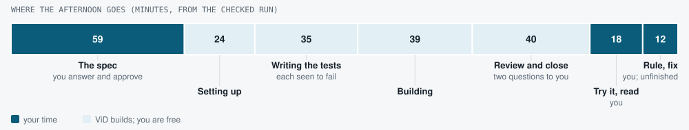

# ViD in local auto mode: the hands-on tutorial

For a product manager, or an engineer with an interest in the product. In one long afternoon you take a product from one paragraph to an approved spec, have it built and tested on your machine, try it, and rule on what independent reviewers found. You type into one Claude Code session. You read no code.

This is ViD's *local auto* mode: ViD's own agents build on your machine, with no GitHub. The finished product is still meant to be hosted; this tutorial stops before that step. The companion document, *ViD in local auto mode: an overview*, explains what each thing is and why. This one is what you type.

---

## What you will do

**The practice product is JobDigest search,** the smallest useful thing: one page where a visitor types words and sees the jobs whose titles contain them all. It is small on purpose. The size of the product decides how long you wait, and this tutorial shows you where the size is set.

**At the end you will have:**

1. Answered ViD's interview and approved a spec of three requirements, three times over, each time for a different reason.
2. Held a product small on purpose, and met what that costs.
3. Made one acceptance criterion stronger, and seen it come back.
4. Approved the list of everything that will be tested.
5. Started a build and left it to run.
6. Tried the built product in your own browser.
7. Ruled on the findings of an independent review.

**Prepared answers come with the lab.** The folder `local-auto-lab/`, beside this file, holds the paragraph you start from (`seed.md`) and the answer to every question ViD asked in the run this tutorial was made from (`answers.md`). ViD's questions are written by a model, so yours will not match word for word. Where a question matches, give the prepared answer. Where it does not, choose the smaller of what ViD offers; when nothing is smaller, accept its recommendation.

**How this tutorial was checked.** Every stop was done once, in this order, on this product. In that run ViD's session was driven by a script, not typed by a person; where a typed session should behave differently, the text says *typed session*. The run reached the middle of stop 14 and was paused there at its time limit; the text says what was not finished.

**Time.** In the checked run:



| Part | Time | What you do |
|---|---|---|
| The spec, stops 1 to 9 | 59 minutes | Type ten messages. ViD works for 43 of those minutes |
| The build, stops 10 to 11 | 2 hours 18 minutes | Answer two questions. Otherwise nothing |
| Trying it and reading the review, stops 12 to 13 | 18 minutes | Use the product; read 15 findings |
| Ruling, and the one fix you accept, stop 14 | 12 minutes when the run was paused, not finished | One message, then one more question |

That is about four hours on the clock, of which roughly one is yours. Plan it as a long afternoon in which you can do other work during the build.

---

## Before you start

**You need:**

- **Claude Code,** signed in, with ViD installed (the two lines below, typed inside Claude Code). Installing needs a GitHub account with the `gh` command signed in; nothing after the install uses GitHub.
- **Docker,** installed and running. Every test ViD runs, it runs inside Docker.
- **The lab folder,** `local-auto-lab/`, open beside you.

```
/plugin marketplace add VisionDeliveryAi/vid
/plugin install vid@vid
```

**Keep the one session open** for the whole afternoon. The build runs inside it. If your machine sleeps or the session closes, the build stops, and it starts again only when you open the session and say `continue`.

**One rule for the whole tutorial:** when ViD offers more or less, choose less. Stops 4 and 8 show why.

---

## Part 1. From one paragraph to an approved spec

ViD calls this part *init*. It ends with a spec and no product: no code, no tests. You are asked at a series of sittings, in a fixed order. ViD may also put a product question to you between them, whenever it meets one.

### Stop 1. An empty folder

Make a new, empty folder, start Claude Code in it, and start ViD:

```bash
mkdir jobdigest-search && cd jobdigest-search && claude
```

```
/vid:vid-init
```

Every ViD command has this form. Type `/vid` to see the list. ViD checks that the folder is empty and asks you to describe the product in your own words.

### Stop 2. Describe the product

Give it the paragraph from `seed.md`, and say what it is: your demand, to be kept word for word.

```
Here is my brief. It is my demand, and I have no other document.

JobDigest search, the smallest thing that is useful. One page. A visitor types one or more words and sees the jobs whose titles contain every one of those words, as whole words, upper or lower case alike. Each job shows its title, its employer, its location and a link to the posting. When nothing matches, the page says so. The jobs come from a list that ships with the product. Nothing else: no accounts, no email, no saved searches, no feed to read, no admin screens, nothing stored about the visitor.
```

**Look at the last sentence.** A third of this paragraph says what the product is not. That is deliberate, and it is the most useful habit this tutorial teaches. ViD cannot infer a boundary from your silence. What you do not rule out, it will ask about, and every answer becomes something to specify, test and build.

### Stop 3. The interview

Less than a minute later ViD comes back with its questions, all at once. In the checked run there were eight, each with a recommendation:

> 1. **What counts as a "word"?** Job titles are messy: "Front-End Developer", "C++ Engineer", …
> 5. **How many results.** [recommended: every match on one page, no paging, plus a count ("12 jobs")]
> 6. **What "nothing stored about the visitor" covers.** … Should results also be shareable as a link?

These are not a questionnaire. ViD asks only what it would otherwise have to invent. Everything with a sensible default it decides itself, and shows you at the next stop. After the questions it checks your scope: which parts of the brief this version could ship without. Here it recommended keeping everything.

Answer everything in one message. You can say "as recommended" and give your exceptions:

```
1. (c): only spaces separate words.
2. As recommended.
3. As recommended.
4. As recommended.
5. Every match on one page, no paging, and no count for now. The list will be about 50 jobs.
6. No cookies, nothing saved in the browser, no analytics or trackers, and the words a visitor types are never stored or logged. Shareable links: later.
7. As recommended. I have no real list yet: use your sample of about 50 jobs.
8. As recommended.
Scope check: keep everything, as you recommend.
```

On questions 1, 5 and 6 this answer chooses less than ViD recommended. Each recommendation was reasonable, and each would have been one more thing to specify, test and build. Remember all three. They come back at stop 13.

### Stop 4. The first approval, and the size of the product

Five minutes later ViD shows the first of three sittings. Read it in this order.

**First, anything that needs your ruling.** A critical reader has gone over the draft and raised objections. One needed an answer:

> **F-03: do the host's standard request logs (visitor address, time, browser) count as "storing something about the visitor"?** (a) yes, only hosting without such logs qualifies; (b) no, as long as they never contain the typed words

You wrote "nothing stored about the visitor" in a sentence. This is what the sentence means once somebody has to build it. Either answer is defensible. It is yours to give.

ViD also showed a consequence of your own answer at stop 3:

> With only spaces separating words, "Manager (Night Shift)" is found by "shift)" but not by "night". Keep, or also separate at brackets and commas?

**Second, the decisions ViD took for you.** There were eight, among them that the page meets the common accessibility standard, and speed targets on a phone.

**Every one of these is sensible. That is the trap.** Each sensible default is a requirement, each requirement becomes about twenty tests, and each test is written, run, built and reviewed. The lab holds a larger version of this product in `ten-requirements/`. Its first try started from three sentences, accepted the sensible defaults, and reached 47 requirements at the second approval and 64 at the third. Nothing in it was wrong. It was simply no longer a first version.

So say *later* to whatever your paragraph did not ask for. *Later* keeps it in the spec, so that it is not forgotten, and builds none of it.

**Then set the size, in plain words.** No requirement exists yet at this sitting, so the limit is for the ones ViD writes next:

```
1. F-03: (b). Ordinary host logs are acceptable, as long as they never contain the typed words.
2. Keep: only spaces separate words.
3. The topic list is accepted.
4. A-013 and A-014 are later, not in this version. Your other decisions stand.
5. Thesis approved.

And the size: this is a first version, so write at most 3 requirements. Move anything else out of this version.
```

Your numbers will differ. The move is the same: rule on what needs you; say *later* to each decision your paragraph did not ask for; state the size.

After your answer this part of the spec is frozen. Later change is added to it, never written over it.

### Stop 5. The second approval: the requirements, and one fail-if

Five minutes later ViD comes back, and it has held to the limit:

> this PRD holds **3 requirements** … Your three-requirement cap holds

They are: matching (R1), results (R2), and "no trace" (R3), the one rule that must never break. Each has its plain sentence, and each has its *fail-if* (its acceptance criterion): the concrete ways a wrong build would fail it.

ViD also asks four questions from its check for gaps. One is about your product:

> 2. Following a posting: same tab or a new one? [recommended: a new tab, so the results stay]

**Now read one fail-if.** The sentence is the promise; the fail-if is what will actually be checked. For each requirement ask one question: *could the product break the sentence while the fail-if stays false?*

In the checked run the answer was yes for R2. Its sentence promised each job's own employer, location and link. Its fail-if failed when one of them was missing. It did not fail when a job was shown with another job's employer. A product that shuffled the employers would have passed every test.

Open `PRD.md`, find the requirement about results, and compare. Then answer:

```
1. Confirmed: the page loads nothing from any other site.
2. No: postings open in the same tab for now.
3. (b): trust the list as written; I own its correctness.
4. Later, as you recommend.
The topics you propose, posting-link safety included, are not in this version.

Requirements approved, with one change. REQ-002's fail-if is too weak: it fails if a shown job lacks its employer, location or link, but not if it shows another job's. Add: a shown job's employer, location or posting link is not the one the shipped list gives for that job.
```

A limit on the number of requirements has a cost, and ViD says so: with only three allowed, two of them each bundle decisions you could have changed separately. That is a fair price for a first version.

### Stop 6. The third approval: a contradiction you made

Five minutes later, the last sitting on the requirements. ViD has read the whole set against itself:

> 1. A job in the list with a missing field: R1 says show it when it matches, R2 fails if it is shown with a field missing. No build can satisfy both.

Look at where this came from. At stop 5 you said "trust the list as written", and you made R2's fail-if stricter. Each was right. Together they cannot both hold for a job whose employer is blank. ViD did not pick a winner. It brought the collision back to you, before anything was built, with a recommendation.

This is what a precise spec costs and what it buys: the argument happens now, in one sentence, and not as a test that can never pass.

```
1. As recommended: show each job's fields exactly as the list gives them.
2. Confirmed.
3. Confirmed.
Final approved.
```

**From here the requirements do not change.** Every later change is a dated line added below them.

### Stop 7. The technical questions, and where it will run

In the same answer ViD moves on to its own last questions. Two are about direction, and both are optional:

> 1. "Any directional hints on design?"
> 2. "Any directional hints on architecture and technical stack?"

The rest are about where the finished product will be hosted: the platform and region, the addresses, a monthly spend cap, how ViD would get access. Building happens on your machine, but the product is meant to live somewhere, and ViD asks now so that nothing is built that cannot run there. It also says what it is not asking, because this product has no email, no outside service and no database.

For this tutorial nothing is chosen, and there is no design:

```
1. The page is plain and text-like. I am not bringing a design, and I am not asking for one now.
2. You pick.
3. It will be hosted, but I have not chosen the host or the region yet. Your default where you have one.
4. Not chosen yet; the platform's own addresses are fine when the time comes.
5. Not chosen yet.
6. No account and no access exist yet.
```

**Never type a password or a key into the conversation.** ViD says so itself. If it needs access to something, it asks which log-in to use or the name of a setting that holds the secret.

ViD makes the technical choices, tells you what they are, and logs each in `DECISIONS.md` as its own proposal. With no design asked for, it skips its design step and will build the page plain. A design can be run later. The overview's section 3.4 shows what a design round looks like, on the larger product.

### Stop 8. The test inventory

This is the longest wait of the spec, about 19 minutes in the checked run, and the most important sitting after the requirements. ViD derives the whole list of what will be checked and shows it to you:

| What | Count |
|---|---|
| Rows for matching | 22 |
| Rows for results | 17 |
| Rows for "no trace" | 20 |
| Rules checked across all the code | 6 |
| Hostile attempts: each tries a forbidden thing and must be seen to fail | 6 |
| Questions for the reviewers who judge the result | 15 |

**Three requirements became 59 rows.** Each row is one *test condition*: one thing that will be tested. This is the real size of your product, and it is the reason for the rule at the top of this tutorial. The larger product in the lab had ten requirements and 114 rows, and took more than four hours only to reach the first thing that could be clicked.

Where do 59 rows come from? One for each promise inside each requirement, and then the ones that expert readers add: a privacy reader, a text-matching reader, an abuse reader, a first-day visitor. A last reader looks for a wrong product that would still pass the whole table, and adds what would catch it.

You are not asked to read 59 rows. The sitting puts the decisions first. There were two, and both exist only because somebody tried to write a test:

> 1. Which characters count as a space between words? Pasted text and phones produce tabs, non-breaking spaces and line breaks that look like spaces. (a) every space-like character; (b) only the ordinary space
> 2. Should a typed `'` find a title written with `’`, and `-` find `–`?

```
1. (b): only the ordinary space.
2. (a): they stay different.
No rows to strike. Inventory approved.
```

**Open `INVENTORY.md` once and read ten rows.** You will find you can judge them. Three from the checked run:

> Upper and lower case are treated alike: "NURSE", "nurse" and "Nurse" each find a job titled "Senior Nurse", and the three searches show the same jobs
>
> Accented letters stay distinct: "cafe" does not find "Café Manager", while "café" and "CAFÉ" find it
>
> A submitted search that matches no job shows a message saying nothing matches, never an empty area with no message

These are product statements, not technical ones. If one is not what you want, this is the cheapest moment to say so.

### Stop 9. Housekeeping, and the stage cut

Two short sittings close the spec.

**Housekeeping.** ViD tidies the spec into its final form: your brief moves, word for word, to a file of its own, and the history to another. It shows what changed (in the checked run: 3 requirements unchanged, nothing dropped or weakened) and asks one setting for its own session.

```
Consolidation approved. And yes to the compaction point.
```

**The stage cut.** ViD proposes how to deliver the product in *stages* (releases), each usable by somebody and safe to release. For a product this small there is one stage, and ViD says why no finer cut exists: search without results gives a visitor nothing, and search and results without the no-trace rule are not safe to release. It also offers a technical first stage, the walking skeleton, and for a product with no outside service it does not recommend one.

```
One stage, no stage 0. And no: do not set up the test site or put anything on it on your own.
```

The second sentence is said unasked. When a product has more than one stage, ViD asks once whether it may set up a test site and put each finished stage on it by itself; with a single stage it does not ask, and saying no does no harm. Going live always waits for you either way.

### What you have now

ViD closes with these words, and they are worth reading twice:

> The spec is ratified; there is no code, no test harness and no written test yet …

Your folder holds a spec and nothing else of the product:

| File | What it holds |
|---|---|
| `PRD.md` | 3 requirements, and what is not in this version |
| `SEED.md` | Your brief, word for word |
| `INVENTORY.md` | 59 rows, none tested yet, which is the correct state now |
| `GRADING-CHECKLIST.md` | The questions every reviewer of the built product will be given |
| `DECISIONS.md` | Every choice ViD made for you, marked as its proposal |

You have typed ten messages. Most of them said "as recommended". The ones that did not are where the product became yours.

---

## Part 2. The build

### Stop 10. Start it, and leave it

One command:

```
/vid:vid-develop
```

From here the build runs without you. In the checked run it went like this:

| What ViD did | Time |
|---|---|
| Set the project up: the foundation, the test harness in Docker, a sample list of jobs | 24 minutes |
| Wrote the tests for the rows, and ran them to see each one fail | 35 minutes |
| Built the product: first the search and the results, then the no-trace rule | 39 minutes |
| Had fresh readers review each part, closed the work, and ran a final independent review | 40 minutes |

**The second line is the one to understand.** Before the product is built, the tests for its rows are written and seen to fail: in the checked run, for 48 of the rows at this point. (The six hostile attempts are written later, each with the rule it attacks.) A test that has been seen to fail can be believed when it passes. This is why a spec with more rows takes longer before you can click anything, and why the row count at stop 8 matters.

**Ask where it stands,** in your own words, whenever you like:

```
Where does the build stand?
```

> We're still in the build's first step, the code skeleton: two of its three parts are done and the third is under way. No product behaviour is built yet; the page loads but doesn't search. … **Running now:** five independent test-writers, one per group of the 59 rows … Nothing is waiting on you.

In the checked run that answer came in 8 seconds. It can take much longer: ViD answers when its current piece of work ends, and in the larger product's build the same question waited 40 minutes.

**Nothing pops up.** If the build has a question for you, it writes it into the session and, when it can, goes on with other work. Look at the session from time to time.

### Stop 11. The questions a build asks

The checked build asked two before it finished.

**A question about your product:**

> **Q1 — row 27, the not-found page.** Unknown addresses already get a plain "not found" page … But addresses naming the site's own folders, like `/jobs/`, … get the web server's "403 Forbidden" page … (a) Yes … **I recommend this** … (b) Grade it again … (c) Record it as a known limit

A reviewer had found a case the requirement did not settle. The build did not stop for it: it kept working on everything the question did not touch. That makes such a question easy to miss.

```
Q1: (c), record it as a known limit.
```

A recorded limit has a consequence you will see at stop 12: the build ends "not complete", with that one row unmet, until you change the ruling. That is deliberate. A limit you chose is still a promise not kept, and the report will not hide it.

**A question that is not about your product:**

> In ViD's own counting script, one line reads its input wrongly. … **May ViD fix that one line?** … **I recommend yes.**

This is ViD asking about its own bookkeeping, not about your product. The useful answer is yes:

```
Q2: yes, fix that line.
```

Something else happened in this build that you were not asked about, and it is the method working. A reviewer judged one test too weak. The test was made stronger, and the stronger test found a real fault: with the browser's Back button, the page came back with the typed word still in the search box, against the no-trace rule. It was fixed before you saw anything.

### Stop 12. The report

Two hours and eighteen minutes after you started it, the build prints its report. Its first lines, word for word:

```
rows: kept 49 · unverdicted 0 · breached 0 · red 0 · owed 1 · deploy-owed 10 (unmet 1; held 0; rows 60 …)
```

> The build is **not complete**: one row is unmet. It's row 60, the folder-address limit you chose to record in your Q1 ruling … Everything else that can be checked here is done. The run is waiting on you.

Read the line from the left. *Kept 49*: 49 rows pass their tests and a fresh reader agreed. *Breached 0*, *red 0*: no row was found wanting, none fails its test. *Owed 1*: the limit you recorded. *Deploy-owed 10*: ten rows can only be proved on a real host, and wait for one. Sixty rows in all: the build added one to the 59 you approved, for the limit.

**"Not complete" is a computed word, not a mood.** One row is unmet, so the build is not complete, and it says which row and why. Nothing here is a score. There is no percentage to argue with.

Below that come one line for each requirement, what the tests did not cover, what was decided on your behalf, and the table of findings. Leave the findings for stop 14, and first look at what was built.

---

## Part 3. Judging what came back

### Stop 13. Try it

Ask ViD how:

```
Before I rule: how do I try the product myself, as a visitor, in my own browser on this machine?
```

It answers with one command to start the product, an address to open, how to stop it, and things worth trying. The command is typed in a terminal, in the project folder:

```bash
docker compose -f docker-compose.test.yml up --build product
```

If you do not use a terminal, ask ViD to run it for you. Then open `http://localhost:8080`.

**What the checked run saw:** a heading, a box labelled "Job title words", a Search button, and one line of hint. Typing `nurse` listed four jobs, each with its title, employer, location and a link: Senior Nurse, Staff Nurse (Night Shift), Veterinary Nurse, Dental Nurse. The address in the browser did not change, which is the no-trace rule at work. `astronaut` gave "No job matches those words."

**Now meet your own decisions.** Try these three, and remember stop 3. (The checked run did not type the first two; they follow from the rules you approved, and the first is a row of the inventory.)

| Try | What happens | Why |
|---|---|---|
| `night` | It does not find "Staff Nurse (Night Shift)" | You chose "only spaces separate words", so the word in that title is "(Night" |
| Follow a posting, then come back | The search is gone, and you type it again | You chose "same tab", and the page keeps no trace of what you typed |
| Look for how many jobs matched | No line says so; the list is only numbered | You chose "no count for now" |

None of these is a fault in the build. Each is the product you specified. This is the other half of "choose less": you find out what less costs by using it, and now you can decide with the product in front of you.

Stop the product with Ctrl-C in the terminal.

**The project viewer.** One more command, in the session:

```
/vid:vid-view
```

It takes seconds, changes nothing in the project, and makes a set of pages in a folder of its own. ViD gives you the path of the two to open first. They open with a double-click. In the checked run the page for "now" read:

> 4 Goals · 5 Capabilities · 3 Requirements · 60 Acceptance criteria
> Progress 49 of 60 criteria pass their test · 49 confirmed by review
> NEEDS YOU 1 · 1 open question

"Confirmed by review" is the number that counts: a row is done when its test passes and a fresh reader has agreed. The viewer also prints some notes about files it could not find for the test-writers and reviewers. Their one effect is the line "Built 47 of 60" beside "49 of 60" passing: rows from those passes are not counted as built. Read the passing and the confirmed numbers, and ignore that one.

### Stop 14. Rule on the review

At the end of every build ViD runs an independent review by itself. Readers who saw none of the building go through the product against each fail-if and try to break it, and one uses the running product with no script, as a curious visitor would.

**Here is the thing to be ready for.** The build was green. All 288 test cases passed. Every row that can be checked on your machine had been reviewed and kept, 49 of them, with the rest waiting for a real host. And the independent review still found 15 things, one of them serious:

| # | How serious | Finding |
|---|---|---|
| G-1 | **high** | In older browsers a search sends the typed words into the address bar, the history and the host's log |
| G-3 | moderate | Some capital letters outside English break case-alike matching |
| G-5 | moderate | Another site can embed the page in a frame |
| G-8 | low to moderate | Results are a numbered list, so the last number is in effect a result count, which you ruled out |
| G-9 | low | On a phone the keyboard stays up over the results |
| G-14 | low | The posting link is a small target for a finger |

G-1 breaks the one rule you said must never break. No test had caught it, because every test ran in a current browser. This is what an independent review is for, and it is why a green build is not the end.

**For each finding you say one of three words.** *Fix*: it breaks a promise you made. *Defer*: it is real, and you did not ask for it in this version. *Dispute*: it is not a fault.

Some of these you can judge at once (G-8, G-9, G-14). Some are technical, and you can only take the stated seriousness on trust (G-5). When in doubt, defer: a deferred finding is recorded as an open question and is not lost.

```
Q3, my rulings:
G-1: fix. The no-trace promise must hold in every browser that can use the page.
G-8: dispute. A numbered list is fine; it is not the count I ruled out.
G-2, G-3, G-4, G-5, G-6, G-7, G-9, G-10, G-11, G-12, G-13, G-14, G-15: defer.
The folder-address limit stays as I ruled it.
Apply the fix.
```

Notice what three of the low findings are. The keyboard over the results, the small link, the text size on a phone: these are what a design round would have settled. You chose to have none, and the review names the cost.

**What ViD does with your ruling.** It records every line in the spec, then applies the one you accepted by itself. It works in the same order as the build: first a test that shows the leak, seen failing; then the change; then the tests again.

And your ruling is itself reviewed. In the checked run that raised one more question, because "every browser that can use the page" met a case nobody had settled:

> **Q4. In a browser that doesn't run the page script, what should a visitor see?** (a) A plain line saying the search needs the page's script. **I recommend this** … (b) Leave it silent …

**This is where the checked run was paused,** at its time limit, twelve minutes into the fix. The change was built and passing its tests, 56 of 56, and not yet merged into the product. To stop a build cleanly, type one word:

```
pause
```

> Paused. The G-1 fix is built and checked but not merged … Say **"continue"** and I'll pick up from here: the merge, the probe ritual, the re-grade, the whole ledger, then the PRD consolidation.

To carry on from there, answer Q4 and type `continue`. What follows was not checked for this tutorial: ViD merges the fix, attacks the rule again, has the changed parts reviewed again, and runs every test once more.

---

## What you have done

You wrote one paragraph and typed fewer than twenty messages. A product exists. At its report it had 60 test conditions behind it: 49 passed and independently confirmed, 10 waiting for a real host, and one that you chose to leave unmet and can see by name. The fix you accepted added a 61st. An independent review found a serious fault that every test had missed, and it will be fixed test-first. Thirteen smaller things are written down as open questions, not forgotten.

You also know what your product costs. Three requirements took an afternoon. The same idea with saved searches and a daily email took more than four hours to reach its first clickable page. The place where that was decided was one sentence at stop 4.

**What comes next,** beyond this tutorial: answer the open question and let the fix finish; make a correction of your own in plain words with `/vid:vid-fix` (after using the product, the checked run's first wish was for the results to stay when you come back from a posting); add a feature with `/vid:vid-add`; choose a host and put the product on a test site. The overview's section 6 describes a correction and a feature.

**And to put it live:** the overview's section 7, *From your machine to live*, gives the path in order. In short: you choose a host, create the accounts and log in, which only you can do; you say "deploy to staging", and ViD sets the hosting up and tries the product for real on a test site; you look at it there; you say "deploy to production", and ViD asks you once more before it goes live. The ten rows of this product that wait for a real host are proved on that path.

---

## When something does not go as written

| What you see | What it is | What to do |
|---|---|---|
| `/vid init` is not a command | The commands are `/vid:vid-init`, `/vid:vid-develop`, `/vid:vid-view` | Type `/vid` and pick from the list |
| ViD's questions differ from the lab's | The interview is written afresh each time | Give the lab's answer where the question matches; otherwise choose the smaller option |
| The second approval shows more than three requirements | The limit was not stated, or not kept | Say again, in words: at most 3, move the rest out of this version |
| The inventory holds many more than 60 rows | The product grew at an earlier stop | Look for what you accepted that your paragraph did not ask for, and say *later* to it |
| The build seems to have stopped | The session closed, the machine slept, or the sign-in to Claude Code expired | Open the session, sign in again if asked, and type `continue`. The build picks up from its records |
| A question from the build scrolled past | A question that does not block everything does not stop the build | Ask where the build stands; open questions are listed |
| ViD asks permission to fix its own script | The question is about ViD's own bookkeeping, not about your product | Say yes |
| The report says "not complete" | One or more rows are unmet, and it names them | Read which. A limit you recorded counts |
| `http://localhost:8080` does not open | The product is not running, or the port is in use | Ask ViD to start it for you, or to use another port |
| The viewer prints notes about missing files, and "Built" is lower than "Passing" | It could not find some agents' written returns, and does not count their rows as built | Nothing. Read the passing and the confirmed numbers |

---

## Your own product

The practice product was chosen to be small. Yours will want to be bigger, and the same four moves keep it in hand.

1. **Write what is out.** End your paragraph with "Nothing else:" and a list. It is the cheapest sentence you will write.
2. **State the size at the first approval,** as a number of requirements, before any exist. For a first version, three to five.
3. **Say "later" freely.** It costs nothing and loses nothing.
4. **Read the row count at the inventory** as the length of your afternoon. About 60 rows took two and a quarter hours to build here. About 114 took more than four hours to reach a first clickable page.

If your product has screens that matter, bring a design, or ask ViD for a design round: the overview's section 3.4 describes it, and the lab's `ten-requirements/` folder holds a worked example with two screens.

When the first version is built and you have used it, grow it one feature at a time. Each feature is a small spec of its own, with its own short interview, its own rows, and its own afternoon.
